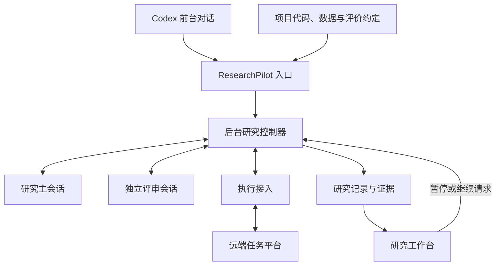

# 系统架构

ResearchPilot 由 Codex Skill、后台研究控制器、项目接入和研究工作台组成。SDM 提供模型开发的规范、证据、评审与决策基础，五个阶段、13 个步骤组织整个研究过程。

## 组件与职责

| 组件 | 职责 |
| --- | --- |
| ResearchPilot 入口 | 调查当前项目，明确任务范围，准备方案和研究配置，定位已有研究及工作台 |
| 后台研究控制器 | 管理状态、预算和执行权限，派发模型工作，监测任务并组织结果驱动接续 |
| 研究主会话 | 研究分析、方案设计与修订，以及允许范围内的代码实施 |
| 独立评审会话 | 对确切方案、代码及证据进行只读质询和复核 |
| 项目与执行接入 | 提供项目事实、训练与评价入口，以及平台提交、查询和产物回收操作 |
| 研究记录 | 保存配置、版本、评审、请求身份、任务、结果、后继决定与停止原因 |
| 工作台 | 展示同一研究记录，提供详情查询及委托控制器的暂停、继续操作 |

模块源码位于 `skills/researchpilot/` 和 `skills/sdm-module/`。安装与运行目录的关系见[目录与配置](WORKSPACE-LAYOUT.md)。

## 结果驱动的持续执行

训练监控产生平台状态与可核验结果，控制器依据持久状态和完成回执路由工作，AI根据实际证据提出研究判断和方案。三者各有职责，监控到终态不会直接取得下一次提交权限。

研究控制器负责调度，模型会话完成分析或方案后，由控制器决定下一项可执行工作。远端任务通过持久状态观察、退避查询与结果交接进入后续流程，持续执行不依赖网页保持打开或用户逐轮发消息。

一个研究由唯一控制器承接。启动时核对所属配置和实时研究线程；已有任务或调用结果未知时，先按原身份查询和对账。后台进程存活、研究线程就绪、训练已提交和结果已分析分别记录。

后继链路包括结果核验、方案修订、方案评审、代码实施、代码评审、功能检查和受控提交。未变化且仍有效的依据可复用，受影响的内容重新检查；13 个步骤不对应固定的 13 次模型调用。

从研究启动到后继提交的完整接续、会话及异常处理见[自主迭代运行机制](AUTONOMOUS-ITERATION.zh-CN.md)。

## 权限与证据

方案评审、工程检查、执行授权和科学判断承担不同职责。独立评审负责判断方案或代码，确定性检查验证实际产物，提交管理器核对授权与预算，结果评价和证据审查支持研究结论。

运行及其尝试在平台操作前登记。提交管理器和防重记录绑定原请求与实际载荷，发生响应未知时保留原身份，避免重复提交。结果通过任务、版本、数据划分、检查点和产物依据关联到所属实验。

运行代码、配置和关键指导在研究开始时固定，恢复使用所属版本核对原回执。新安装包不会重写正在运行或已暂停研究的依据。

适用 SDM 对象和校验由统一接受路径消费，技术细节见[统一治理](../skills/sdm-module/sdm-lifecycle/references/sdm-governance.md)。完整步骤职责见[研究流程](WORKFLOW-GUIDE.zh-CN.md)。

## 会话与工作台

前台对话是用户入口，后台主会话和独立评审会话分别保留工作历史。交接绑定当前方案、实际代码和正式证据，主会话的分析阶段与实施阶段使用相应读写权限。会话完成回执保留调用身份；未核实的调用阻止后续派发。

工作台消费研究状态及接受记录，并核对其配置和版本依据。它展示运行事实与记录覆盖，不重新裁定历史研究，也不直接调用模型或训练平台。暂停与恢复请求委托所属控制器及恢复程序处理。

任务范围记录用于区分单次评测和持续研究，不产生新的执行权限。异常证据显示为待核实；入口与研究关联核实后合并展示。[工作台与会话](CHAT-WORKBENCH-BINDING.zh-CN.md)说明交互边界。

## 接入与验证范围

项目接入提供训练、功能检查和评价事实；执行接入提供平台操作；评价接入约定结果形态、指标和选择规则。替换平台或模型时复用统一研究流程，具体条件见[项目接入指南](GENERIC-DELIVERY.zh-CN.md)。

架构职责不等于所有项目均已完成部署验证。支持范围、已验证条件及尚缺的验收见[当前能力](EXECUTION.md)；SDM21 到现行 13 步的来源与调整见[流程演进](../skills/sdm-module/sdm-lifecycle/references/sdm21-to-13-evolution.zh-CN.md)。
