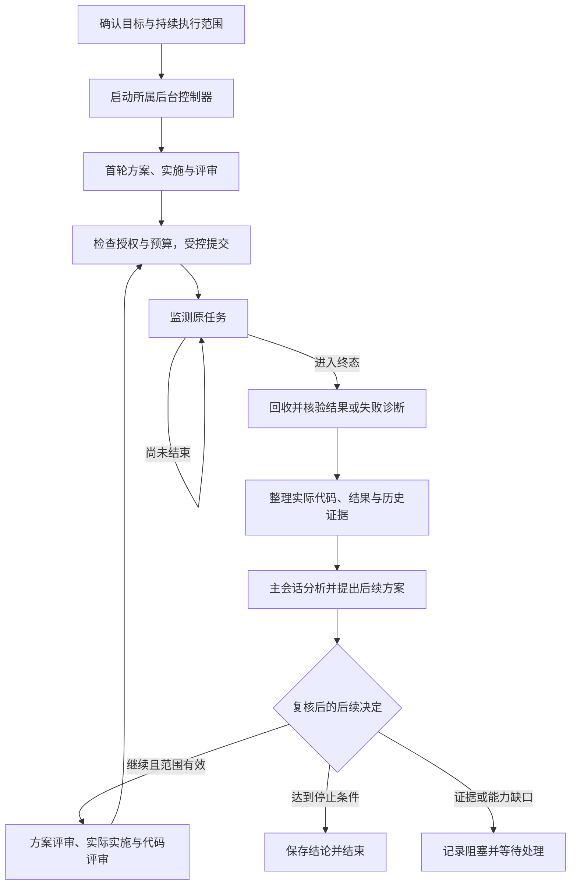

# AI 自主迭代的运行机制

ResearchPilot 的自主迭代，是在明确目标和执行范围内，依据实际结果形成下一方案、完成代码变更与评审，并继续提交实验。用户无需逐轮发送“继续”；监控负责发现任务事实，AI 负责研究分析与方案，控制器负责状态接续和执行条件。

监控到任务结束后自动接续，是整个机制的触发基础。自主研究还需要回答：结果是否可用、下一步研究什么、实际修改了什么，以及这次执行是否满足条件。

## 从研究启动到下一轮

这一过程由研究所属的后台控制器组织。初始化配置、打开工作台或完成一次分析，都不能单独证明持续研究已经启动。

## 监控与事件交接

当前训练监控主要按原任务编号持续查询平台状态，依据排队、运行和异常情况安排下一次查询并保存观察记录。等待期间无需持续调用模型，长时间排队也无需由某一轮前台聊天保持等待。

平台终态只是执行事实。任务结束后还要核对所属请求与版本，回收日志和产物；成功结果核对评价约定、数据划分和指标，失败任务形成没有有效质量分数的诊断。产物尚未齐全时继续回收，不直接把平台“成功”送成有效实验结果。

可消费的结果或诊断通过持久事件交给控制器。交接记录、任务身份和回执用于恢复与重复检测，避免每次查询到同一终态都再启动一次分析。

## 状态路由与 AI 判断

| 工作 | 程序负责 | AI 负责 |
| --- | --- | --- |
| 结果准备 | 核验任务和产物，汇总指标、候选、历史和预算 | 根据提供的证据解释差异，识别尚不能确定的原因 |
| 后继方案 | 提供已执行代码、比较对象、可改范围和结构化输出要求 | 提出可检验假设、选择干预与比较对象，说明预期判断价值 |
| 独立评审 | 绑定本次方案及评审记录，处理接受、修订、补证等状态 | 质询方案或代码，指出异议并检查修订回应 |
| 代码实施 | 限定工作区，记录实际差异并检查产物 | 按已接受方案修改允许的代码与配置 |
| 执行接续 | 校验确切版本、评审、功能检查、授权和预算，再登记并提交任务 | 提供研究判断，不通过自然语言同意授予执行权限 |

基本指标和比较统计可以由程序计算，研究推理依赖 AI 对真实代码、结果和约束的判断。后继方案在结果回收后生成，可以回到较早候选，也可以修订当前假设，不能预先写定第二轮改动来冒充结果驱动研究。

每项后台工作完成后，控制器读取其状态和完成回执，检查规定输出，再路由到实施、评审、提交、停止或补证。代码中的状态转换承担流程推进；模型生成的文字需要转化为受核验的具体方案与实际产物。

## 会话与执行的连续性

后台研究主会话承接分析、方案与实施，独立评审使用另一条持续会话。调用通过所属模型执行链进行，前台聊天不会因此自动增加一轮用户消息。工作台从同一研究记录展示过程、评审轮次和当前进展。

持续会话保留研究历史，每轮仍提供明确的正式证据与当前约束。会话记忆有助于延续讨论，不能代替已执行版本、真实结果和授权记录。分析与实施使用相应读写范围，独立评审保持只读。

控制器持久保存当前阶段、任务、调用和完成回执。中断后先核对这些原记录；提交或模型调用结果未知时沿原身份对账，不盲目创建替代请求。恢复能力依赖原证据和服务可用性，不构成任意故障下永久在线的保证。

## 需要分别处理的情况

| 情况 | 正确接续 |
| --- | --- |
| 平台结束，产物暂未齐全 | 保持回收或待核实状态，尚未形成有效结果 |
| 已分析，但本次仅为单次评测 | 交付报告并结束，不自动修改模型 |
| 模型已返回，方案仍缺证据 | 记录评审或证据阻塞，不能视为可提交方案 |
| 方案接受，但实际实现或检查未通过 | 修复并重新核验受影响部分 |
| 提交响应未知或重复事件到达 | 核对原请求、任务与回执，避免重复执行 |
| 目标已达、预算耗尽或用户暂停 | 按所属条件停止新派发，说明目标与停止原因 |

因此，监控触发是一项明确的工程机制，产品价值需要在“真实结果 → 有依据的判断 → 实际变更 → 受审后继实验”中验证。流程能够连续运行，也不保证每轮改善或研究假设成立。

## 实现索引与验证范围

| 环节 | 源码入口 |
| --- | --- |
| 研究启动与接管核验 | [research_launch.py](../skills/sdm-module/sdm-lifecycle/scripts/research_launch.py) |
| 状态观察、结果核验与持久交接 | [component_event_source.py](../skills/sdm-module/sdm-lifecycle/scripts/component_event_source.py)、[research_execution_source.py](../skills/sdm-module/sdm-lifecycle/scripts/research_execution_source.py) |
| 状态路由与后继执行 | [component_pipeline.py](../skills/sdm-module/sdm-lifecycle/scripts/component_pipeline.py) 的 `step`、`completed` 和 `submit` |
| 后继所需实际证据与项目事实 | [project_pipeline_facts.py](../skills/sdm-module/sdm-lifecycle/scripts/project_pipeline_facts.py) 的 `replan` |
| 后台会话 | [working_sessions.py](../skills/sdm-module/sdm-lifecycle/scripts/working_sessions.py) |
| 提交前条件与适用规范 | [component_submission.py](../skills/sdm-module/sdm-lifecycle/scripts/component_submission.py)、[research_acceptance.py](../skills/sdm-module/sdm-lifecycle/scripts/research_acceptance.py) |

已有 CPU 分类案例记录了结果驱动的模型修改、独立评审和真实后继提交，见[参考资料](archive/README.md)。RoadModel、其他远端平台、重启和长期无人值守的具体边界见[支持范围](EXECUTION.md)。SDM 的职责继承与活动整合见[21→13 步说明](COMPARISON-WITH-BMAD-ML.zh-CN.md)。
