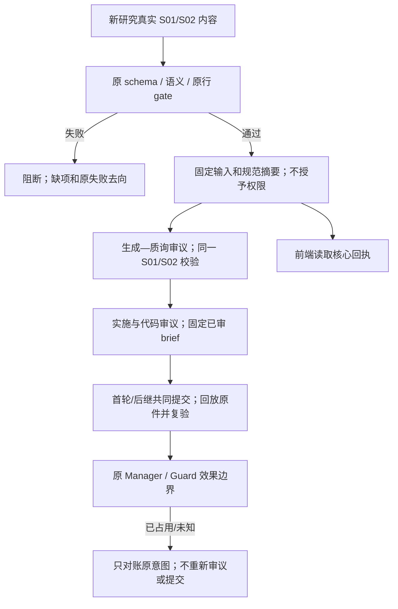

# SDM 规范收敛：分批重构进度与实际接线

通用接入已沿同一SDM 13步实现：当前项目提供数据、训练/功能检查/评价入口和可改范围；执行可选择官方LPAI组件或项目命令驱动；评价按项目主要指标及方向核验。支持多类分类及标量回归的规定结果形式。账号、资源及数据读取配置从当前项目环境取得，缺失时调查并引导补齐。接口能力与真实任务验收分开报告，具体事实见[通用交付说明](GENERIC-DELIVERY.zh-CN.md)。 原SDM的S01/S02、适用G契约、B01、实验内核、S10、科学裁决、Manager/Guard及双会话持续使用。旧批次说明只代表对应历史范围。

当前rc6.40按实际交付/执行边界整理为13项活动，原21步表保留作规范来源与接线清单，不是固定现行目录。每项活动的输入、产出、推进、失败及合并理由见[当前生命周期](WORKFLOW-GUIDE.zh-CN.md)。本次未改变科学接受范围；原S01/S02已接记录检查，其余原规范接受仍待接入。新目录允许步骤/阶段增删与重组，验证见[本批索引](EVOLVED-WORKFLOW-VALIDATION.json)。

日期：2026-11-15。源码候选 `0.3.0-rc6.38`；本批不替换正式安装，不迁移既有项目。原审计见 [21 步审计](SDM21-EVOLUTION-AUDIT.zh-CN.md)。本页记录审计后的改造，历史证据不补标新规范接受。

## 本批完成什么

首批拆成“规范读取/共享校验”和“研究意图接线”。原计划中 1–8 的其他部分仍待接入；没有把只接通 S01/S02 写成整批 1–8 已完成。

1. 原 `_semantic_step_checks` 从 `specctl.py` 原样抽到 `lifecycle_rules.py`。正式 CLI 导入它，组件也调用它，原各步具名条件不复制一份。`check_records()` 实际调用原 `AssetBundle.validate_artifact()` 与 `contracts.evaluate_gate()`，读取原 `lifecycle-steps.json` 的 gate。
2. 原规范读取依赖完整带入新 native 包和冻结：11 个引擎资产、8 个公共 schema、7 个 owner schema，共 26 份。原 owner 摘要校验、自检、canonical engine digest 保留；新冻结另固定原始字节摘要，原始字节和规范语义摘要分开验证。
3. Windows 使用逐组件、句柄相对的只读打开，拒绝 reparse/junction、非普通文件、多链接及读取中变化。共享冲突只作短暂、有界、同权限重试，不退化为普通路径读取；严格共享边界限于资产根和子项，父目录/盘符仅作元数据锚，不阻挡其他项目写入。POSIX 分支保留。**这支持规范只读消费，不代表原 journal/workspace 事务已经移植到 Windows。**
4. 新初始化 v2 在任何冻结/平台操作前校验实际 S01/S02；科学审议、代码审议、回放和首轮/后继提交均调用同一原校验。新 profile 不能去掉意图或降级为旧 gate。缺非目标、机制、不确定性、错误来源、把目标预设为必然结论都会阻断，不能由模型 approve 覆盖。
5. 前端读取核心生成的回执及其标签/范围，可打开原件；没有自行重算另一份科学通过状态。没有此 profile 的旧研究不增加这项显示。

## 原 SDM 接线清单（来源编号）

历史 rc6.39 曾统一原五阶段、21 步叙述和投影；此目录固定方式已在 rc6.40 修正，详见[完整生命周期](WORKFLOW-GUIDE.zh-CN.md)与[校对验证](SDM21-UNIFICATION-VALIDATION.json)。这不改变下表的科学接线状态。

“已接原记录校验”指对象 schema、语义和原行 gate；**不指**正式生命周期事件、签名或外部锚定已接受。

| 原步 | 本批后状态 | 现有能力与下一接线 |
| --- | --- | --- |
| 1 需求/非目标 | 已接原记录校验 | initializer → S01 → 原对象/语义/行 gate；前端投影核心回执 |
| 2 假设/机制/不确定性 | 已接原记录校验 | 实际 S02 → 同一校验；生成—质询、回放、首轮/后继都消费 |
| 3 系统/数据契约 | 待接线 | 固定比较/数据与评价保护保留；需明确适用 G 契约与真实数据事实 |
| 4 基线选择 | 待接线 | 基线引用与 incumbent 保留；接原 B01 |
| 5 基线复现锁定 | 待接线 | 真实父任务/配方清单及可选复现保留；接原 B02/B03/权限 |
| 6 实验与变更策略 | 待接线 | 原 validate_change_policy 已可消费；须接实际 E01/变更证据 |
| 7 就绪 | 待接线 | 既有审议/平台前检保留；接 E02/S04 适用事实 |
| 8 协议冻结 | 待接线 | 新 runtime 已固定规范资产；不能冒充 E01 接受/锚定 |
| 9 实施拆分 | 待接线 | 现有实施工作区/允许文件保留；接原验收关系 |
| 10 实施与变更 | 待接线 | 原生实施/产物固定保留；接 E05 |
| 11 代码审查 | 待接线 | 生成—质询代码审议保留；不冒充原 owner/CI 接受 |
| 12 确定性验收 | 待接线 | 需要适用验收的真实供证，不以 compile 代替 |
| 13 功能/恢复前检 | 待接线 | 需要适用的实际 tensor/finite/tiny/resume 等供证 |
| 14 Run/Attempt | 待接线 | Manager/Guard 精确身份保留；接科学运行计划与预算 |
| 15 训练/确认 | 待接线 | 原官方执行/对账保留；搜索、复现、独立确认分别验收 |
| 16 锁定评价 | 待接线 | 结果身份/四产物/指标重算保留；接原评价接受 |
| 17 稳健性 | 待接线 | 明确任务适用性与实际结果 |
| 18 完整证据 | 待接线 | 真实失败/取消/未知/成功与全部科学计划统一核对 |
| 19 独立证据审查 | 待接线 | 生成—质询保留；接适用五视角、偏差和权限 |
| 20 科学结论 | 待接线 | 原判定函数保留；goal_met 仍不等于 D05 |
| 21 后继/归档 | 待接线 | 原血缘/历史反馈保留；接唯一前驱/后继接受 |

运行回执明确写 `transition_accepted:false` 和 `remaining_integration_steps:3..21`。后者是“尚未集成”，不能解释成“不适用”或“自动放行”。当前没有新增一套适用性裁剪策略；原 formal 1–20 的固定适用规则本批不改。

## 原规范校验怎样进入实际执行链

这是保留现有执行能力的局部接线。原六项提交树仍是兼容执行控制，不能称为覆盖完整 SDM 的科学通过标准。下一批必须继续把实际契约/就绪/证据接入同一规范；不在旁边补另一个“全通过”布尔集合。

## 名称与兼容

协作统一称 **生成—质询审议（Generator–Critic）**，角色为方案生成者和独立质询者。它不是随机分组的 A/B test。当前指引、说明、命令帮助和前端文案使用此名称；旧协议键 `a/b`、历史记录及冻结原件保留。

新对话采用 dialogue v4，新规划/结果指导采用 review v7；旧对话 v1/v2/v3 与旧指导 v6 另留原实现。实际逐 SHA 复核 9 份旧提示内容一致，回放仍选原版本，不为改名重放模型。此前的版本化旧提示仍可能出现旧称，这是兼容原件，不是新产品命名。

原 S02 校验按空格数判断语句结构，会误拒绝不插空格的正常中文。本批在同一原校验器增加中文字符结构判断，保留原英文检查、最小长度与占位文本拒绝；两条路径共同使用。它仍是结构语义校验，不是对假设真伪的证明。

## 关键代码定位

- [lifecycle_rules.py](../skills/sdm-module/sdm-lifecycle/scripts/lifecycle_rules.py)：原步骤语义、原对象/行门禁校验、规范依赖闭包。
- [research_intent.py](../skills/sdm-module/sdm-lifecycle/scripts/research_intent.py)：原 S01/S02 内容适配、完整记录摘要引用、提案与共同提交复验。
- [specctl.py](../skills/sdm-module/sdm-lifecycle/scripts/specctl.py)：正式路径导入同一个步骤语义函数。
- [component_submission.py](../skills/sdm-module/sdm-lifecycle/scripts/component_submission.py)：原审议回放、确切载荷/授权及新意图共同复验。
- [research_runtime.py](../skills/sdm-module/sdm-lifecycle/scripts/research_runtime.py)：只修改新 freeze 的规范闭包，其他恢复函数 AST 保持。
- [research_dashboard_data.py](../skills/sdm-module/sdm-lifecycle/scripts/research_dashboard_data.py)：只读核心回执的前端投影。
- [控制用例](../skills/sdm-module/sdm-lifecycle/tests/test_sdm_governance.py)：真实原校验、合成传输、拒绝/回放/恢复与 Windows 边界。

## 验证与旧项目保护

验证数字与范围见 [本批验证索引](SDM-GOVERNANCE-BATCH1-VALIDATION.json)。使用实际原 schema/语义/gate、审议回放、组件调度、Manager/Guard、冻结与前端投影，模型/平台传输为明确替身。另检查旧提示字节、打包依赖闭包、缺失/篡改资产、真实 Windows junction/hardlink 与持有句柄写入冲突。没有用这些检查代替真实 ML、平台功能或完整原账本资格。

早期测试出现一次遗漏替身的 CLI 只读查询尝试，未进入平台写入，也没有取得可用平台结果；已修正并在离线测试入口增加真实后端拦截。另一个旧文件 symlink 测试因宿主无创建权限明确跳过，不计为通过；真实 junction/hardlink 拒绝用例保留执行。

已有项目的冻结脚本/配置/指引 197 文件及原研究索引按改造前摘要核对；原正式安装仍保留 rc6.37 的 294 文件。本批不热换执行器、重写旧 hash/Guard/request key、不恢复定时器、不开启训练。源码与候选包独立验证，不宣称旧任务已经通过新规范。

后继批次：先完成 3–8 的任务适用性、数据/比较契约、基线、实验变更及就绪/协议冻结，再推进 9–14 的真实验收与 Run 绑定，随后 15–21 的完整证据/审查/判定/后继。每批继续更新本页与主流程，前端仅消费已接通的核心记录。
