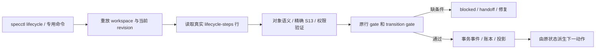
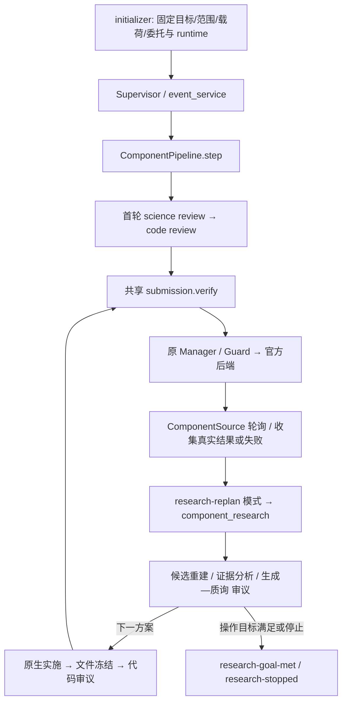
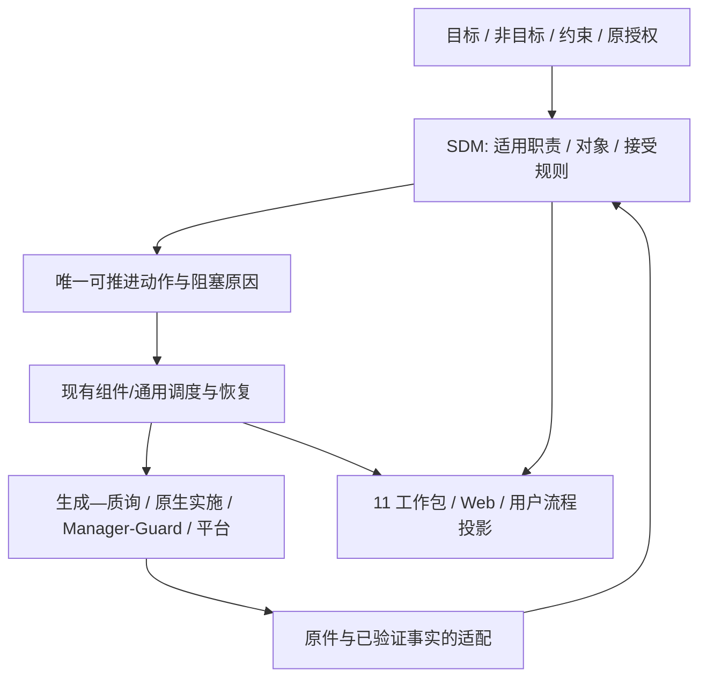

# SDM 原 21 步到 ResearchPilot：源码、门禁与缺口审计

2026-11-15 首批重构已落入 rc6.38 源码候选：共享原校验、完整资产依赖及 S01/S02 实际接线已完成，3–21 尚待逐项接通，正式安装与旧冻结不变。当前接线和验证以[分批重构进度](SDM-REFACTOR-PROGRESS.zh-CN.md)为准；下文审计/旧版本说明保留其当时范围。

核对日期：2026-11-15（Asia/Shanghai）。对象：本机源码 `0.3.0-rc6.37`。本轮先审计，没有实施下一批运行时重构、升级安装或启动研究。

## 结论：规范来源清楚，运行时融合尚未完成

ResearchPilot 确实继承了 SDM 的 21 步定义、契约校验、科学裁决、权限和账本实现，也新增了真实平台执行、双角色协作、异步交付、恢复与工作台。**但默认组件研究链目前没有统一由原 21 步规范决定可推进动作和科学结论。** 原正式路径、后加通用图和组件路径共享部分代码，仍各有推进规则。rc6.37 统一的是组件内的首轮/后继提交条件，不能把它扩大解释为原 SDM 21 步已经完整融合。

此前以职责表对应和“复用求值器”说明融合程度不够准确。本审计纠正这个边界：名字相近、同一脚本文件、指引提及、源文件留存，都不能单独证明调用过原校验或已获原规范接受。用户要的是在原 SDM 规范内演化出一个统一系统；下文按这一要求核对，而非要求普通任务机械跑完所有原步骤/格式。

## 1. 原版身份与可重做的证据

“原版”限定为本仓库保留的初始提交 `ec870b0e12b0932741a193520a004cba5ae9f3c3`（2026-09-18，BMAD + SDM 可分发模板）。未取得并核实独立上游最新 SDM 发布；因此以下证明的是**本项目从已保留原模板怎样演化**，不冒充对所有上游版本的比较。原 21 行完整输入、输出、门禁、失败去向与当前行差异均保存在 [机器证据](SDM21-EVOLUTION-AUDIT.json) 的 steps。

源码有未提交历史修改，HEAD 不代表全部当前字节。证据按文件 SHA-256 和函数 AST 比较；AST identical 只证明该函数语法复用，不能证明其调用到的所有函数/配置行为也不变。报告链接定位当前函数，机器证据同时保留它相对原提交的归属。

本轮 56 份核心源码/规范/入口文件、21 条原/现定义、229 个纯门禁 DSL 正反检查，另有 10 项实际原科学判定函数检查。人工追踪动态模式分支；静态名字出现不当作实际调用。验证不访问模型、平台、网络或真实研究控制。输出独立于源码与运行现场。

复查命令（需有上述 Git 历史；导出快照无历史时不能重建来源）：

```powershell
python -B scripts/audit-sdm21.py --source . --output <源码目录之外的路径>/SDM21-EVOLUTION-AUDIT.json
```

检查结果与限制：229 项是合成事实上下文的求值器测试，覆盖原/现 21 行、HPO 条件和组件提交条件的正例/逐项缺失反例；**不是**全生命周期集成验收、真实 S13/签名重放、模型功能测试或新 ML 实训。rc6.37 已有的 140 项控制回归见 [原控制验证](SUBMISSION-GATE-VALIDATION.json)，其通过也不能推导本审计发现的规范缺口已解决。

## 2. 哪些是直接继承，哪些是后加实现

| 层面 | 核对结果 | 含义 |
| --- | --- | --- |
| 正式生命周期行 | 仍为 21；仅 5/7/8/11/12/13/15/16 的 gate/platform_operations 更改平台操作名 | Jenkins 适配为 ML，未把 21 行改成组件 12 状态 |
| 原门禁/科学判定 | evaluate_gate、validate_change_policy、evaluate_scientific_decision 与原函数 AST 一致 | 原规则实现可复用；默认组件只调用其中求值器，不等于都已使用 |
| 原状态/账本 | workspace.py、ledger.py 整文件一致；正式 advance/freeze/build-evidence/scientific-decision 主函数一致 | 原正式接受链确实存在，不是重写后借名字 |
| 原正式局部调整 | S13 对象 subject 绑定、baseline 操作名、R01 runtime profile 兼容、冻结 G05 标定事实约束 | 这是原规范实现内的适配/加强，不是所有原校验都“完全不变” |
| 新增协作/执行 | proposal_review、proposal_model_runner、component_*、Manager/Guard、任务图/事件/恢复在原提交均不存在 | 当前代码里说 original review/Manager，多指本项目原有原件或所有者，不能解释为初始 SDM 原生模块 |
| 安装范围 | native builder 携带入口、lifecycle 脚本/指引和两个 Agent Skill；不带正式 assets 与完整 owner schemas | 留有 specctl.py 不代表安装版正式引擎可完整使用 |

直接继承、后加实现都可以属于同一个系统。问题在于同一科学职责由谁决定“已满足”、接受哪份版本、下一步依赖什么，当前还没有贯通。

## 3. 现在实际怎样编排

### 3.1 原正式链



普通 advance 要求正好当前 step；8、14、18、20 有专用流程，不能绕过。第 19 步还核对 S10 审查人与已验 authority。原适用性函数对 **1–20 返回适用**，只对 21 作后继状态判断：原正式引擎目前并未原生提供任意裁剪 1–20 的统一策略，不能把用户允许简化误写成这个功能已经存在。

### 3.2 默认组件链

入口 inspect 是读取材料/已有索引；由前台 Agent 按 Skill 指引选择研究准备/接续，并非 inspect 内部自动调用正式 lifecycle。



实际动态调用不是“组件→34 项→21 步”：event_coordinator 把 proposal-review/research-replan/prepare-implementation/freeze-implementation 转为 CLI flags；run_project_pipeline.main 对各模式直接调用 proposal_review.gate、research_replan.advance 或 research_implementation.prepare/freeze 后 return。research_replan 对 parent_route=lpai-component 分流到 component_research。**同一个入口脚本被调用，不意味着其通用 run() 图调度函数也运行。**

同样，记录标签 recorded-for-original-sdm 不是正式 ledger 已接受的证明；需要有实际对象校验/接受调用和对应记录。

### 3.3 通用图与已存在的桥

另一分支 run_project_pipeline.run → task_pipeline.coordinate 使用 workflow_definition，默认 34、显式 exploration revision 2 为 30 个内部节点；业务展示是五阶段 11 工作包。它有 code_change、baseline_required、robustness_required 等条件。执行节点 5/15/16 返回 completed 时，task_pipeline._execute 实际调用 verified_s13，验证正式 workspace/replay 的 accepted handoff 及结果 digest。这是应复用的真桥，不是概念映射；但默认组件提交/结果链没有自动走这条桥。

因此当前不是问“21 现在等于几步”就能表达：规范仍 21；11 工作包、34/30 检查、组件 12 调度分支是不同路径/视图，既非按层依次跑，也没有证明相互等价。下一版可以合并用户操作，必须让它们依赖同一套适用职责和接受结果。

## 4. 按原 21 步逐项核对

以下每节的“原门禁”完整保留原行条件；输入输出沿用其 ID，具体原对象定义见机器证据。所述“当前组件”专指上节的默认实际路径，不因仓库别处有函数就标为已接通。缺原文件名不自动意味着缺职责，明确列出的是未共用的判断、证据或实际行为。


### 01. 问题与非目标

**原输入 → 输出：** intent、constraints → S01。

**原规则与实现：** S01 的 requirement_id、owner、impact 非空，non_goals 是非空列表；这是结构检查，不会自动证明需求正确。 代码：[specctl._semantic_step_checks](../skills/sdm-module/sdm-lifecycle/scripts/specctl.py#L6068)。

**原门禁 / 失败去向：** `{"all_of":[{"check":"problem.clear"},{"check":"non_goals.explicit"}]}`；`clarify`。

**正式定义差异：** 该行原/现一致。

**当前编排、检查与产物：** research_initialize.prepare 要求 objective、source_ref、project_id 等初始字段，写 confirmed-plan.json 与 delegation.json。它要求目标和授权来源，但没有原 S01 的 non_goals 强制字段，也没有调用 S01 校验。Skill 询问用户属于指引，不能当作已落盘的程序门禁。 代码：[research_initialize.prepare](../skills/sdm-module/sdm-lifecycle/scripts/research_initialize.py#L37)。

**继承判断与融合缺口：** 部分职责重建；未统一接受记录。把当前 objective、约束和真实授权来源适配为原需求语义；非目标缺失时应明确待澄清，不能因字符串非空视为第 1 步全部通过。


### 02. 假设、机制与不确定性

**原输入 → 输出：** S01、S03.PRD、history → S02。

**原规则与实现：** S02 检查 hypothesis、mechanism、uncertainty 非空，且 target_as_must 必须为 False。门禁称为 falsifiable，但现有代码主要检查这些字段，不是逻辑证明器。 代码：[specctl._semantic_step_checks](../skills/sdm-module/sdm-lifecycle/scripts/specctl.py#L6068)。

**原门禁 / 失败去向：** `{"all_of":[{"check":"hypothesis.falsifiable"},{"check":"target_not_must"},{"check":"mechanism.explicit"},{"check":"uncertainty.explicit"}]}`；`revise`。

**正式定义差异：** 该行原/现一致。

**当前编排、检查与产物：** proposal_review.validate_proposal 检查 hypothesis、counterevidence、alternatives、expected_observations、outcome_actions 等非空字符串，生成—质询审议补充实质质疑、独立调用来源和关键异议关闭。它们是原初始模板之后新增的协作能力；没有调用 S02 的结构语义校验，也没有同一 target_as_must 条件。 代码：[proposal_review.validate_proposal](../skills/sdm-module/sdm-lifecycle/scripts/proposal_review.py#L103)；[proposal_review.validate_response](../skills/sdm-module/sdm-lifecycle/scripts/proposal_review.py#L118)；[proposal_model_runner.drive](../skills/sdm-module/sdm-lifecycle/scripts/proposal_model_runner.py#L300)。

**继承判断与融合缺口：** 新增审议有价值，但不等于继承了原全部判据。保留 生成—质询，把假设、机制、可推翻条件、不确定性转成同一 S02 语义；审议回执附着于确切版本，不再另定义一份假设是否可接受。


### 03. 系统、数据与评价契约

**原输入 → 输出：** S02、system_facts、data_facts → G01、G02、G03、G04、G05、G06、G07、G08、G09、G10、G11、G12、G13、R04、R05、R06、S12、S13。

**原规则与实现：** 第 3 步要求适用的 G01–G13、R04/R05/R06 语义关闭，并有 data.quality-check、data.labeling-status 的真实结果。_validated_step_records 对对象、父引用与摘要进行校验；R04/R05/R06 由已认证数据交接结果派生，不能由调用者任填。 代码：[specctl._validated_step_records](../skills/sdm-module/sdm-lifecycle/scripts/specctl.py#L5299)；[contracts.AssetBundle.validate_artifact](../skills/sdm-module/sdm-lifecycle/scripts/contracts.py#L2434)。

**原门禁 / 失败去向：** `{"sequence":[{"all_of":[{"operation":"data.quality-check"},{"operation":"data.labeling-status"}]},{"check":"contracts.all_applicable_semantics_closed"}]}`；`contract-story-or-readiness-block`。

**正式定义差异：** 该行原/现一致。

**当前编排、检查与产物：** 当前 comparison_identity 固定 protocol/source/split/selection；component_payload.harness 保护原 trainer，round_evidence 核对二分类预测、验证行和四份归档摘要。可选 dataset_input 使用另外记账的官方数据资产准备。这落实了当前场景的数据/评价一致性，但不是全部适用的 G 契约关闭，未把数据质量、标注状态等统一归入原门禁。 代码：[research_initialize.prepare](../skills/sdm-module/sdm-lifecycle/scripts/research_initialize.py#L37)；[component_payload.harness](../skills/sdm-module/sdm-lifecycle/scripts/component_payload.py#L107)；[component_research.round_evidence](../skills/sdm-module/sdm-lifecycle/scripts/component_research.py#L25)。

**继承判断与融合缺口：** 场景子集已实现，契约覆盖未统一。先列明任务适用的原契约，再复用校验；不适用的几何/标定条件要有依据，不能把所有模型都硬套同一条件，也不能全部写 pass。


### 04. 选择精确基线

**原输入 → 输出：** G02、G03、G09、G10、existing_model_refs → B01。

**原规则与实现：** B01 需要 baseline_id、scope、model/data/evaluator 版本与 tolerance 等；原步骤区分选定基线和下一步实际复现锁定。 代码：[specctl._semantic_step_checks](../skills/sdm-module/sdm-lifecycle/scripts/specctl.py#L6068)。

**原门禁 / 失败去向：** `{"all_of":[{"check":"baseline.scope_exact"},{"check":"baseline.version_selected"}]}`；`choose-or-version-baseline`。

**正式定义差异：** 该行原/现一致。

**当前编排、检查与产物：** initializer 绑定 baseline_source 与 baseline_model；后继 registry 以已核验候选重建 incumbent，严格更高才替换，同分保留最早候选；实施绑定所选基线而非把最近一轮自动当基线。它没有创建/校验原 B01，原 tolerance 与锁定要求也不是 comparison_identity 的同义词。 代码：[research_initialize.prepare](../skills/sdm-module/sdm-lifecycle/scripts/research_initialize.py#L37)；[component_candidates.registry](../skills/sdm-module/sdm-lifecycle/scripts/component_candidates.py#L40)；[component_pipeline.ComponentPipeline.replan](../skills/sdm-module/sdm-lifecycle/scripts/component_pipeline.py#L173)。

**继承判断与融合缺口：** 基线引用与候选选择已有明确改进；需合入同一基线对象。区分“原始基线”“当前最好候选”“本次因果对照”，避免三者混用。


### 05. 基线复现与锁定

**原输入 → 输出：** B01、data_refs、evaluator_refs → B02、B03、S12、S13、S14。

**原规则与实现：** B02/B03 精确绑定 snapshot、复现、锁定评价回执、容差、运行环境和 baseline_lock 权限；平台结果不能只用一段文字代替。当前正式定义把 Jenkins 操作改成 ML 操作，科学检查保留。 代码：[specctl._semantic_step_checks](../skills/sdm-module/sdm-lifecycle/scripts/specctl.py#L6068)；[specctl._validated_step_records](../skills/sdm-module/sdm-lifecycle/scripts/specctl.py#L5299)。

**原门禁 / 失败去向：** `{"sequence":[{"all_of":[{"operation":"git.snapshot"},{"operation":"jenkins.baseline-reproduction"},{"operation":"ml.locked-evaluation"}]},{"all_of":[{"check":"baseline.receipts_exact"},{"check":"baseline.tolerance_pass"},{"check":"baseline.runtime_environment_exact"},{"check":"authority.baseline_lock"}]}]}`；`repair-or-version`。

**正式定义差异：** 仅平台操作与门禁中的对应操作名调整；完整原/现行见机器证据。

**当前编排、检查与产物：** 首轮运行可成为第一份真实基线结果，但初始门不要求先取得 B02/B03。后继 execution_evidence 读取真实父任务与组件任务清单，识别已执行配方以避免重复；另有显式 deterministic-reproduction：不同 UID、相同协议/训练配置、逐条预测概率、完整 epoch 历史和选中 epoch 一致才通过。该可选能力并非默认 initializer 的 decision_policy v2，且不是原容差/独立确认规则。 代码：[component_execution_evidence.produce](../skills/sdm-module/sdm-lifecycle/scripts/component_execution_evidence.py#L103)；[component_reproduction.check](../skills/sdm-module/sdm-lifecycle/scripts/component_reproduction.py#L23)；[component_candidates.registry](../skills/sdm-module/sdm-lifecycle/scripts/component_candidates.py#L40)。

**继承判断与融合缺口：** 不能笼统说“没有复现能力”，也不能说默认已完成原锁定。将真实复现回执接入 B02/B03 语义；确定何种任务需要复现、容差和权限，复用现有能力而非再建一个复现器。


### 06. 实验设计与变更控制

**原输入 → 输出：** S01、S02、S03.PRD、S03.Architecture、G_refs、B_refs → E01、E03、E04。

**原规则与实现：** E01/E03/E04 描述实验、HPO 和执行约束；原 validate_change_policy 检查变量隔离/变更类型，HPO 启用时 E03 完整，未启用走明示条件分支。 代码：[specctl._semantic_step_checks](../skills/sdm-module/sdm-lifecycle/scripts/specctl.py#L6068)；[contracts.validate_change_policy](../skills/sdm-module/sdm-lifecycle/scripts/contracts.py#L3337)。

**原门禁 / 失败去向：** `{"all_of":[{"check":"experiment.schema"},{"check":"variables.isolated"},{"when":{"condition":"hpo_enabled","then":{"check":"E03.complete"},"else":{"check":"true"}}}]}`；`return-to-step-2-through-5`。

**正式定义差异：** 该行原/现一致。

**当前编排、检查与产物：** component_research 生成 research-plan.json、research_revision/intervention 和 implementation-request.json，生成—质询审议成本、观察、行动及比较；implementation_contract 限定可改文件、训练范围和评价身份。但没有调用原 validate_change_policy，审议文字与参数绑定尚未成为原 E01 的统一事实源。 代码：[component_research.advance](../skills/sdm-module/sdm-lifecycle/scripts/component_research.py#L196)；[research_implementation.execution_contract](../skills/sdm-module/sdm-lifecycle/scripts/research_implementation.py#L36)；[research_implementation.prepare](../skills/sdm-module/sdm-lifecycle/scripts/research_implementation.py#L57)。

**继承判断与融合缺口：** 存在一份新的计划与约束体系，需要语义适配和规则复用。单变量不宜仅由模型声称；适用的原变更检查必须实际执行，允许的多变量设计也应声明并按对应规则检查。


### 07. 实验就绪与授权

**原输入 → 输出：** E01.draft、B_refs、data_refs、budget → E02、S04、S12、S13、S14。

**原规则与实现：** E02 + S04 要有规划材料、阻塞项全通过、当前 contract-preflight/data quality 结果及 readiness 权限；不是“方案已获审议”就允许执行。 代码：[specctl._semantic_step_checks](../skills/sdm-module/sdm-lifecycle/scripts/specctl.py#L6068)；[specctl._derived_step_checks](../skills/sdm-module/sdm-lifecycle/scripts/specctl.py#L6357)。

**原门禁 / 失败去向：** `{"sequence":[{"all_of":[{"operation":"data.quality-check"},{"operation":"jenkins.contract-preflight"}]},{"all_of":[{"check":"planning_readiness.trio_complete"},{"check":"protocol_readiness.all_blocking_gates_pass"},{"check":"authority.readiness"}]}]}`；`route-owner`。

**正式定义差异：** 仅平台操作与门禁中的对应操作名调整；完整原/现行见机器证据。

**当前编排、检查与产物：** rc6.37 首轮与后继共用 submission.verify，验证科学审议、代码审议、载荷、比较/范围、Manager 和委托。Manager.plan 检查实际组件配置与所需官方能力，apply 写前再计划校验。但自定义 GATE 的 manager_preflight 事实只检查 action == task.submit；真正平台前检在其他调用中，不能把这个名字解释为原 E02/S04/S09 全部通过。 代码：[component_submission.verify](../skills/sdm-module/sdm-lifecycle/scripts/component_submission.py#L140)；[lpai_manager.Manager.plan](../skills/sdm-module/sdm-lifecycle/scripts/lpai_manager.py#L247)；[lpai_manager.Manager.apply](../skills/sdm-module/sdm-lifecycle/scripts/lpai_manager.py#L354)。

**继承判断与融合缺口：** 组件内首轮/后继已统一，尚未统一到原就绪规则。保留当前强绑定与真实平台前检，把它们作为原门禁的受验证输入；补齐适用的 readiness 事实，不再维护另一套完整就绪结论。


### 08. 冻结协议与外部锚定

**原输入 → 输出：** E02.approved、E01.candidate → E01.frozen、S12、S13、S14。

**原规则与实现：** 专用 freeze 命令要求当前位置为 8，校验候选 E01、当前回执与内容摘要，先 provisional，再外部 anchor-ledger-head 精确核验后 accepted；普通 advance 不得绕过专用流程。 代码：[specctl._do_freeze](../skills/sdm-module/sdm-lifecycle/scripts/specctl.py#L7079)；[specctl._do_lifecycle](../skills/sdm-module/sdm-lifecycle/scripts/specctl.py#L11753)。

**原门禁 / 失败去向：** `{"sequence":[{"all_of":[{"operation":"git.tag-frozen-spec"},{"operation":"jenkins.freeze-receipt"}]},{"check":"freeze.content_digest_and_current_receipts"},{"substate_event":"freeze.provisional"},{"operation":"git.anchor-ledger-head"},{"check":"anchor.result_exact"},{"substate_event":"anchor.accepted"}]}`；`block`。

**正式定义差异：** 仅平台操作与门禁中的对应操作名调整；完整原/现行见机器证据。

**当前编排、检查与产物：** research_runtime.freeze 复制脚本与指引，记录 runtime/guidance 摘要；implementation._freeze 固定确切文件和参数；审议/提交绑定载荷 hash。它们冻结的是执行器与实施载荷，不是已经被原规范接受并外部锚定的 E01。原冻结函数还未携带正式 assets。 代码：[research_runtime.freeze](../skills/sdm-module/sdm-lifecycle/scripts/research_runtime.py#L20)；[research_implementation._freeze](../skills/sdm-module/sdm-lifecycle/scripts/research_implementation.py#L137)；[component_submission.verify](../skills/sdm-module/sdm-lifecycle/scripts/component_submission.py#L140)。

**继承判断与融合缺口：** 三种冻结对象应共同纳入同一研究记录：协议、代码、执行器分别有摘要。不能用代码包未改来证明实验协议已获接受；需要何种外部锚定应由同一任务规范明示，旧冻结绝不改写。


### 09. 实施拆分与确定性验收

**原输入 → 输出：** E01.frozen、S03.PRD、S03.Architecture → S05、S06。

**原规则与实现：** S05/S06 要有验收标识与 allowed_paths；原语义检查主要验证结构完整，真正验收执行另有步骤，不能说非空列表就证明实现正确。 代码：[specctl._semantic_step_checks](../skills/sdm-module/sdm-lifecycle/scripts/specctl.py#L6068)。

**原门禁 / 失败去向：** `{"all_of":[{"check":"stories.deterministic_acceptance"},{"check":"context.allowed_paths"}]}`；`re-split`。

**正式定义差异：** 该行原/现一致。

**当前编排、检查与产物：** research_implementation.prepare 复核已接受方案与审议，为原生实施任务建立工作区、允许文件、保护输入和 execution_contract；不授予执行权限。当前有文件边界，但未创建原 S05/S06 的统一 story/验收关系。 代码：[research_implementation.prepare](../skills/sdm-module/sdm-lifecycle/scripts/research_implementation.py#L57)；[research_implementation.execution_contract](../skills/sdm-module/sdm-lifecycle/scripts/research_implementation.py#L36)。

**继承判断与融合缺口：** 可直接保留现有任务准备器，复用原验收语义，允许合并多个 UI 节点。需要说明每个可修改对象由哪个验收条件保护，不能只记录“原生线程完成”。


### 10. 实施与变更留痕

**原输入 → 输出：** S06.per_story → E05、S12、S13。

**原规则与实现：** E05 绑定定义摘要、revision、冻结实验摘要和 diff；原流程还要求 git.branch-change-request 操作结果，保证改动归属。 代码：[specctl._semantic_step_checks](../skills/sdm-module/sdm-lifecycle/scripts/specctl.py#L6068)；[specctl._engineering_step_subjects](../skills/sdm-module/sdm-lifecycle/scripts/specctl.py#L4819)。

**原门禁 / 失败去向：** `{"sequence":[{"check":"coding.allowed_paths_only"},{"operation":"git.branch-change-request"}]}`；`return-story`。

**正式定义差异：** 该行原/现一致。

**当前编排、检查与产物：** implementation._freeze 拒绝越界、链接、摘要变化、缺文件、比较或范围变化，Python compile 只做语法检查；实现产物包含 parent_plan_digest、job_id 和 execution_contract。当前没有借此生成/校验原 E05 或原 Git change-request 回执。 代码：[research_implementation._freeze](../skills/sdm-module/sdm-lifecycle/scripts/research_implementation.py#L137)；[implementation_validation.validate_completed](../skills/sdm-module/sdm-lifecycle/scripts/implementation_validation.py#L129)。

**继承判断与融合缺口：** 实施隔离和回执可复用；将现有 native job/文件差异作为原变更语义的适配输入。普通无 Git 合并任务可用经规范定义的文件变更接受方式，不能伪造 MR 或默认为已合并。


### 11. 代码审查与所有者批准

**原输入 → 输出：** S13.change_receipt、frozen_diff → S07、S12、S13。

**原规则与实现：** S07 的 owner approval_receipts 加 git.change-review-status、implementation-checks 是原门禁；不能把任何 reviewer 的 approve 都解释为所有者审批。 代码：[specctl._semantic_step_checks](../skills/sdm-module/sdm-lifecycle/scripts/specctl.py#L6068)。

**原门禁 / 失败去向：** `{"all_of":[{"operation":"git.change-review-status"},{"operation":"jenkins.implementation-checks"},{"check":"review.owner_approvals"}]}`；`return-coding`。

**正式定义差异：** 仅平台操作与门禁中的对应操作名调整；完整原/现行见机器证据。

**当前编排、检查与产物：** 首轮先科学后代码审议；后继 code_review 绑定已审计划、原父任务、实际清单与待执行载荷。proposal_review 验证角色/调用分离和关键问题关闭，submission.verify 回放原件。这里的“原件”是本项目新增审议模块的原始回执，不是证明该 生成—质询 模块来自初始 SDM，也不是原 owner/CI 接线。 代码：[component_pipeline.ComponentPipeline.code_review](../skills/sdm-module/sdm-lifecycle/scripts/component_pipeline.py#L460)；[component_submission.initial_review](../skills/sdm-module/sdm-lifecycle/scripts/component_submission.py#L59)；[component_submission.verified_review](../skills/sdm-module/sdm-lifecycle/scripts/component_submission.py#L39)。

**继承判断与融合缺口：** 保留并融合 生成—质询 为审查实现；适用的所有者批准、CI 与职责独立性仍由原规则决定。不要再用两次模型 approve 代替所有规范审查。


### 12. 集成与确定性验收结果

**原输入 → 输出：** approved_change → S08、S12、S13。

**原规则与实现：** S08、merge-status、deterministic-acceptance 与 all_pass；验收标识非空只是必要结构，平台结果和产物应对应确切 revision。 代码：[specctl._semantic_step_checks](../skills/sdm-module/sdm-lifecycle/scripts/specctl.py#L6068)；[specctl._validated_step_records](../skills/sdm-module/sdm-lifecycle/scripts/specctl.py#L5299)。

**原门禁 / 失败去向：** `{"all_of":[{"operation":"git.merge-status"},{"operation":"jenkins.deterministic-acceptance"},{"check":"deterministic_acceptance.all_pass"}]}`；`repair`。

**正式定义差异：** 仅平台操作与门禁中的对应操作名调整；完整原/现行见机器证据。

**当前编排、检查与产物：** 实施冻结验证完整文件/语法，Manager 验证请求与组件配置，模型执行代码审议；默认组件链没有把研究代码的确定性功能验收结果作为原 S08 消费。产品自身控制测试通过也不能充当每个新模型实现的验收。 代码：[research_implementation._freeze](../skills/sdm-module/sdm-lifecycle/scripts/research_implementation.py#L137)；[component_pipeline.ComponentPipeline.prepare_submission](../skills/sdm-module/sdm-lifecycle/scripts/component_pipeline.py#L662)；[lpai_manager.Manager.plan](../skills/sdm-module/sdm-lifecycle/scripts/lpai_manager.py#L247)。

**继承判断与融合缺口：** 这是实质缺口，不能仅改名。应在现有实施/前检调用中收取适用验收的真实结果并绑定载荷；无合并任务显式不适用 merge，不等于功能验收也不适用。


### 13. 实施后功能与恢复前检

**原输入 → 输出：** merged_revision、E01.frozen → S09、S12、S13。

**原规则与实现：** S09 检查 geometry、tensor、finite、tiny、resume 五类事实，并要求实际 post-implementation-preflight 成功；失败回修复或登记偏差。任务不涉及的检查需要规范化适用条件。 代码：[specctl._semantic_step_checks](../skills/sdm-module/sdm-lifecycle/scripts/specctl.py#L6068)。

**原门禁 / 失败去向：** `{"all_of":[{"operation":"jenkins.post-implementation-preflight"},{"check":"preflight.geometry_tensor_finite_tiny_resume"}]}`；`repair-or-E06`。

**正式定义差异：** 仅平台操作与门禁中的对应操作名调整；完整原/现行见机器证据。

**当前编排、检查与产物：** 保护 trainer、解码 payload、比对 wrapper/AST 和官方请求是已有控制。_freeze 明确写 model_functional_verification: False；执行证据也明确是 static decoding。训练代码中的 finite 检查与控制器恢复，不能证明候选模型在提交前已完成 tiny run/断点恢复等功能前检。 代码：[component_payload.harness](../skills/sdm-module/sdm-lifecycle/scripts/component_payload.py#L107)；[component_execution_evidence.produce](../skills/sdm-module/sdm-lifecycle/scripts/component_execution_evidence.py#L103)；[research_implementation._freeze](../skills/sdm-module/sdm-lifecycle/scripts/research_implementation.py#L137)。

**继承判断与融合缺口：** 不能把 manager_preflight 或模型审议当 S09。保留已有检查，补远端、受授权的必要功能验证适配；无需在本地训练，也不必对无几何输入模型强制几何检查。


### 14. 物化 Run、Attempt 与预算

**原输入 → 输出：** E01.frozen、E04、S09 → R01、R02。

**原规则与实现：** materialize-run 要求当前位置为 14，精确 R01 指纹/引用/预算和 R02 planned Attempt；执行前应知道计划运行集合。当前对运行镜像绑定增加 runtime profile 兼容检查。 代码：[specctl._do_materialize_run](../skills/sdm-module/sdm-lifecycle/scripts/specctl.py#L7684)；[specctl._validated_run_fingerprint_context](../skills/sdm-module/sdm-lifecycle/scripts/specctl.py#L8004)。

**原门禁 / 失败去向：** `{"all_of":[{"check":"run.fingerprints_exact"},{"check":"run.references_exact"},{"check":"run.budget_exact"},{"check":"attempt.planned"}]}`；`block`。

**正式定义差异：** 该行原/现一致。

**当前编排、检查与产物：** Manager 计划绑定 namespace、owner、组件、请求、运行时摘要和原 Guard；pipeline 持久记录 attempts/rounds，预算观察已知 UID 并计入失败取消；scope 限 epochs。默认 policy v2 是 until-target，不能说有原 E04 的总试验上限。当前尚未消费原 R01/R02 或把全部计划/偏差统一纳入同一科学清单。 代码：[lpai_manager.Manager.plan](../skills/sdm-module/sdm-lifecycle/scripts/lpai_manager.py#L247)；[component_pipeline.ComponentPipeline.load](../skills/sdm-module/sdm-lifecycle/scripts/component_pipeline.py#L115)；[component_candidates.registry](../skills/sdm-module/sdm-lifecycle/scripts/component_candidates.py#L40)；[research_initialize.prepare](../skills/sdm-module/sdm-lifecycle/scripts/research_initialize.py#L37)。

**继承判断与融合缺口：** 保留 Manager/Guard 精确副作用身份；在其前面接受规范 Run/Attempt，再映射到实际意图。操作 identity 与科学 run_id 可以不同，但关系必须唯一且可核对；未知结果不能用新 Attempt 绕过。


### 15. 训练、搜索与确认

**原输入 → 输出：** R01、R02、R03、E03.when_hpo → R03、R07、R08、S12、S13。

**原规则与实现：** 非 HPO 要明确 not_applicable；HPO 要保留每个 trial、可回放选择并隔离正式测试；训练还要求所选配置确认、独立 seed/environment、R01 环境匹配及 Attempt terminal。 代码：[specctl._advance_hpo_step15](../skills/sdm-module/sdm-lifecycle/scripts/specctl.py#L11459)；[specctl._do_lifecycle](../skills/sdm-module/sdm-lifecycle/scripts/specctl.py#L11753)。

**原门禁 / 失败去向：** `{"sequence":[{"when":{"condition":"hpo_enabled","then":{"sequence":[{"operation":"ml.hpo-search"},{"all_of":[{"check":"hpo.every_trial_retained"},{"check":"hpo.selection_replayable"},{"check":"hpo.formal_test_isolated"}]}]},"else":{"check":"hpo.not_applicable"}}},{"all_of":[{"operation":"jenkins.execution-orchestration"},{"operation":"ml.training"}]},{"all_of":[{"check":"confirmation.selected_config_replayed"},{"check":"confirmation.independent_seed_environment"},{"check":"attempt.environment_matches_R01"},{"check":"attempt.terminal"}]}]}`；`retry-or-E07`。

**正式定义差异：** 仅平台操作与门禁中的对应操作名调整；完整原/现行见机器证据。

**当前编排、检查与产物：** Manager.apply → 原 Guard → 官方后端提交，pending/unknown 保留原意图；ComponentSource 轮询，等待期间不重启研究推理。连续模型修改不是完整 HPO trial 协议。可选 deterministic-reproduction 是同配置同预测的复现，不能替代原 independent_seed_environment。 代码：[lpai_manager.Manager.apply](../skills/sdm-module/sdm-lifecycle/scripts/lpai_manager.py#L354)；[lpai_manager.Manager.reconcile](../skills/sdm-module/sdm-lifecycle/scripts/lpai_manager.py#L428)；[component_event_source.ComponentSource.cycle](../skills/sdm-module/sdm-lifecycle/scripts/component_event_source.py#L200)；[component_reproduction.check](../skills/sdm-module/sdm-lifecycle/scripts/component_reproduction.py#L23)。

**继承判断与融合缺口：** 平台执行与恢复是现有优势，应作为原步骤的执行适配。HPO、复现、独立确认分别声明和验收；没有实际执行的确认不得用“本轮训练成功”补成已完成。


### 16. 锁定评价与结果有效性

**原输入 → 输出：** checkpoint、R01 → R07、R08、S12、S13。

**原规则与实现：** 原规则检查评价器 digest、R01 环境及精确 locked-evaluation 回执；结果是否有效与指标高低分开。 代码：[specctl._locked_evaluation_subjects](../skills/sdm-module/sdm-lifecycle/scripts/specctl.py#L2042)；[specctl._do_lifecycle](../skills/sdm-module/sdm-lifecycle/scripts/specctl.py#L11753)。

**原门禁 / 失败去向：** `{"all_of":[{"operation":"jenkins.evaluation-orchestration"},{"operation":"ml.locked-evaluation"},{"check":"evaluator.digest_exact"},{"check":"attempt.environment_matches_R01"}]}`；`E07-or-invalid`。

**正式定义差异：** 仅平台操作与门禁中的对应操作名调整；完整原/现行见机器证据。

**当前编排、检查与产物：** component_results.verify 绑定任务与原提交事实；round_evidence 核对 split、预测、结果、checkpoint 四文件、验证行、test_used=False，并重算二分类 macro-F1。改变评价身份、摘要或指标会拒绝。这是当前特定场景的有效性控制，尚未转成原 R07/R08/锁定评价接受。 代码：[component_results.verify](../skills/sdm-module/sdm-lifecycle/scripts/component_results.py#L90)；[component_research.round_evidence](../skills/sdm-module/sdm-lifecycle/scripts/component_research.py#L25)。

**继承判断与融合缺口：** 复用结果采集与重算，把已核验事实送入原评价语义；不要求重复跑一次评价来满足格式。声明 adaptive fixed validation 的边界，不能称 untouched test 或统计优势证明。


### 17. 稳健性与失败保留

**原输入 → 输出：** selected_checkpoints、G11 → S12、S13。

**原规则与实现：** G11 约束稳健性评价；不论 pass/fail 都保留，禁止改结果。步骤定义有真实 ml.robustness-evaluation 门禁。 代码：[specctl._do_lifecycle](../skills/sdm-module/sdm-lifecycle/scripts/specctl.py#L11753)。

**原门禁 / 失败去向：** `{"all_of":[{"operation":"ml.robustness-evaluation"},{"check":"robustness.pass_or_fail_retained"},{"check":"robustness.no_result_editing"}]}`；`retain-failure-evidence`。

**正式定义差异：** 该行原/现一致。

**当前编排、检查与产物：** 通用 workflow_definition.build 已有 robustness_required 使 17 成为 required、18 依赖它。默认组件链没有消费这一适用性字段，也没有把当前曲线/错误分析变成稳健性评价。失败诊断和预算记录保留是已有能力，但不等于稳健性职责已完成。 代码：[workflow_definition.build](../skills/sdm-module/sdm-lifecycle/scripts/workflow_definition.py#L50)；[component_research.analyze](../skills/sdm-module/sdm-lifecycle/scripts/component_research.py#L60)；[component_research.advance](../skills/sdm-module/sdm-lifecycle/scripts/component_research.py#L196)。

**继承判断与融合缺口：** 当前组件场景的适用/不适用尚未归一。复用原 G11 与通用条件的意图，落实为唯一任务适用性规则；需要稳健性时纳入真实结果，未通过也进入证据清单。


### 18. 汇集完整证据与偏差

**原输入 → 输出：** every_planned_run_attempt_artifact → D01、D02、D03、D04。

**原规则与实现：** 专用 build-evidence 在第 18 步核对每个 planned Run/Attempt、偏差与精确回执，形成 D01–D04；不是只汇总最好或成功运行。 代码：[specctl._do_build_evidence](../skills/sdm-module/sdm-lifecycle/scripts/specctl.py#L8337)；[specctl._do_verify_evidence](../skills/sdm-module/sdm-lifecycle/scripts/specctl.py#L8952)。

**原门禁 / 失败去向：** `{"all_of":[{"check":"evidence.complete_attempt_accounting"},{"check":"evidence.deviations_accounted"},{"check":"evidence.receipts_exact"}]}`；`request-missing-work-or-block`。

**正式定义差异：** 该行原/现一致。

**当前编排、检查与产物：** 当前 rounds + candidate registry 重读不可变产物，保留最新与 incumbent、失败诊断和 observed UID，分析曲线、混淆及配对错误；execution_evidence 还读取实际组件配方清单。另有开发空间 study_accounting 统计保留的运行/交付时间，它明确不声称完整未知计数或 SDM 加速倍数。它们没有自动成为默认组件链的 D01–D04 接受。 代码：[component_research.analyze](../skills/sdm-module/sdm-lifecycle/scripts/component_research.py#L60)；[component_candidates.registry](../skills/sdm-module/sdm-lifecycle/scripts/component_candidates.py#L40)；[component_execution_evidence.produce](../skills/sdm-module/sdm-lifecycle/scripts/component_execution_evidence.py#L103)；[study_accounting.summarize](../skills/sdm-module/sdm-lifecycle/scripts/study_accounting.py#L25)。

**继承判断与融合缺口：** 采集和分析可保留，需统一计划/实际 Attempt 对账、有效性、偏差、统计适用性和证据关系。实际组件任务清单不是本研究全部科学计划，时间统计也不是科学证据资格。


### 19. 独立证据审查

**原输入 → 输出：** E01.frozen、D01、D02、D03、D04 → S10、S14。

**原规则与实现：** S10 需 reviewers/roles、五视角、无未决偏差；第 19 步还把审查人/角色与通过验证的 authority attestation 精确匹配。结构完整和签名权限是不同层次。 代码：[specctl._semantic_step_checks](../skills/sdm-module/sdm-lifecycle/scripts/specctl.py#L6068)；[specctl._do_lifecycle](../skills/sdm-module/sdm-lifecycle/scripts/specctl.py#L11753)；[authority.verify_authorities](../skills/sdm-module/sdm-lifecycle/scripts/authority.py#L864)。

**原门禁 / 失败去向：** `{"all_of":[{"check":"authority.reviewer_independent"},{"check":"deviation.none_unresolved"},{"check":"five_lenses.complete"}]}`；`supplement-or-invalid`。

**正式定义差异：** 该行原/现一致。

**当前编排、检查与产物：** 方案/结果/代码 生成—质询 有模型和调用来源分离、原始资料、关键异议关闭、回放；但默认组件链未调用正式 S10 五视角与 authority.verify_authorities。打包有 evidence-review Skill 文本，也不证明该审查已经执行。 代码：[proposal_review.validate_response](../skills/sdm-module/sdm-lifecycle/scripts/proposal_review.py#L118)；[proposal_model_runner.drive](../skills/sdm-module/sdm-lifecycle/scripts/proposal_model_runner.py#L300)；[component_submission.verified_review](../skills/sdm-module/sdm-lifecycle/scripts/component_submission.py#L39)。

**继承判断与融合缺口：** 保留 生成—质询 为原审查职责的实际执行者之一。统一审查对象、视角、偏差与权限；根据任务规范决定需要的独立性，不把两模型不同等同于正式 principal/role 权限已验证。


### 20. 科学判定与结论接受

**原输入 → 输出：** reviewed_bundle、E01.frozen_rule → D05、S12、S13、S14。

**原规则与实现：** scientific-decision 在第 20 步从冻结规则与受审证据派生 D05，要求全 Attempt 核对、互斥穷尽和 invalid→inconclusive→rejected→supported 优先级，再验权限与外部锚定。原 evaluate_scientific_decision 函数保留；当前 _governed_decision_context 另补了冻结 G05 标定事实约束。 代码：[contracts.evaluate_scientific_decision](../skills/sdm-module/sdm-lifecycle/scripts/contracts.py#L7040)；[specctl._governed_decision_context](../skills/sdm-module/sdm-lifecycle/scripts/specctl.py#L9366)；[specctl._do_scientific_decision](../skills/sdm-module/sdm-lifecycle/scripts/specctl.py#L9816)。

**原门禁 / 失败去向：** `{"sequence":[{"all_of":[{"check":"decision.all_attempts_accounted"},{"check":"decision.rule_exhaustive_mutually_exclusive"},{"check":"decision.precedence_invalid_inconclusive_rejected_supported"},{"check":"authority.D05"}]},{"substate_event":"decision.provisional"},{"operation":"git.anchor-ledger-head"},{"check":"anchor.result_exact"},{"substate_event":"anchor.accepted"}]}`；`supersede-only`。

**正式定义差异：** 该行原/现一致。

**当前编排、检查与产物：** 默认 policy v2 的 registry 用 best.metric >= target.value 得到 goal.met；结果审议后 pipeline 可以转 research-goal-met。policy v3 可增加显式复现要求。该判断是当前操作性目标与停止条件，不调用原 D05 判定器，也没有把未达标区分为原四种科学结论。 代码：[component_candidates.registry](../skills/sdm-module/sdm-lifecycle/scripts/component_candidates.py#L40)；[component_research.advance](../skills/sdm-module/sdm-lifecycle/scripts/component_research.py#L196)；[component_pipeline.ComponentPipeline.step](../skills/sdm-module/sdm-lifecycle/scripts/component_pipeline.py#L716)。

**继承判断与融合缺口：** 这是核心融合点，不能再仅加“基于 SDM”说明。把操作目标达标与科学结论作为同一研究记录中的不同字段；正式科学结论复用原规则/判定器与必要证据，证据不足时如实待判定，不伪造 D05。


### 21. 后继设计、失败学习与归档

**原输入 → 输出：** D05_or_failure_cases → E01、S02。

**原规则与实现：** 新 E01/S02 与前驱双向链接，前驱协议不改；原生命周期对第 21 步有 successor_experiment 是否已存在的适用判断。后继是新研究协议的演化，不是覆盖旧结论。 代码：[projection.lifecycle_step_applicability](../skills/sdm-module/sdm-lifecycle/scripts/projection.py#L586)；[projection._apply_lifecycle_step](../skills/sdm-module/sdm-lifecycle/scripts/projection.py#L599)；[specctl._do_lifecycle](../skills/sdm-module/sdm-lifecycle/scripts/specctl.py#L11753)。

**原门禁 / 失败去向：** `{"all_of":[{"check":"successor.reciprocal_links"},{"check":"predecessor.protocol_unchanged"}]}`；`continue-or-archive`。

**正式定义差异：** 该行原/现一致。

**当前编排、检查与产物：** component_research 绑定 accepted_review_ref、所选父候选/计划、历史反馈与下一实施请求，pipeline 持久接续；旧冻结不迁移。开发空间另有 study_successor.prepare，验证原审议已被消费且归档后只输出 proposal-only。它们有实际血缘与恢复控制，但没有共用原 successor 接受与归档真相。 代码：[component_research.advance](../skills/sdm-module/sdm-lifecycle/scripts/component_research.py#L196)；[component_pipeline.ComponentPipeline.replan](../skills/sdm-module/sdm-lifecycle/scripts/component_pipeline.py#L173)；[study_successor.prepare](../skills/sdm-module/sdm-lifecycle/scripts/study_successor.py#L14)；[research_restore.work](../skills/sdm-module/sdm-lifecycle/scripts/research_restore.py#L233)。

**继承判断与融合缺口：** 后继并非回到另一套系统重启。保留当前 incumbent/失败反馈与旧身份，统一 predecessor/successor、协议变更与新增授权的记录和接受。不能把每个训练轮次都强称新的正式 Experiment。


## 5. 门禁反例证明了什么

以下是可重复的**规则非等价**实验，不是一次真实研究越过了门禁，也没有伪造审议回执交给运行器：

| 输入给纯 evaluate_gate 的合成事实 | 组件 GATE | 原 SDM 相应行 |
| --- | --- | --- |
| 组件五个 check + scoped delegation 全 True，其余未给 | 通过 | 原 1/2/7/8/11/12/13/14/18/19/20 等仍缺各自条件 |
| 第 2 步其余原事实齐备，只移除 target_not_must | 不属组件六条件 | 原第 2 步拒绝 |
| 第 13 步只缺 post-implementation-preflight 或 geometry_tensor_finite_tiny_resume | 不属组件六条件 | 原第 13 步拒绝 |
| 第 20 步缺全 Attempt 核对、科学优先级、D05 权限或精确锚定 | 不属组件六条件 | 原第 20 步拒绝 |

组件真实 verify 还会回放审议、验载荷、计划与授权，不能通过传入几个 True 来绕过；本实验只说明**即使这些组件事实全部真实，逻辑上也不能推出原各步骤已满足**。229 项检查覆盖原/现门禁正例与每个选中条件缺失的拒绝；没有把合成上下文变成科学事实。

这一证据也解释 rc6.37 的具体范围：两个提交入口复用了同一 verify，确实改善一致性；GATE 却是在新模块定义的六项条件，没有读取 lifecycle-steps 的步骤 gate。共享函数 evaluate_gate 是复用解释器，尚不是共用原规范条件。

还直接调用了原 `evaluate_scientific_decision`，以合成的冻结规则/Run/Attempt/证据分别验证 supported、rejected、无决定性结果、低功效优先、协议无效优先，以及缺 Attempt、重复 Attempt、Run 错绑、非终态、支持/拒绝同时为真的拒绝，共 10 项。它证明原判定函数仍可独立消费完整事实，且会拒绝不完整核对；不证明这些合成事实来自真实试验，也没有发出或接受 D05。科学结论不是 `best.metric >= target` 的别名。

## 6. 现状缺口与重构决策

### 6.1 必须修的是规范接受关系

| 缺口 | 源码证据 | 后果 | 收敛方向 |
| --- | --- | --- | --- |
| 三处适用性/推进规则 | formal 1–20、generic flags、component stage/decision_policy | 同一任务所需职责不由唯一规范派生 | 在原 SDM 内集中定义版本化任务适用性、有效证据复用和动作依赖 |
| 计划/冻结/运行对象未贯通 | E01/R01/R02 与 research-plan/profile/Manager-plan 各自校验 | 摘要都精确，仍不能证明彼此的科学含义相同 | 语义适配引用现有原件，不复制原始数据、重造身份或补假回执 |
| 审议与就绪条件不同 | 生成—质询 + 自定义六条件 vs 原 E02/S04/S09/S10 | 模型批准可能被过度解读 | 保留 生成—质询 并纳入原审查；实际前检/确定性验收独立供证 |
| 结果与结论未统一 | registry/goal-met vs D01–D05 | 达到验证集目标被误当科学结论 | 统一证据核对，分开表达操作达标与按证据得到的科学结论 |
| 原校验难以在安装/宿主中消费 | builder 不带 assets；安全目录加载/Unix 锁依赖 | 不能只加 import 宣称接线完成 | 最小依赖闭包、固定摘要、受支持宿主的安全实现与拒绝行为一起验证 |

正式宿主本轮只读实测：AssetBundle.load 报 ContractError(asset_load_failed)，根因 PermissionError；ledger 导入因 fcntl 不可用而阻塞。它们是当前 Windows/资产读取与锁支持问题，不能解释为“原 SDM 所有规则无效”或“文件不存在”。不能删安全读取/伪造 fcntl 让测试表面通过。

### 6.2 一个系统怎样融合

**建议作有边界的收敛重构，保留有效执行能力，不推倒重建。** 以原 SDM 的对象语义、校验和接受链为规范核心：原 21 步是主目录，任务配置明确适用职责；现有自研能力成为这些职责的协作实现、事实来源和执行适配。下图是目标，当前尚未交付：



统一不要求只有一个函数、数据库或机械时钟。事件 Inbox 负责可靠交付，Guard 负责副作用，模型 Context 负责对话延续；它们可保留自己的运行状态。**同一科学职责的适用条件、通过规则、已接受版本和结论只能有一份权威定义**，组件/通用图消费它，不再自行宣布等价通过。代码和用户说明都不能只做“外面套一个 SDM facade，里面仍各判各的”。

具体融合方式：

1. **先复用原契约语义，再做原件适配。** 当前 comparison、research-plan、native implementation、Manager plan、真实结果各自带版本/摘要；适配其事实到原职责需要的对象。原规范已有的检查直接调用；新场景确实缺少的检查在同一规范中扩展，并说明依据。普通任务不必手填全套旧文件，但缺失事实不能靠格式转换补出来。
2. **把任务适用性收回原规范。** 原 formal 1–20 一律适用不能无改动承担用户允许的简化；通用 flags 可作为现有输入，不直接照搬为第二套条件。建立任务类型/变更/风险到职责的明确判定与不适用理由，复用已接受且摘要/范围未变的证据。界面可以合并节点，底层仍能解释覆盖了哪几步、跳过为何合理、谁接受。
3. **让首轮和后继消费同一接受规则。** 不是在现有六条件旁再加 21 个布尔值；应由原规范给出本次提交必须具备的已接受职责。原 verify-only、载荷绑定、范围与权限检查保留，逐项迁入/接入共同校验，防止双写两份 ready。
4. **把证据与结论接回科学语义。** 现有采集/重算/候选选择继续工作，先完成计划与所有 Attempt、偏差和适用统计核对，再进入相应审查/判定。goal_met 用于停止/用户目标，scientific outcome 由证据和原规则决定；不满足正式 D05 条件时保留未判定，不把工程停止状态塞成 supported。
5. **展示来自同一记录。** 11 工作包/组件状态/Web 显示 SDM 职责进度、真实动作、血缘与阻塞来源；聊天关联只是入口元数据。前端不能再维护“研究已完成”的独立科学规则。

### 6.3 建议实施顺序与可验收结果

| 批次 | 具体改造范围 | 必须提供的实现证明 |
| --- | --- | --- |
| 1：规范与事实边界 | 从现有 AssetBundle/validator/workspace 接口确定需要的依赖；安全宿主支持；统一任务适用性；为 1–8 及当前计划/比较做适配 | 原语义正反例在声称支持的宿主可运行；缺资产/错误摘要/缺关键事实拒绝；裁剪原因可追溯；不写第二份判断 |
| 2：实施到提交 | 9–14，确定性验收/功能前检真实供证；首轮/后继消费共同接受；保留 Manager/Guard | 同一规则缺失在两个入口同样拒绝；代码或范围变化失效；审议不授权；已占用意图只对账；冻结原件不变 |
| 3：执行、证据与判定 | 15–21，真实任务结果 → Run/Attempt 核对 → 证据/审查/结论 → 后继 | 失败、取消、未知与全部计划不漏记；反例区分 invalid/inconclusive/rejected/supported；goal_met 不冒充 D05；后继引用唯一前驱 |
| 4：投影与单一路径验收 | 通用/组件入口消费同一规范；工作台/说明同步；新安装依赖闭包 | 从一项输入可追到适用 21 职责、每项实际校验、已接受版本、下一动作与展示；可恢复且无重复训练 |

上表是基于审计的建议拆分，不是已实施或已获科研执行授权。每批对新版本新冻结验收；旧研究沿版本解释原记录，既不重标为通过新门禁，也不重写 Guard/请求 key、旧 hash 或旧科学结论。需要实际 ML/平台验证的场景单独在已有授权范围内确认，不能用离线 DSL 检查冒充。

## 7. 本轮交付边界

本轮新增逐项审计、可复查机器证据和只读审计脚本，更新文档入口/收敛说明与导出清单。没有修改研究执行 Python、21 步规范行、科学判定条件或平台配置，没有升级 Skill、提交/推送 Git、启动训练或恢复暂停定时器。旧活动配置/冻结按既有保护清单只读核对；对既有研究处于运行还是暂停不作未经核查的泛化陈述。

对外准确表述应是：**“ResearchPilot 在原 SDM 21 步规范与源码基础上演化，已补充持续研究执行、协作与恢复能力；当前默认组件路径的规范接受尚在收敛，本审计逐项披露接线与缺口。”** 现在不能声称“原 21 步已完整统一落地”或“21 步已等价变成固定的另一组步骤”。


## 附：关键接线定位


- [specctl._do_lifecycle](../skills/sdm-module/sdm-lifecycle/scripts/specctl.py#L11753)：读取原步骤、严格顺序、权限、原 gate 与账本接受。

- [projection.lifecycle_step_applicability](../skills/sdm-module/sdm-lifecycle/scripts/projection.py#L586)：1–20 固定适用，21 的实际条件。

- [workspace.mutate](../skills/sdm-module/sdm-lifecycle/scripts/workspace.py#L643)：原状态变更与事务接受。

- [event_coordinator.run](../skills/sdm-module/sdm-lifecycle/scripts/event_coordinator.py#L16)：动态模式到 CLI flag，不自动运行通用图。

- [run_project_pipeline.main](../skills/sdm-module/sdm-lifecycle/scripts/run_project_pipeline.py#L186)：各专用模式直接分发后返回。

- [run_project_pipeline.run](../skills/sdm-module/sdm-lifecycle/scripts/run_project_pipeline.py#L25)：另一分支的通用任务图入口。

- [research_replan.advance](../skills/sdm-module/sdm-lifecycle/scripts/research_replan.py#L153)：组件 parent_route 分流。

- [task_pipeline._execute](../skills/sdm-module/sdm-lifecycle/scripts/task_pipeline.py#L176)：5/15/16 完成必须核验 accepted S13。

- [task_pipeline.verified_s13](../skills/sdm-module/sdm-lifecycle/scripts/task_pipeline.py#L43)：真正连接正式 workspace/replay 的既有桥。

- [component_pipeline.ComponentPipeline.dispatch_submission](../skills/sdm-module/sdm-lifecycle/scripts/component_pipeline.py#L638)：首轮/后继共同入口；非 new 只 reconcile。

- [component_submission.verify](../skills/sdm-module/sdm-lifecycle/scripts/component_submission.py#L140)：自定义六条件，调用求值器但未读取 21 行 gate。

- [contracts.evaluate_gate](../skills/sdm-module/sdm-lifecycle/scripts/contracts.py#L7898)：纯规则求值，非事实生成器。


打包证据：[native builder](../scripts/build-native-skill.py)；入口指引：[用户 Skill](../skills/researchpilot/SKILL.md)。
