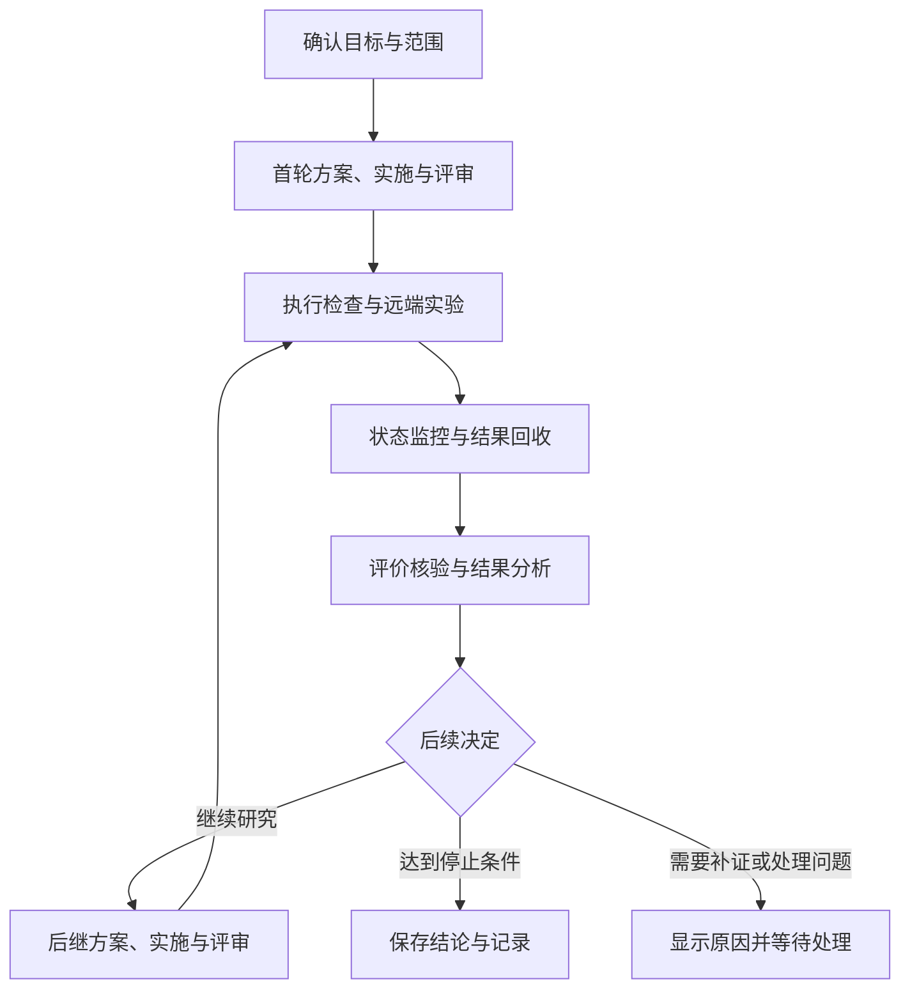

# ResearchPilot 使用指南

在 Codex 中打开实际模型项目，通过 ResearchPilot 说明任务。系统先检查项目并补齐必要信息，再提出方案；持续研究启动后，由后台在已确认范围内推进实验。

首次使用先完成[安装](delivery/INSTALLATION-MODES.md)。训练与评价入口尚未接入时，先按[项目接入指南](GENERIC-DELIVERY.zh-CN.md)准备。

## 发起任务

先说明本次工作的完成边界。以下消息用于表达任务意图，其中具体指标、预算和文件范围需按项目补充。

**单次评测**

> 使用 $researchpilot，评测当前指定权重，沿用已有数据划分和评价程序，收集结果并分析主要问题。本次只做评测，不修改模型或提交后续训练。

**持续研究**

> 使用 $researchpilot，先检查当前项目的训练、数据、评价和已有结果。我希望围绕主要指标持续改进模型。先整理研究方案、可修改范围、资源预算和停止条件，确认后再执行。

Codex 会从项目读取能查到的信息，并补问缺失的目标、权限和执行范围。已有研究应先沿其原记录检查；同一个研究无需因更换聊天或重新打开工作台而重复创建。

单次评测交付结果与分析后结束。若之后需要改进模型，可明确提出持续研究需求，并将该报告作为已有材料。[任务范围与状态](TASK-SCOPE.zh-CN.md)说明两者在工作台中的区别。

## 确认方案与执行范围

开始执行前，确认一份具体方案，至少包括：

| 内容 | 需要明确的事项 |
| --- | --- |
| 目标与评价 | 主要指标、优化方向、目标要求及使用的数据划分 |
| 研究起点 | 当前实现或选定候选、已有权重与可用结果 |
| 修改范围 | 允许修改的代码，以及需要固定的数据和评价程序 |
| 资源与预算 | 执行平台、单任务资源、任务总数或时限，以及失败处理上限 |
| 接续与停止 | 是否允许持续迭代，何时结束，哪些情况需要人工处理 |

有模型偏好时可以一并说明；没有偏好时由研究方案提出候选。没有历史结果也可以开始研究，首轮先获取可比较的有效结果。

可用以下形式确认已讨论的方案：

> 按已确认的方案和执行范围开展持续研究。允许根据实际结果修订方案、修改约定文件，并在评审和检查通过后提交后继实验；达到目标、预算耗尽或遇到需要处理的阻塞时停止。

后继实验仍在有效授权范围内时，无需逐轮发送“继续”。目标、数据、资源或修改范围发生实质变化时，需要重新核对相应内容。

## 研究执行与结果迭代

后台开始工作、训练任务提交和训练完成是不同状态。系统会核对研究线程是否已接管，提交成功后再记录实际任务编号和平台信息。排队期间继续监控已有任务，完成后回收产物并核验评价结果。

结果分析基于实际报告和代码，后继方案可以继续当前候选，也可以选择较早的候选作为起点。方案和实际代码均需经过相应评审与检查；多轮方案审议、修订回应和代码评审保留在方案详情中。

实验效果下降时保留负结果，依据证据决定修订、回退或继续。训练失败时先诊断，再按原范围决定是否修复和重试；失败任务按约定计入预算。提交结果未知时先核对原请求，避免重复创建任务。

## 查看工作台

在 Codex 中请求“打开当前项目的研究工作台”。页面按当前项目的研究登记显示记录，确认页面中的项目目录和研究名称与本次任务一致。

| 视图 | 主要内容 |
| --- | --- |
| 概览 | 当前进展、主要指标、最新结果和当前最优候选 |
| 实验记录 | 每轮实验的配置、执行、评价结果及分析依据 |
| 研究主线 | 已选用的候选演进路径 |
| 研究脉络 | 方案与实验的完整分支关系，以及各节点的详细记录 |

研究脉络以“研究方案 → 实验”组织。实验详情汇总配置、执行、结果和分析；方案详情保留逐轮方案与代码评审。图中关系依据实际记录的候选起点，实验编号表达先后顺序。

任务状态区分别说明“最近结果分析”“结果驱动迭代”和“当前自动推进”。曾进入持续迭代的研究仍可能处于暂停或阻塞状态，历史接续不等于当前正在运行。

后台研究主会话和独立评审会话由研究管理，前台聊天全文不会自动同步到工作台。会话详情与当前限制见[工作台与会话](CHAT-WORKBENCH-BINDING.zh-CN.md)。

## 暂停、继续与结束

| 操作 | 行为 |
| --- | --- |
| 暂停研究 | 停止派发新的分析、方案和训练；已提交的远端任务按平台自身状态继续。 |
| 继续研究 | 核对同一研究的任务与回执后，沿原范围接续。 |
| 停止远端任务 | 需要明确指定待停止的任务，并核对平台最终状态。 |
| 调整目标或范围 | 在 Codex 中说明变更，核对受影响的方案、预算和权限后执行。 |

达到目标、预算或时限耗尽时，系统保存结果与结论并结束。未达到目标也可能正常结束，应结合停止原因判断。权限缺失、证据异常或无法解决的评审问题会显示具体阻塞原因。

浏览器关闭后，已启动的研究可继续运行；持续推进依赖本机后台、网络及服务可用。电脑关闭后，远端任务可能仍在运行，恢复时应先核对原任务。[运行状态与排障](CONTINUOUS-RUNTIME.zh-CN.md)提供处理路径。

## 常用指令

- “查看当前研究进度，说明当前最优、最新结果、正在执行的工作和下一步。”
- “解释本轮方案的依据，并展示方案和代码的评审过程。”
- “比较这些实验的主要指标、资源开销与失败情况，说明取舍。”
- “暂停后续研究，保留已经提交的远端任务。”
- “继续原研究，先核对任务状态并沿用有效范围。”

产品的适用评价形式和验证范围见[支持范围](EXECUTION.md)。
