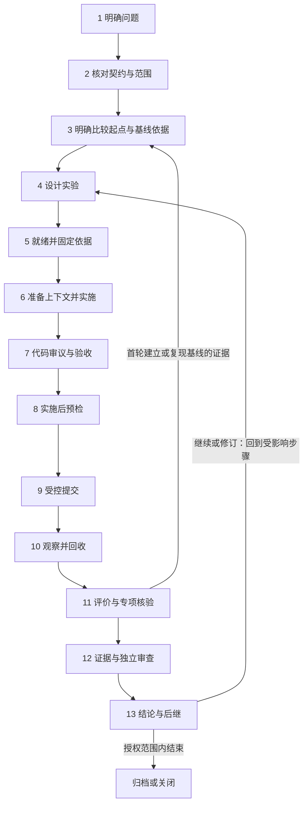

# ResearchPilot 模型开发生命周期

ResearchPilot 将模型研究组织为五个阶段、13 个步骤。本页说明各步的输入、产出、推进条件和依赖，供项目接入与技术设计查阅；日常操作见[使用指南](USER-GUIDE.zh-CN.md)。

步骤可以复用仍有效的证据，后继实验回到受影响环节，不要求每轮重新执行全部活动。远端功能预检依赖实际环境分配，步骤编号表达职责，而非固定的调用次序。

适用规则沿 SDM 的契约、评审、权限和科学决策执行。未实现、缺证据与不适用分别记录，具体支持边界见[当前能力](EXECUTION.md)，来源关系见[SDM21 到 13 步的演进](../skills/sdm-module/sdm-lifecycle/references/sdm21-to-13-evolution.zh-CN.md)。

## 1. 流程原则与 SDM 来源

ResearchPilot 以原 SDM 生命周期为起点，保留按步骤解释模型开发的方式，将实际执行与后续能力有机融入。本版按 **13 个活动步骤**组织：问题与比较基础 → 实验准备 → 工程实现 → 运行与评价 → 证据与后继。

这里的 13 是当前流程的表达结果，不是固定框架，也不要求每轮执行 13 次调用。步骤可随实际需要新增、删除、拆分、合并或调整顺序；适用的证据和执行边界仍须满足。当前保留五组交付阶段，是因为它们对应明确的输入/交接边界，不要求以后仍为五组。原 21 步作为来源对照，不再规定现行目录必须保留 21 个编号。

现行流程合并共享交付活动，保留适用科学职责。将来省略工作须区分：确实不适用、已有有效证据可复用、尚未实现或仍缺事实。流程编排的调整不等于已有规范门禁全部接通；不能用新步骤号重新标记历史证据。

当前步骤使用 ResearchPilot 工作流程编号；“原 SDM 1/2”等均指来源编号。原 `lifecycle-steps.json` 和正式账本继续保留其 21 个稳定身份，不因展示重组改号。[原 21 步源码审计](SDM21-EVOLUTION-AUDIT.zh-CN.md)是来源证据，[分批重构进度](SDM-REFACTOR-PROGRESS.zh-CN.md)记录实际接线。

八组合并的依据、合并后仍需分别满足的检查，以及13步活动与底层21步身份的区别，见[SDM继承与流程整合](COMPARISON-WITH-BMAD-ML.zh-CN.md)。

## 2. 流程总览

| 当前步骤 | 活动 | 来源与调整 |
| --- | --- | --- |
| 1 | 明确目标与可证伪问题 | 原 SDM 1,2；合并原问题提出和研究问题定义：它们共用一份需求背景，在同一研究意图准备活动中交付。 |
| 2 | 核对数据、评价契约与执行范围 | 原 SDM 3；保留原契约步骤，将平台能力和执行范围的现有实现纳入同一准备活动；权限仍贯穿后续。 |
| 3 | 明确比较起点与基线依据 | 原 SDM 4,5；承接原比较定义和基线管理职责，区分探索起点、实际比较对象与阶段基线；复现、锁定和替换按证据进展处理，不要求首轮即确立稳定基线。 |
| 4 | 设计实验与运行计划 | 原 SDM 6；保留原实验设计边界；将生成—质询作为其协作实现，不单列新的科学阶段。 |
| 5 | 检查就绪并固定实验依据 | 原 SDM 7,8；合并就绪和冻结为一次执行准备交付，保留“先就绪、再固定”的内部依赖；不将两种接受混成一个布尔值。 |
| 6 | 准备上下文并实施变更 | 原 SDM 9,10；合并任务拆分与编码：它们在同一实施作业中衔接，准备和实际完成仍分别可追溯。 |
| 7 | 审查代码并完成工程验收 | 原 SDM 11,12；合并工程交付的审查和验收，保留审议判断与确定性事实两个证据来源。 |
| 8 | 执行实施后预检 | 原 SDM 13；保留独立的实施后边界，因为它依赖实际实现和环境，不能在方案讨论时预先通过。 |
| 9 | 登记运行并受控提交 | 原 SDM 14；保留提交身份边界，与长时间观察分开，避免把提交请求、平台 UID 和训练完成混为一谈。 |
| 10 | 观察训练并回收执行结果 | 原 SDM 15；展开原训练编排的真实等待、回收和恢复能力；这些是职责内部扩展，不另设科学通过标准。 |
| 11 | 核验评价与适用专项结果 | 原 SDM 16,17；合并评价交付：常规与专项可在同次结果核验中说明，但各自适用性与证据不能互相替代。 |
| 12 | 汇总证据并开展独立审查 | 原 SDM 18,19；合并证据准备与审查为一个证据交付步骤，保留“先汇总、后独立审查”和各自证据身份。 |
| 13 | 形成结论并决定后继或归档 | 原 SDM 20,21；合并结论和行动交付，使决定有紧邻的证据依据；科学裁决、目标状态和后继授权仍分别保留。 |

图示为一轮正常活动依赖；不是固定线性执行器。已有有效基线/工程证据可复用，失败或新事实返回受影响环节；实际阻断以原所有者、校验器及回执为准。

## 3. 问题、契约与比较基础

### 步骤 1：明确目标与可证伪问题

**输入**：用户目标、约束、非目标、现有结果和问题来源。

**执行与产出**：项目发现和渐进引导准备实际输入；research_intent 构造原 S01/S02，初始化、方案/代码审议、回放和共同提交调用同一原校验。 输出：需求 S01 与研究简报 S02；目标、假设、机制、反证和不确定性。

**推进条件**：原 S01/S02 schema、步骤语义和原行 gate 均通过才接受该记录；transition_accepted:false，仍不产生训练授权或正式转移。

**失败与返回**：问题不清则澄清，假设/反证不足则修订；不以模型同意覆盖缺项。

**从 SDM 如何演进**：原步骤 1,2。合并原问题提出和研究问题定义：它们共用一份需求背景，在同一研究意图准备活动中交付。

**当前实现边界**：原记录检查已接入；完整生命周期转移不由本步骤投影产生。

代码：[research_initialize.py](../skills/sdm-module/sdm-lifecycle/scripts/research_initialize.py)、[research_intent.py](../skills/sdm-module/sdm-lifecycle/scripts/research_intent.py)、[proposal_model_runner.py](../skills/sdm-module/sdm-lifecycle/scripts/proposal_model_runner.py)。

### 步骤 2：核对数据、评价契约与执行范围

**输入**：研究问题、系统/数据事实、划分、评价器、平台能力和用户授权。

**执行与产出**：复用原 G 契约规则；项目接入固定实际数据来源、划分、输入输出、比较身份和评价程序；执行接入的能力与真实用户范围分别核验。 输出：适用契约、数据与评价身份、资源/权限范围及未闭合项。

**推进条件**：沿原契约所有者核对适用事实；配置完整不等于数据事实、科学可比性或用户授权已成立。

**失败与返回**：缺契约/数据事实先补齐；范围变化重新核对，不能用“当前未实现”代替“不适用”。

**从 SDM 如何演进**：原步骤 3。保留原契约步骤，将平台能力和执行范围的现有实现纳入同一准备活动；权限仍贯穿后续。

**当前实现边界**：原适用G对象、语义、G02引用闭包、当前项目与比较身份已进入共同接受；完整平台签名/外部锚定资格另行供证。

代码：[contracts.py](../skills/sdm-module/sdm-lifecycle/scripts/contracts.py)、[component_pipeline.py](../skills/sdm-module/sdm-lifecycle/scripts/component_pipeline.py)、[required_skills.py](../skills/sdm-module/sdm-lifecycle/scripts/required_skills.py)、[component_submission.py](../skills/sdm-module/sdm-lifecycle/scripts/component_submission.py)。

### 步骤 3：明确比较起点与基线依据

**输入**：研究问题、已有代码/权重/结果（可暂缺）、数据与评价约定、历史候选和复现材料

**执行与产出**：先固定起始配方、数据和评价身份；没有历史结果时允许经步骤4–11取得首个有效探索结果。每个后继由原方案审议选择有效候选作为实际比较对象，实施前核对原接受决定、结果和配方一致。探索后按原基线规则处理阶段基线选择、复现、锁定或替换。

**推进条件**：原B01承担比较定义；首轮分数、指标最优或候选选用不自动完成B02锁定、B03复现。探索不要求预先拥有稳定高分基线；适用的原证据和执行授权仍须满足。

**失败与返回**：结果无效先诊断，不计作候选；不可比则补证或版本化。比较对象与已接受方案不一致时阻断实施；不能自动退回首轮或最新结果。

**从SDM如何演进**：承接原SDM 4/5的比较定义与基线管理职责，拆清探索起点、实际比较对象和阶段基线；复现与锁定按证据进展完成，可由步骤13回到本步，不要求第一次训练即确立稳定基线。

**当前实现边界**：原B01与模型/数据/评价绑定继续核验；后继沿原接受决定核对比较候选及原配方。完整B02/B03正式资格不由普通结果或选择标签推定。

首轮只给出探索起点，原B01仍约定实际模型、数据与评价身份；它不要求预先已有高分结果。后续审议可以选择较早的有效候选作为持续比较对象。实现会核对原接受决定、候选结果及原配方，不能悄悄换成首轮或最新一轮。

例如：第1轮用于了解现状，第2轮形成较好候选，第3轮退化；后继可以沿原回退决定选第2轮继续改进，不把第1轮永久固定为基线，也不默认沿第3轮继续。阶段基线可在证据积累后按原规范选定；正式锁定与复现资格仍需相应证据，不能由一次得分替代。

代码：[component_candidates.py](../skills/sdm-module/sdm-lifecycle/scripts/component_candidates.py)、[component_pipeline.py](../skills/sdm-module/sdm-lifecycle/scripts/component_pipeline.py)、[research_acceptance.py](../skills/sdm-module/sdm-lifecycle/scripts/research_acceptance.py)。

## 4. 实验设计与准备

### 步骤 4：设计实验与运行计划

**输入**：研究问题、适用契约、探索起点或已核验比较对象、历史证据与预算。

**执行与产出**：生成—质询审议在共同证据上形成可证伪方案；指明实际基线、竞争解释、结果分支和变更影响。 输出：干预、对照、预期观察、判断规则、搜索/确认运行及成本计划。

**推进条件**：调用既有方案语义、异议闭合与确切回执校验；原 E01/E03/E04 和变更政策继续作为规范依据。审议接受不签发权限。

**失败与返回**：拒绝或缺证据时修订/补证；问题、契约或基线不成立时回到步骤 1–3。

**从 SDM 如何演进**：原步骤 6。保留原实验设计边界；将生成—质询作为其协作实现，不单列新的科学阶段。

**当前实现边界**：原实验科学内核、变量/第6步检查和同一非续期预算已接；完整E01签名及全部锚定工件不由普通投影代替。

代码：[research_replan.py](../skills/sdm-module/sdm-lifecycle/scripts/research_replan.py)、[proposal_review.py](../skills/sdm-module/sdm-lifecycle/scripts/proposal_review.py)、[proposal_model_runner.py](../skills/sdm-module/sdm-lifecycle/scripts/proposal_model_runner.py)、[contracts.py](../skills/sdm-module/sdm-lifecycle/scripts/contracts.py)。

### 步骤 5：检查就绪并固定实验依据

**输入**：待执行方案、数据/方法就绪事实、预算及需固定的版本。

**执行与产出**：检查数据、方法和平台条件，固定确切方案/代码/指引/规范摘要。原 26 份规范依赖进入新冻结。科学协议接受、运行时冻结和实施后预检分别记录。初始化固定执行代码可先于模型审议，这是宿主启动准备，不代表科学协议已接受。 输出：就绪结果、固定协议依据及冻结运行时引用；各自接受范围单列。

**推进条件**：沿原 E02/S04 及协议冻结规则判断；当前运行时能冻结不等于原 E01.frozen 已接受或已外部锚定。

**失败与返回**：缺就绪事实返回对应所有者；固定后的语义变更按原变更/后继规则处理，不改旧冻结。

**从 SDM 如何演进**：原步骤 7,8。合并就绪和冻结为一次执行准备交付，保留“先就绪、再固定”的内部依赖；不将两种接受混成一个布尔值。

**当前实现边界**：运行时/规范固定已有实现；原就绪和实验协议冻结的完整接受尚待接入。

代码：[research_runtime.py](../skills/sdm-module/sdm-lifecycle/scripts/research_runtime.py)、[research_intent.py](../skills/sdm-module/sdm-lifecycle/scripts/research_intent.py)、[component_pipeline.py](../skills/sdm-module/sdm-lifecycle/scripts/component_pipeline.py)、[specctl.py](../skills/sdm-module/sdm-lifecycle/scripts/specctl.py)。

## 5. 工程实现与验收

### 步骤 6：准备上下文并实施变更

**输入**：确切方案、受保护接口、允许文件、已有 Context 和验收要求。

**执行与产出**：从方案准备受限实施合同，复用原 Context，由官方 Codex SDK 原生实施线程产出实际改动并交付；不以审议文字冒充代码。 输出：实施任务/上下文、实际代码差异、版本与变更交付。

**推进条件**：保持文件/能力边界及确切方案绑定；原 S05/S06/E05 的任务、上下文和变更职责不因合并消失。

**失败与返回**：上下文不足先补齐，实施失败返回对应任务；能力缺口由原反馈路由处理。未改代码时复用仍有效的实施证据。

**从 SDM 如何演进**：原步骤 9,10。合并任务拆分与编码：它们在同一实施作业中衔接，准备和实际完成仍分别可追溯。

**当前实现边界**：受限实施/Context 与实际交付已有实现；原 S05/S06/E05 接受关系尚待统一。

代码：[research_implementation.py](../skills/sdm-module/sdm-lifecycle/scripts/research_implementation.py)、[research_context.py](../skills/sdm-module/sdm-lifecycle/scripts/research_context.py)、[implementation_validation.py](../skills/sdm-module/sdm-lifecycle/scripts/implementation_validation.py)。

### 步骤 7：审查代码并完成工程验收

**输入**：实际差异、确切科学方案、接口契约、历史异议和验收证据。

**执行与产出**：独立质询核对方案忠实性和变更影响，必要的确定性检查提供实际行为证据；工程 CI 与代码审议分别记录。 输出：代码审议回执、确定性工程验收结果和待处理问题。

**推进条件**：共同提交会回放确切代码审议；原 S07/S08 的验收职责仍需真实供证，模型 approve 或 compile 不能代替完整验收。

**失败与返回**：重大异议未闭合返回步骤 6；缺检查先补证，不用审议接受覆盖失败。

**从 SDM 如何演进**：原步骤 11,12。合并工程交付的审查和验收，保留审议判断与确定性事实两个证据来源。

**当前实现边界**：代码审议及部分工程检查可执行；原 S07/S08 接受尚未全面统一。

代码：[proposal_model_runner.py](../skills/sdm-module/sdm-lifecycle/scripts/proposal_model_runner.py)、[component_submission.py](../skills/sdm-module/sdm-lifecycle/scripts/component_submission.py)、[implementation_validation.py](../skills/sdm-module/sdm-lifecycle/scripts/implementation_validation.py)、[scm_ci.py](../skills/sdm-module/sdm-lifecycle/scripts/scm_ci.py)。

### 步骤 8：执行实施后预检

**输入**：实际代码/配置、固定方案、执行环境及适用功能/恢复要求。

**执行与产出**：复用当前项目的真实执行环境、配方和所需能力前检；按变化判断需验证的功能/恢复条件，消费与当前实现一致的证据。 输出：适用的张量、有限值、微型运行、恢复与平台准备证据。

**推进条件**：原 S09 与当前 Manager 写前核验保持各自范围；只核对 action 的叶子条件不能冒称全部科学就绪。

**失败与返回**：预检失败先修复；影响协议时回到步骤 4/5，不能跳过后直接提交。

**从 SDM 如何演进**：原步骤 13。保留独立的实施后边界，因为它依赖实际实现和环境，不能在方案讨论时预先通过。

**当前实现边界**：项目适用功能检查的实际执行、回收和回放已接；二分类保留原微型拟合/接续要求。每个项目必须有其真实远端证明，不能冒称完整S09平台签名资格。

代码：[research_implementation.py](../skills/sdm-module/sdm-lifecycle/scripts/research_implementation.py)、[component_payload.py](../skills/sdm-module/sdm-lifecycle/scripts/component_payload.py)、[lpai_manager.py](../skills/sdm-module/sdm-lifecycle/scripts/lpai_manager.py)、[component_submission.py](../skills/sdm-module/sdm-lifecycle/scripts/component_submission.py)。

## 6. 运行与评价

### 步骤 9：登记运行并受控提交

**输入**：固定运行计划、当前实现、预检、确切审议回执和真实授权。

**执行与产出**：首轮和后继进入同一 component_submission 边界，核对意图、审议、载荷和授权，再由 Manager/Guard 处理平台效果。 输出：Run/Attempt 与确切提交身份；平台读回或待对账状态。

**推进条件**：原科学 Run/Attempt 关系继续对齐；兼容六条件是操作控制，不等价于全部原科学门禁。Guard 非 new 时只沿原身份对账。

**失败与返回**：缺前置事实阻断；结果未知禁止换 key/通道重提，也不为未知旧请求补一轮新审议后重发。

**从 SDM 如何演进**：原步骤 14。保留提交身份边界，与长时间观察分开，避免把提交请求、平台 UID 和训练完成混为一谈。

**当前实现边界**：共同接受通过后先登记Run/Attempt，再沿原授权、Manager/Guard和同一预算提交；正式R01/R02完整签名资格另行供证。

代码：[component_submission.py](../skills/sdm-module/sdm-lifecycle/scripts/component_submission.py)、[lpai_manager.py](../skills/sdm-module/sdm-lifecycle/scripts/lpai_manager.py)、[submission_guard.py](../skills/sdm-module/sdm-lifecycle/scripts/submission_guard.py)。

### 步骤 10：观察训练并回收执行结果

**输入**：同一平台 UID、原请求/Attempt、预算和执行计划。

**执行与产出**：官方 SDK 与原事件源观察同一任务，持久退避，终态后回收产物并登记分析作业；监督、收件、在途排空和恢复在此保障连续性。 输出：平台终态、原始产物、失败/取消/未知证据及唯一结果交接。

**推进条件**：精确身份、原授权和预算保持；搜索、训练、复现与独立确认分别核验。宿主存活不证明研究进展。

**失败与返回**：暂时读取失败退避；未知先对账；已知准备失败进入修复，不赋低分或伪装有效训练结果。用户暂停阻止新派发。

**从 SDM 如何演进**：原步骤 15。展开原训练编排的真实等待、回收和恢复能力；这些是职责内部扩展，不另设科学通过标准。

**当前实现边界**：已有部分真实持续执行/恢复记录；未据此宣称全部平台及长时自主性均已验收。

代码：[component_event_source.py](../skills/sdm-module/sdm-lifecycle/scripts/component_event_source.py)、[lpai_manager.py](../skills/sdm-module/sdm-lifecycle/scripts/lpai_manager.py)、[research_supervisor.py](../skills/sdm-module/sdm-lifecycle/scripts/research_supervisor.py)、[component_pipeline.py](../skills/sdm-module/sdm-lifecycle/scripts/component_pipeline.py)。

### 步骤 11：核验评价与适用专项结果

**输入**：实际 checkpoint/产物、规定数据和评价器、适用场景/稳健性要求。

**执行与产出**：原二分类生产器核验四项产物；项目结果接入核验结果、预测、划分、检查点和功能检查五项产物，并按项目评价方法重算固定验证指标；专项和稳健性按任务与结论要求核验，未支持的类型明确说明。 输出：有身份和协议边界的评价结果、专项结果、无效项及限制。

**推进条件**：平台 succeeded 不等于有效结果；原锁定评价与稳健性规则决定需要哪些事实，未测不能写成通过。

**失败与返回**：产物/协议无效则保留无效证据；需补测则回到相应运行工作；不适用须有依据，不为凑步骤重复评测。

**从 SDM 如何演进**：原步骤 16,17。合并评价交付：常规与专项可在同次结果核验中说明，但各自适用性与证据不能互相替代。

**当前实现边界**：规定结果形式的多类分类和标量回归核验已有实现；独立TEST、分割/Pillar及通用专项接受仍需实际接入与验收。

代码：[component_results.py](../skills/sdm-module/sdm-lifecycle/scripts/component_results.py)、[contracts.py](../skills/sdm-module/sdm-lifecycle/scripts/contracts.py)、[specctl.py](../skills/sdm-module/sdm-lifecycle/scripts/specctl.py)。

## 7. 证据、结论与后继

### 步骤 12：汇总证据并开展独立审查

**输入**：全部计划运行/尝试、有效与无效结果、失败/取消/偏差和不确定性。

**执行与产出**：汇总原始引用、配方、失败与历史反馈；生成—质询用于检视解释和后继方案。原 D01–D04/S10 的完整性、适用审查视角与职责分离继续作为依据。 输出：完整证据索引、独立审查、重大异议及结论限制。

**推进条件**：全部科学计划和实际 Attempt 须落账；不能仅汇总成功或最好结果，也不能从模型角色存在推定完整 S10 已完成。

**失败与返回**：缺证据补证，矛盾/无效证据按原规则处理；重大异议未闭合不补标通过。

**从 SDM 如何演进**：原步骤 18,19。合并证据准备与审查为一个证据交付步骤，保留“先汇总、后独立审查”和各自证据身份。

**当前实现边界**：完整已登记尝试账目、真实结果及原S10五视角检查已接；完整D01–D04正式工件发布和组织签名不由普通记录代替。

代码：[component_results.py](../skills/sdm-module/sdm-lifecycle/scripts/component_results.py)、[component_research.py](../skills/sdm-module/sdm-lifecycle/scripts/component_research.py)、[proposal_review.py](../skills/sdm-module/sdm-lifecycle/scripts/proposal_review.py)、[review_guidance.py](../skills/sdm-module/sdm-lifecycle/scripts/review_guidance.py)、[contracts.py](../skills/sdm-module/sdm-lifecycle/scripts/contracts.py)。

### 步骤 13：形成结论并决定后继或归档

**输入**：已审证据、固定判断规则、目标/预算、授权和用户最新指示。

**执行与产出**：保留原科学裁决；原候选规则选择实际比较对象及下一行动，积累证据后可提出阶段基线，按适用的原复现、锁定和替换规则回到步骤3。后继沿同一Context/Guard接续，不将当前最优直接晋级为正式基线。 输出：科学结论及限制；继续、补证、修订、回退、停止或归档的明确决定与血缘。

**推进条件**：支持、否定、证据不足和实验无效分别判断；goal-met 只代表登记目标策略，不自动产生 D05。单项 Study 完成与项目目标完成分开。

**失败与返回**：需要后继回到步骤 1–5 中受影响环节，必要时补测；范围或授权变化重新核对，归档/关闭按原规则。无固定轮数自动停/续。

**从 SDM 如何演进**：原步骤 20,21。合并结论和行动交付，使决定有紧邻的证据依据；科学裁决、目标状态和后继授权仍分别保留。

**当前实现边界**：原科学裁决函数与后继选择已接，探索性证据不足时返回inconclusive；正式D05签名、锚定和确认性研究资格仍需供证。

代码：[contracts.py](../skills/sdm-module/sdm-lifecycle/scripts/contracts.py)、[component_candidates.py](../skills/sdm-module/sdm-lifecycle/scripts/component_candidates.py)、[research_replan.py](../skills/sdm-module/sdm-lifecycle/scripts/research_replan.py)、[component_pipeline.py](../skills/sdm-module/sdm-lifecycle/scripts/component_pipeline.py)、[dashboard_lineage.py](../skills/sdm-module/sdm-lifecycle/scripts/dashboard_lineage.py)。

## 8. 首轮、后继与跨步骤能力

首轮先准备步骤 1–5 的实际输入与范围，按任务需要实施/复用工程证据；后台对确切初始方案与代码开展审议，经过共同提交边界后才登记实际任务。新初始化的 S01/S02 原记录检查在初始化、审议、回放及共同提交处共用。

后继由步骤 10–13 的真实结果与选择驱动，回到需要调整的问题、契约、基线或实验计划。只改参数不等于自动免除受影响的核验；未变更且仍有效的证据不重复生成。最新结果、实际对照和历史最优分别保留，失败准备不赋低分。

首个任务在有效基线形成前失败时，第10—11步保留确切失败编号、日志和无有效分数的结果。已授权的持续后台可在第12—13步分析、独立质询并形成有依据的修复，回到步骤4—8准备和实施，再通过同一步骤9。共同就绪检查回放原已登记失败任务、父计划和受审修复；第3步仍为建立中，直到新训练产生有效结果。失败任务计入原预算，不重新发放预算，也不把它当作零分候选。只读诊断不提交任务；未知效果必须先沿原身份对账。

失败修复与后继尝试的具体任务、结果和适用限制见[自主修复与后继验证](AUTONOMOUS-ITERATION-RESULTS.zh-CN.md)。

生成—质询审议支持问题/协议、代码与证据活动；Context、收件、监督、持久退避、在途排空、暂停和恢复贯穿流程。它们扩展职责的落实方式，不维护另一套科学通过标准。未知模型/平台请求只沿原身份对账，用户暂停阻止新派发，Web 委托原控制器。

## 9. 规范实现和当前缺口

原对象/schema、行 gate、语义、权限与科学判定继续优先复用。当前普通组件已接入适用G契约、B01、原实验科学内核、S10及原科学裁决；未支持工作负载和完整正式资格有独立的实际供证要求，详见各步及[重构进度](SDM-REFACTOR-PROGRESS.zh-CN.md)。不能将待接线解释成不适用，也不以步骤合并抹平工程验收、科学审查和权限差异。

原 26 份规范依赖进入新包/新冻结；Windows 可安全只读消费，原 journal/workspace 全事务仍需受支持宿主。运行时冻结不等于原 E01 正式接受，目标达标不等于 D05。记录校验、审议接受、执行授权、平台成功、结果有效、指标目标和科学结论分别报告。

## 10. 编排、显示和兼容

`research_initialize`和同一个`ResearchPipeline`执行新项目与既有二分类研究，按项目、执行和评价接入推进同一13步。`run_project_pipeline`只保留已有显式绑定模式的兼容调用，不再作为通用新项目的另一条研究流程；`specctl`保留完整正式账本能力，普通适配器不冒称签名资格全部通过。通用 11 工作包、34/30 内部检查 ID 及组件调度状态与本页步骤属于不同编号，不能按相同数字直接解释为对应。

进度报告和 Web 共用 `lifecycle-map.json`/`lifecycle_view.py`，只说明当前活动涉及哪些现行步骤；来源编号在 `sdm_steps` 中明确标出。不从状态顺序或任务数推断步骤已通过。旧 v1 投影使用原 SDM 编号，保留其 schema 和来源身份；新 v2 明确使用现行流程编号。

工作台读取同一研究证据，不同步前台聊天全文。新研究来源会话由实际CODEX_THREAD_ID取得并保留到新索引，已有研究不自动改绑；任意外部Web到原生聊天的跳转不作已实现承诺，详见[会话关系](CHAT-WORKBENCH-BINDING.zh-CN.md)。旧冻结、Guard、任务、Context、配置、指引、索引和版本化提示不改写；新目录不迁移旧项目。实际入口、源码和研究冻结分别核验，以实际运行原件报告结果。

维护时先从实际输入、产出、依赖和失败路径决定怎样组织步骤，再核对 SDM 来源与规则复用，并同步指引、展示及验证。不得为了保持 21 或 13 的数量而添删职责。流程检查摘要见 [演进流程验证](EVOLVED-WORKFLOW-VALIDATION.json)，专业术语见 [统一词表](TERMINOLOGY.zh-CN.md)。

## 11. 会话协作

步骤4、6和13由持续研究主会话承接方案、实施和后继分析；步骤4、7和12的独立质询由另一条持续只读评审会话承担。主会话按分析与实施阶段使用相应读写权限，评审依据确切方案、实际代码及本轮证据。

每次变更仍需对受影响对象重新评审和核验。未知调用按原身份对账，旧研究保留所属固定版本。前台对话和工作台的职责见[工作台与会话](CHAT-WORKBENCH-BINDING.zh-CN.md)，技术细节见[主会话与独立评审参考](../skills/sdm-module/sdm-lifecycle/references/planner-context.zh-CN.md)。
