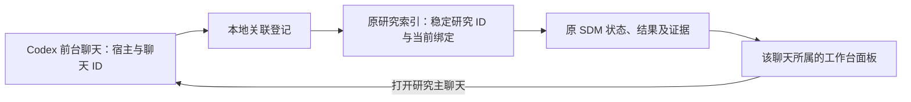

> 历史归档：保留文档重组前已发布的内容，来源提交 `bfd2c30`。原文中的状态、计划和验收按当时版本解释。当前说明见[文档中心](../../README.md)。

# Codex 聊天与研究工作台的双向关联设计

日期：2026-11-14。状态：设计方案，尚未实现聊天登记、页面自动跟随或前端聊天跳转。本轮只核对源码、当前聊天身份和官方宿主能力，没有切换聊天、发消息或操作研究。

## 1. 当前缺口

当前工作台按项目目录、研究索引和研究编号读取 SDM 原记录；浏览器 URL 的 `study` 参数选择研究。`bmad_ml.inspect()` 返回“当前 Codex 会话”这个静态入口描述，不登记当前聊天 ID。

`research_dashboard_data.py` 的绑定信息有可选 `origin_codex_chat_id` 读取口，以及后台 Context 的 `execution_thread_id`，但没有完整的前台聊天登记/反向导航实现；`conversation_sync` 明确为 false。当前不能声称切换任意 Codex 聊天时工作台已自动跟随，也不能把后台线程当成用户讨论的原聊天。

## 2. 身份与职责

| 身份 | 用途 | 约束 |
| --- | --- | --- |
| 项目/工作区身份 | 限定文件、索引与界面服务范围 | 同目录可有多个聊天/研究；同 Git remote 的不同克隆或工作树不自动等同 |
| SDM 研究身份 | 持续追踪目标、实验、证据与脉络 | 复用已有研究 ID 与索引，不以聊天标题替代，不修改旧冻结内的 `project_id` |
| 前台聊天引用 `host_id + thread_id` | 用户讨论、主聊天导航和相关聊天 | 标题只展示；改名不改变绑定，分叉产生新身份 |
| 后台执行/审议线程 | 原实施 Context、模型调用及完成回执 | 从原记录读取，不能冒充前台主聊天，也不保证都可在桌面导航 |

一个研究可以关联多个前台聊天，保留一个默认主聊天；一个聊天也可涉及多项研究，但每个项目上下文只有一个明确的当前展示研究。查看者不自动成为主聊天，更不取得第二份调度权。主聊天是讨论和导航归属，实际执行权仍属于原 SDM 协调器/Guard。

创建来源聊天、当前主聊天和当前页面来源聊天应分别记录：创建来源保留历史，主聊天可经明确移交改变，页面来源用于返回本次查看的聊天，三者不能共用一个可覆盖字段。

## 3. 推荐结构

本地关联登记放在项目 `.bmad-ml/` 下，是交互元数据，不是另一份科学账本。登记关系至少包含项目引用、聊天引用、研究引用、角色（主聊天/相关查看）、当前展示研究及绑定来源。反向查询由同一关系表派生，不维护两份互相冲突的真相。

不把聊天关联塞进原冻结配置、Manager plan 或 Guard；否则一个页面关联变动就会改变执行摘要。研究恢复后仍由原研究索引解析当前配置；浏览绑定本身不授予恢复、提交或更换运行时的权限。

## 4. 从 Codex 自动关联到工作台

### 首次在聊天中使用 Skill

1. 获取可信的当前聊天身份与宿主。当前本机能读取 `CODEX_THREAD_ID`，并可用受支持的聊天读取工具核对 ID、宿主与项目元数据；这只是已观察到的本机能力，不冒称所有 CLI/远程环境都有同样接口。
2. 按“此聊天已有绑定 → 用户明确指定的研究 → 明确新建研究”的顺序路由。没有绑定而项目内存在多个研究时，显示项目研究列表，不按最近修改的 `CURRENT.json` 或聊天名称猜。
3. 新研究登记当前聊天为主聊天；明确继续已有研究则关联到该研究，保留原主聊天，除非用户明确移交主聊天归属。
4. 启动/复用原项目工作台，在该聊天所属面板中打开带有明确研究和聊天引用的 URL；研究身份仍从原索引校验，URL 字段不充当授权。
5. 下次在同一聊天使用 Skill 时，直接恢复它的研究视图。会话重命名不影响结果，用户无需填写 UUID。

宿主本次调用上下文应当优先于环境变量。`CODEX_THREAD_ID` 只是在本机观察到的身份候选，不是桌面焦点 API；后台进程还可能继承父进程环境，不能据此把自己登记为前台主聊天。应核对身份确实属于本次前台调用；无法取得可靠上下文时显示未绑定，避免伪造自动关联。

仅做 ResearchPilot 工程维护的聊天，不因工作目录相同就自动认领某项模型研究。维护框架代码的聊天可以查看研究，但不能据此覆盖其原主聊天或变成一个研究控制器。

### 只点击切换聊天，没有发消息

普通 Skill 不是一直运行的桌面插件，不能假定点击聊天就会重新执行它。

首选方案是复用宿主的会话所属面板：每个已关联聊天持有自己的工作台标签与研究 URL，按聊天显示相应页面。当前 `open_in_codex` 工具明确支持把面板交给调用聊天；跨聊天隐藏面板可排队到该聊天显示时打开。但“本机两个既有聊天来回切换，面板正确恢复”仍需实际 UI 验收，不能只看接口说明就标成已实现。

若面板在某个宿主中不具备所需的会话归属行为，则保留明确的“打开本聊天研究”入口，不冒称纯切换自动跟随。

独立浏览器窗口默认固定查看所选研究。要增加“跟随当前 Codex 聊天”，必须先核验宿主提供的前台聊天选择/焦点事件，再用该事件查询关联。原 app-server 的 loaded/active 状态不是桌面焦点；不能用最近活跃时间、线程列表或另一 app-server 的事件来猜当前窗口。

若将来支持多个桌面窗口，跟随应限定到明确的窗口和页面上下文，不能用全机“最后活跃聊天”覆盖所有页面。窗口标识和选择事件同样需要宿主实际支持及验收。

## 5. 从工作台打开 Codex 聊天

从某个聊天打开的研究页，首要按钮是“返回关联聊天”，回到该页面的已校验来源聊天；另提供“打开研究主聊天”。独立打开而没有来源聊天的页面，默认显示“打开研究主聊天”。关联信息中列出其他相关聊天；按钮显示真实聊天标题，定位使用技术 ID。后台执行 Context 单独标为“执行线程/记录”，不占据这些前台聊天按钮。

本机主聊天优先使用官方支持的 `codex://threads/<thread-id>`。在受支持的宿主交互中，也有 `navigate_to_codex_page(threadId)` 导航工具；普通本地网页不能直接把 Agent 的 MCP 工具当作自身 JavaScript API。第一版可以由用户点击本机深链；若需要宿主桥接，桥接只接收校验过的已登记聊天引用并执行导航。

打开聊天只导航，不新建聊天、不发送提示词、不启动 turn、不调用 `thread/resume` 去接管执行、不重启研究。打开失败显示“此设备当前无法打开该聊天”，保留研究页；不自动寻找同名聊天替代。

官方深链文档明确描述本地聊天。远程宿主、另一台电脑或另一账号的路由，需要独立核验可达性和受支持的宿主入口；不能自行拼接未记录的 host 查询参数来宣称可用。已归档或不可用聊天应按宿主真实状态提示，不因点击查看而自动取消归档或更换主聊天。

## 6. 多聊天、多研究和研究恢复

| 情况 | 预期行为 |
| --- | --- |
| 同一项目，聊天 A 看研究 X，聊天 B 看研究 Y | 两个面板分别保持 X/Y，禁止项目级全局“最后聊天”覆盖 |
| 两个聊天都查看研究 X | 共用原 SDM 事实，保留明确主聊天；不创建第二控制器 |
| 在聊天 A 的研究页临时查看研究 Y | 标明临时/固定查看；不悄悄把 A 的当前研究和主聊天归属改成 Y |
| 一个聊天管理多项研究 | 记住该聊天明确选择的当前研究，并保留其他关联；有歧义时给研究列表 |
| 聊天改名、重开客户端 | 按 ID 恢复，标题按可用元数据刷新 |
| 聊天分叉 | 新聊天 ID，可继承相关查看关系，但不自动继承主聊天或执行归属 |
| 原聊天删除/不可达 | 保留历史引用，提示不可用；由用户明确选新主聊天 |
| 研究更换宿主或恢复冻结 | 展示仍指向同一逻辑研究，由原合法索引解析当前运行；不迁移 Guard、Context 或科学证据 |
| 项目移动/复制/新增工作树 | 通过显式项目身份/别名核对；不能仅凭目录名或 Git remote 自动认领旧研究 |

页面头部应持续显示当前研究、关联主聊天、固定/跟随模式。双向导航不代表聊天全文同步；前台提出的新目标或约束是否已被后台消费，仍须沿 SDM 原控制链记录版本和确认，不能用页面显示关联成功代替。

## 7. 实施与验收次序

1. 先落本地登记与当前聊天可信身份解析，扩展原 `inspect`/索引投影；缺身份时明确未绑定。
2. 在已有工作台上增加主聊天/相关聊天信息和本机深链按钮；不改科研调度。
3. 按聊天打开/复用所属面板，实际验证两个聊天、同目录不同研究及重开客户端的行为。
4. 再决定独立窗口实时跟随是否有可用宿主事件；无事件就保留固定查看和明确入口。

关键验收：不按同目录/最后活跃误绑；点击深链回到确切原聊天；改名和重开不丢；分叉/失效不抢主聊天；恢复不改原控制身份；只导航不发消息、不调模型、不训练；旧未绑定研究仍可查看，不补造历史聊天 ID。

本次尚未实现或实测这些 UI 行为。研究绑定、焦点跟随和聊天上下文/控制同步是三种不同能力，应分别报告。

## 8. 依据

- 当前源码：`bmad_ml.py inspect`、`ensure-dashboard.py`、`research_dashboard_data.py`、`research_context.py` 和工作台 URL/SSE 路由。
- 本轮本机观察：当前进程聊天 ID 与宿主聊天读取工具返回一致；只读核对，没有打开其他聊天或枚举无关内容。
- [官方桌面深链说明](https://learn.chatgpt.com/docs/reference/commands)：已有本地聊天的 `codex://threads/<thread-id>`。
- [官方 app-server 说明](https://learn.chatgpt.com/docs/app-server)：线程/turn/运行状态事件；本轮未从该文档核验到桌面当前选中聊天的焦点订阅接口。
- 当前宿主工具说明：`open_in_codex` 的会话所属面板及 `navigate_to_codex_page` 的指定聊天导航。工具可用不等于普通网页直接有调用能力。

## 方案会话与原有绑定的区别

新组件研究另有研究专属的持续方案会话，由原模型调用链管理。当前该科学方案上下文已与实施Context统一为研究主会话；来源聊天仍是另一种入口身份，独立质询保持隔离。关联详情展示两条工作会话，不新增未经支持的原生聊天跳转按钮。具体见[方案上下文说明](../../../skills/sdm-module/sdm-lifecycle/references/planner-context.zh-CN.md)。

## 当前双会话绑定

新组件研究的研究主会话已经统一承接设计和实施，原execution_thread_id兼容字段指向该主会话；独立评审使用自己的持续会话。工作台的研究关联详情分别显示两条会话、工作轮次和待确认状态。来源聊天仍是用户入口身份，不能从目录推断或覆盖。后台主会话不是前台聊天全文的副本，用户无需手工转发两条后台会话或逐个整理侧栏。当前规范以[双会话说明](../../../skills/sdm-module/sdm-lifecycle/references/planner-context.zh-CN.md)为准。
