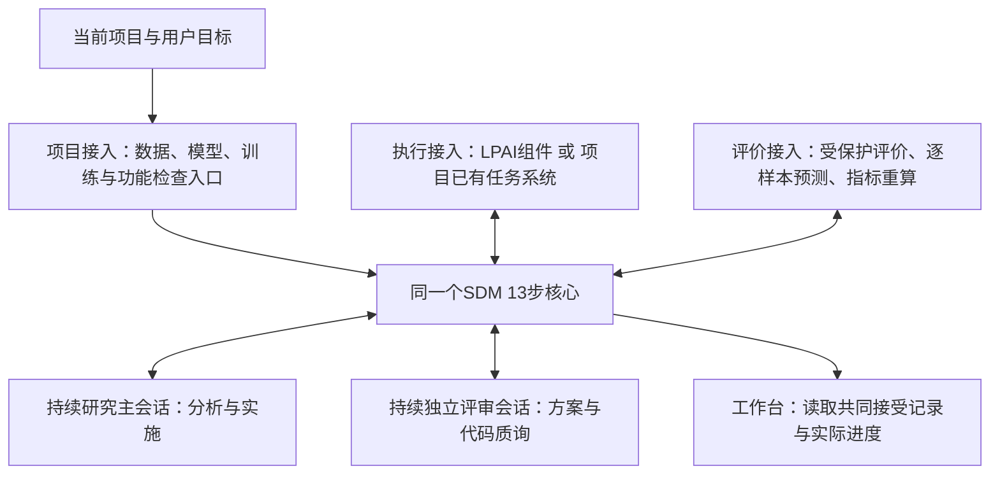

> 历史归档：保留文档重组前已发布的内容，来源提交 `bfd2c30`。原文中的状态、计划和验收按当时版本解释。当前说明见[文档中心](../../README.md)。

# 通用项目交付：同一SDM 13步，三类接入

ResearchPilot继续使用同一条SDM 13步。模型项目提供“训练什么、怎样训练和评价”的事实，执行接入负责把确切任务交给已配置环境；规范校验、方案与代码审议、授权、预算、结果接续和恢复由共同核心负责。更换模型项目或平台，不另建一条研究流程。

## 1. 从当前项目开始，而不是从作者的示例开始

安装完整ResearchPilot Skill，在Codex中打开自己的模型项目，选择ResearchPilot并发送需求，例如：

> 使用 $researchpilot，先检查当前项目的训练入口、数据划分、基线和评价程序。目标是把验证集的主要指标提升到指定值；先说明你读到了什么，缺少什么，暂不提交训练。

Skill读取当前目录的源码/配置候选、已有研究索引和项目本机能力描述。若存在`researchpilot.project.json`，会核验其声明文件及摘要；否则Codex先调查项目已有材料，再整理项目接入事实。不能从代码得知的数据权限、目标、资源或停止条件才向用户询问。用户不必手写内部JSON，也不能把某次示例配置当成新项目的默认研究计划。

准备输入、原契约与初始方案后，确认资源和执行范围，沿原`research_initialize.py`准备冻结研究，再启动原监督器。安装、只读发现和初始化准备本身不提交训练。后台只有在共同方案/代码审议、适用契约及提交门禁通过后才分配任务。

## 2. 哪些内容分开，哪些始终共同

| 接入部分 | 提供什么 | 不由它决定什么 |
| --- | --- | --- |
| 项目 | 源文件、训练/预检/评价命令、可改文件、数据与划分身份、输入输出、训练范围 | 是否可以跳过适用SDM契约、是否获准提交 |
| 执行 | 探测环境、提交、查询原请求、读取任务、收集产物 | 科学判断、预算续期、未知请求重发 |
| 评价 | 评价程序、标签或连续目标含义、预测、主要指标、优化方向、检查点选择规则 | 用平台成功代替有效结果，或用得分代替科学支持 |

账号、凭据、SDK、资源池、队列和输出位置保留在项目本机环境，不能写进公共Skill。`researchpilot.project.json`描述可移植的项目事实；`.bmad-ml/CAPABILITIES.json`和`.bmad-ml/ENVIRONMENT.json`保留当前机器能力。相同Skill可以用于多个项目，各项目仍要有自己的事实、权限和记录。

## 3. 13步如何承接这些接入

1. **明确目标与可证伪问题。** 从实际需求形成需求和研究简报（原S01/S02）；目标是待检验要求，不能预先写成必须成立的科学结论。
2. **核对数据、评价契约与执行范围。** 项目事实进入原G契约，仍检查G02引用闭包、真实数据/划分、标签或连续目标、输入输出、评价与资源身份。
3. **明确比较起点与基线依据。** 基线记录（原B01）绑定实际基线源文件和比较条件。声明的基线、实际复现结果与强基线资格分别报告。
4. **设计实验与运行计划。** 原实验科学内核与生成—质询审议使用真实项目事实；任务数、训练范围和停止条件只采用当前授权。
5. **检查就绪并固定依据。** 固定规范依赖、运行代码、项目文件、比较身份与执行配置。之后不能修改旧冻结以“修复”历史证据。
6. **准备上下文并实施变更。** 持续主会话消费实际结果和已接受方案，只改项目允许的文件；源码文件名和框架由项目决定。
7. **审查代码并完成工程验收。** 独立评审检查确切变更；静态检查、载荷摘要及保护范围由共同提交路径核验。
8. **执行实施后预检。** 项目声明适用检查及检查程序。已授权远端环境分配后执行，结果必须覆盖全部声明；不能用一句“通过”代替实际证据。
9. **登记运行并受控提交。** 原Run/Attempt先登记，平台提交管理器（Manager）的原写入事务与防重记录（Guard）管理唯一请求。LPAI组件只是其中一个执行接入。
10. **观察训练并回收结果。** 沿原持久轮询、退避、事件交接和收件机制，核对同一编号、原请求和确切载荷。失败保留原证据；结果未知只查询原请求。
11. **核验评价与适用专项结果。** 核验固定划分、完整产物、检查点及逐样本指标。新接入不再强制二分类形状或宏平均F1；不支持的评价形式明确阻断。
12. **汇总证据并独立审查。** 仍使用完整账目、原S10五视角和独立审查，不由项目适配器自发给出科学通过。
13. **形成结论并决定后继或归档。** 目标、预算、有效结果与科学判断分别处理；后台把真实结果交给同一主会话提出下一方案，由独立评审质询，再回到共同门禁。没有确认性协议时，不能把自适应验证达标表述为科学假设获证。

步骤8的远端功能检查依赖步骤9完成资源分配，先检查再完整训练。13步是职责及依赖表达，并不要求每轮重复13次调用。

## 4. 已有代码如何保证只有一套通过标准

| 共同职责 | 实际代码 | 接入变化 |
| --- | --- | --- |
| 控制与推进 | `ResearchPipeline`、`research_replan`、`research_acceptance.DISPATCH` | 原控制器改用中性公共导入，历史类名保留兼容别名；项目分析准备器不实现循环或模型客户端 |
| 规范与科学判断 | `AssetBundle`、`lifecycle_rules`、原实验内核、S10、`evaluate_scientific_decision` | 项目事实转换为同一规范对象；首轮/后继/回放共用原接受路径 |
| 提交与恢复 | `ManagerCore.apply`、`submission_guard.Guard` | 项目执行Manager继承原写入事务，只适配平台事实和提交/查询操作 |
| 等待与通知 | `ComponentSource.cycle`、原事件/收件/完成交接 | 项目事件源继承原轮询与持久交接，只替换产物收集；不是靠飞书消息唤醒聊天 |
| 评价 | `project_results`、`project_preflight.verify_report` | 新项目独立重算和功能报告验证；远端报告与本地回放共享同一个功能报告检查函数 |
| 展示 | 原核心接受投影、`research_dashboard_data` | 按项目主要指标和方向显示；前端不另判通过 |

部分历史模块或协议字段仍含`component`/`lpai`，用于保持旧记录和调用身份，不表示新研究必须使用组件。用户入口及Skill名称统一为ResearchPilot。

## 5. 与原SDM规范的继承及必要演进

13步与原21步的合并关系保持，[逐项来源说明](../../../skills/sdm-module/sdm-lifecycle/references/sdm21-to-13-evolution.zh-CN.md)中的职责不因项目接入改变。主要调整是把原来内嵌的二分类、PyTorch、固定文件名和LPAI组件假设移到相应接入。

有一项规范本身需要明确演进：原G07仅能表达离散类别，不能真实表达回归目标。现在在原G07语义校验器及所属schema增加连续值空间，要求目标名称、单位、范围和语义逐项对应；离散类别检查保留，G02依然要求原G07/G08引用闭包。没有用省略契约、伪造类别或另建回归流程解决。所属schema与目录摘要同时更新，新研究固定演进后的规范；原冻结继续使用原文件及摘要。这是本项目对保留原始SDM模板的明确扩展，不能称为上游原样不变。

## 6. 评价和平台边界

当前结果接入支持多类别分类准确率、宏平均F1、均值IoU，以及标量回归MAE/MSE；支持最后一轮或主要指标最优且最早并列检查点。分类均值IoU来自逐样本混淆计数，不能代替RoadModel分割/Pillar评价。其他结果形式、指标与选择规则需要补充接入和验证，不会自动套用现有分数。

项目训练、功能检查和评价入口由项目拥有；公共包只收集有界UTF-8源码与小型说明，大数据应使用已配置的远端只读数据入口及确切身份，不把真实数据或权重塞进Skill。当前载荷采用Python启动器及POSIX超时命令，执行环境需具备这些条件；这不是对任意操作系统或平台的无条件兼容承诺。

功能检查也要说明具体含义。本次NumPy示例的微型训练检查是：取每类两条训练样本，14次更新内损失下降；再以两次更新核对参数保存/加载后下一步完全一致，并检查完整训练使用原始初始化。它不要求六条样本全部分类正确，也不把损失下降作为质量达标。此前PyTorch二分类项目仍保留其四样本全部拟合及优化器/状态接续要求。不同模型的适用条件分别固定在其原G09运行校验器、审议和项目检查程序中；同一研究的远端执行、回收与回放共用该固定条件，不能在失败后修改条件来追认通过。

官方LPAI方式已连接原组件任务。项目命令方式要求固定驱动文件和`probe/submit/lookup/read/collect`五个操作，可接入现有远端任务系统，但平台账号、接口实现和部署验收仍须实际提供。`local-engineering`只允许非机器学习工程任务，拒绝本地训练。接口解耦不等于另一家远端平台已通过真实训练验收。

## 7. 验证和交接

2026-11-16首次通用接入验收完成真实CPU训练与原核心收口（包含两次工程接续）。示例使用720条二维坐标，按固定身份划分540条训练、180条验证，分为内环、中环、外环三类；输入是两个坐标，输出是三类概率与预测类别。它用于核验接入和持续研究链，不能代替RoadModel或泛化效果验收。

| 实际任务 | 执行与结果 | 在验收中的角色 |
| --- | --- | --- |
| `7ed7ecae-83a4-44a3-9594-afe9f0602da5` | 10轮成功，均值IoU 0.197732 | 较早有效任务；后续接续被工程缺陷阻断，不计入最终两轮链 |
| `26b2747e-1566-439a-b950-191e1360cee4` | 10轮成功，均值IoU 0.197732 | 最终同一研究的线性基线 |
| `feb2f3c3-47e5-463e-bb30-e2c87745afcb` | 10轮成功，均值IoU 1.000000，达到0.95目标 | 按实际基线分析、实施及独立审议后的后继 |

三个任务均为1 CPU、4 GiB、0 GPU。后台从线性基线的结果提出径向基函数特征改造，实际修改模型与实验说明，经独立方案及代码质询后提交后继；训练参数范围未放宽。训练、预测、划分、检查点和功能报告五项产物校验及逐样本指标重算通过，原账目、S10对象检查、科学裁决和目标停止路径完成。原科学结论仍是探索性、证据不足以确认假设；验证集达标不是确认性结论。

这次从首次启动到最终完成包含两次受控工程接续，修复了实际项目事实在代码审议中的传递、Windows深路径完成回执及恢复绑定问题。没有改写旧冻结、训练结果、通过条件或增加任务预算；保留同一研究的两条持续会话。最后一次接续后，由原后台独立完成方案、实施、评审、提交、回收和收口，前台只读观察。因此可以报告本次工作链验证通过，不能报告从首次启动全程无人介入验收通过。

非组件方式另做了一项真实本地CPU整数校验任务：通过原提交事务及防重记录，模拟提交成功但响应丢失，第二次写入被拒绝，查询找回原任务且重复回放不新增写入。它只证明执行接口与恢复复用，未运行本地机器学习，也未验收第二家远端平台。

固定输入的124项离线控制、50项研究衔接与展示检查、4组前端检查、9项安装检查通过；随后入口只读发现新增1项、恢复修复新增4项定向检查通过。原550份保护文件、源码Git索引及项目索引保持，旧研究和定时器未恢复。可移植事实与原件摘要见同目录`GENERIC-DELIVERY-VALIDATION.json`。

接手人使用自己的账号、当前项目与资源重新核对权限，再做一个独立CPU任务。作者的示例、任务UID和机器能力不能作为同事环境已经可用的证明。旧研究的冻结、Context、Guard、索引和暂停状态均不迁移。

## 8. 2026-11-17独立验收：研究执行无需前台接管

本次使用已经交付的实际ResearchPilot Skill，新建独立研究，不恢复先前案例，也不把旧结果计作新轮次。仍采用上述720条三类二维环形数据及固定540/180划分，从声明的线性工程基线开始；没有提供旧后继配方或代码。最多两个新任务，各1 CPU、4 GiB、0 GPU、10轮及最多16次功能预检更新，原预算不续增。

| 真实任务编号 | 有效结果 | 角色 |
| --- | --- | --- |
| `162b9665-730c-46a7-8c1c-e213cfba7449` | 10轮成功，均值IoU 0.197732 | 基线 |
| `7f8ae8f1-1a96-43dc-b5e6-4082031be4a5` | 10轮成功，均值IoU 1.000000 | 真实结果驱动的后继 |

后台在首轮结果后继续同一研究主会话，提出适合同心环的径向特征表示；经过原独立评审会话质询，再实际修改项目允许的模型与实验说明文件。训练参数、数据划分和受保护评价保持，经独立代码评审及原提交门禁后自动提交第二任务。两轮的五项产物与逐样本指标核验通过，原Run/Attempt账目、S10对象检查、科学裁决和停止流程完成。主要指标达到0.95目标；质量目标与工作链验收分别记录。

从首次启动起，研究分析、实施、审议、提交和收口没有前台代改或工程接续，研究宿主没有前台重启；同一两条持续会话累计13个原生工作轮次。原连续链检查确认存在实际受审后继，全部后台工作完成后监督器自行退出。

需要准确保留一项展示侧操作：启动后，前台更正了工作台索引的schema和项目根目录，只重新启动只读网页服务；没有改冻结研究、方案、模型、审议回执、提交或研究后台。该操作单独留有记录。因此可以说研究执行全程没有前台接管，不能说整个验收期间前台没有做过任何修改。

本次361份冻结输入和1623份既有保护文件摘要保持，其中包含原550份项目保护文件；源码Git与项目索引、实际安装保持，旧研究和定时器未恢复，没有创建数据资产。仅补充本轮验收记录，未修改产品执行代码。前一日两次工程接续的记录保留，不追认成无接管运行。

本例仍是单种子、自适应固定验证的简单合成问题。原科学结论为inconclusive；模型得分不能证明泛化、框架因果收益、RoadModel/Pillar指标或另一家远端平台已验收。此次没有做OS重启或长期无人值守实验。

## 结果分析后如何自动进入下一轮（2026-11-17修复）

持续迭代由当前研究唯一的后台控制器负责。主会话完成方案后，控制器读取已接受方案，
派发代码实施、提交前检查和独立代码评审，通过同一提交门禁后才向训练平台提交后继任务。
后台继续监测新任务，并把真实结果送回主会话，形成下一次循环。
用户无须在每轮分析结束后再发“继续”。达到停止条件、授权用尽或证据待对账时会明确停止。

初始化只准备配置。单独调用分析入口也只生成待实施请求；这两种情况都不能声称
“自主迭代已启动”。新研究统一使用初始化返回的冻结 `research_launch.py`，传入当前项目
根目录及配置。它只封装原监督器的启动、展示登记和实时身份核验，不另建训练循环，
不增加执行授权或预算。只有实时研究线程已接管，返回的 `automatic_iteration_active`
才为 true；HTTP服务能访问但研究线程未就绪时仍为 false。

已有或结果未知的启动记录不自动重试。旧研究保留原冻结、任务编号和执行记录，
通过原恢复入口核对并接续；更新Skill不会自动恢复旧研究或改变其已授权范围。

### 为什么平台有任务，而工作台没有记录

工作台按当前项目的登记索引读取研究，不是整个LPAI账号的任务总览。
配置与存储须位于同一项目范围；其他项目的任务应打开所属项目的工作台。
新启动入口会自动登记；发现无效索引、配置不可读或越出当前项目时会显示提示。
工作台显示项目根目录，并核对原后台进程；保存的“运行中”记录不能覆盖实际已退出的状态。
同名前缀不能证明重复提交，核对应使用研究编号、轮次、请求键和平台UID。

### 已验证与尚未验证

本轮验证使用离线控制替身，覆盖启动接管、重复启动拦截、已停止/未知启动不重放、
项目登记隔离、后台退出提示，以及原控制器分析→实施→评审→后继提交的多轮状态推进。
不调用真实模型、不提交训练任务。它验证机制，不能替代同事机器上的RoadModel运行复验。

## 探索起点、比较对象与阶段基线

第3步“明确比较起点与基线依据”保留原SDM比较定义和基线管理职责。没有历史结果也可先定义真实起始配方及评价约定，再执行首轮探索；原B01不被当成高分、复现完成或正式锁定证明。

后继继续使用原候选选择与独立审议。实施前核验选定候选与原接受决定一致，并复核结果、比较协议和原配方，不默认取第1轮、最后一轮或只按显示排序选择。步骤13可据证据选择持续比较对象并回到第3步处理阶段基线；正式复现/锁定仍需原要求的证据。旧研究保留原冻结，当前修正只用于新冻结，不重写其既有方案、授权或回执。
