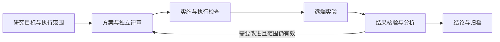

[返回项目介绍](../README.md)

以下安装与使用命令在仓库根目录执行。

# ResearchPilot

**在 Codex 中开展由实验结果驱动的模型研究。**

ResearchPilot 将方案设计、代码修改、独立评审、远端训练和结果分析连接为持续研究流程。用户明确目标、预算和可修改范围后，系统根据真实实验结果提出下一轮方案，在授权范围内继续迭代；工作台展示方案、实验及其依据。

适用于已有训练代码和数据、需要反复开展模型实验的算法项目。项目的训练、评价和执行环境需要完成接入。

## 核心能力

| 能力 | 产品行为 |
| --- | --- |
| 对话式研究入口 | 从当前项目读取代码、配置和已有结果，补齐目标、评价约定与执行范围，形成可执行方案。 |
| 结果驱动迭代 | 回收实际结果后开展分析、修订方案、实施和评审；满足执行条件后提交下一轮。 |
| 独立评审 | 研究主会话负责分析与实施，独立评审会话检查方案和代码，保留逐轮意见与修订记录。 |
| 研究工作台 | 查看运行状态、实验指标、方案演进和候选分支，追溯每轮实验的配置、结果与分析。 |
| 执行范围与恢复 | 按已确认的资源和停止条件推进；遇到暂停、阻塞或结果未知时保留记录，核对后接续。 |



## 两种任务范围

- **单次评测**：评测指定实现或权重并分析结果，报告交付后结束。
- **持续研究**：围绕目标开展实验，根据结果修改方案并继续执行，直至达到目标、用尽预算、用户暂停或出现需要处理的阻塞。

工作台分别显示结果分析是否完成、是否进入持续迭代，以及当前是否仍在自动推进。单次评测正常结束时不会显示为研究卡住。[任务范围与状态说明](../docs/TASK-SCOPE.zh-CN.md)介绍各状态的含义。

## 快速开始

准备 Python 3.11+ 和已登录的 Codex，在 ResearchPilot 仓库中为实际模型项目安装：

```powershell
git clone https://github.com/Inner-vic/research-pilot.git
cd research-pilot
python scripts/setup.py --project-root "D:\Projects\MyModel"
```

将示例路径替换为已存在的模型项目目录。安装会准备完整 Skill、项目所需的 Codex SDK 和本地工作台；训练平台的账号、权限与执行配置另行接入。

随后在 Codex 中打开该模型项目，选择 ResearchPilot，或发送：

> 使用 $researchpilot，先检查当前项目的训练入口、数据划分、评价程序和已有结果。我要围绕主要指标持续改进模型。先整理方案与执行范围，确认后再提交任务。

Codex 会调查已有信息，并引导补齐缺项。方案、执行范围和相关检查就绪后，才能提交远端任务。详细步骤见[安装说明](../docs/delivery/INSTALLATION-MODES.md)和[使用指南](../docs/USER-GUIDE.zh-CN.md)。

## 工作方式与支持范围

ResearchPilot 以 SDM 的模型开发规范为基础，采用五个阶段、13 个步骤组织研究。前台对话用于需求沟通，后台研究控制器负责持续推进，工作台读取同一份研究记录。浏览器关闭后，已启动的研究可继续运行；持续推进仍依赖本机后台、网络和已配置服务可用。

当前提供官方 LPAI 组件接入和项目命令驱动接口。通用评价接入覆盖规定格式的多类别分类和标量回归；其他评价形式需要补充适配。完整说明见[项目接入](../docs/GENERIC-DELIVERY.zh-CN.md)与[支持范围](../docs/EXECUTION.md)。

[SDM 继承与流程整合](../docs/COMPARISON-WITH-BMAD-ML.zh-CN.md)解释原21步的职责如何组织为13步；[自主迭代运行机制](../docs/AUTONOMOUS-ITERATION.zh-CN.md)说明监控事件、状态接续、AI判断和下一轮执行如何协作。

## 文档

| 文档 | 用途 |
| --- | --- |
| [安装说明](../docs/delivery/INSTALLATION-MODES.md) | 安装、更新、项目环境与常见安装问题 |
| [使用指南](../docs/USER-GUIDE.zh-CN.md) | 发起任务、确认方案、查看结果、暂停与继续 |
| [项目接入](../docs/GENERIC-DELIVERY.zh-CN.md) | 训练、评价和远端执行接口的准备要求 |
| [研究流程](../docs/WORKFLOW-GUIDE.zh-CN.md) | 五个阶段、13 个步骤的职责与推进条件 |
| [系统架构](../docs/ARCHITECTURE.md) | 入口、会话、控制器、执行接入和工作台的协作 |
| [支持范围](../docs/EXECUTION.md) | 已支持能力、验证范围与已知限制 |
| [版本变更](../docs/CHANGELOG.md) | 面向使用者的版本变化与升级影响 |

完整导航见[文档中心](../docs/README.md)。案例、验收报告和设计来源收录于[参考资料](../docs/archive/README.md)。
