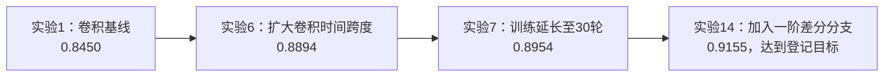

# 运行案例：指骨轮廓分类

这是从一项已完成的 **LPAI 组件库真实研究**整理的脱敏案例。用于理解 ResearchPilot 怎样提交、等待、核验、分析并修改方案；查看本目录不会创建研究或启动训练。

想跟着操作，先看 [一步步使用](RUN-GUIDE.zh-CN.md)。只想核对案例，可在 Codex 里说：

> 使用 ResearchPilot，带我阅读 examples/distal-outline。先说明任务、数据、主指标和研究主线，再解释两个失败方案以及为什么回到历史最优。先不训练。

## 任务与数据

[DistalPhalanxOutlineCorrect（Zenodo）](https://zenodo.org/records/11186597) 是公开的单变量序列分类数据，原问题是判断提取的指骨轮廓是否正确。这里使用的是轮廓序列，**不是直接训练医学图像诊断或分割模型**。数据来自 TSML/UCR 归档，使用数据时请遵循原记录的引用说明。

本次只使用 TRAIN 文件：600 个样本、长度80、2类；按固定协议划分449训练/151验证（验证类别支持数56、95）。随机种子42。原始 TEST 未使用。数据、划分、检查点选择口径在多轮之间保持，原文件 SHA256 见 [case.json](case.json)。仓库不附原始训练数据、逐样本记录或权重。

## 结果摘要

- 登记目标：内部验证集 macro-F1 ≥ 0.90，按目标迭代，无预设实验次数上限。
- 有效初始基线：实验1，0.8450。
- 最终最优：实验14，0.9155；比初始基线增加0.0705。
- 主线：实验1 → 实验6 → 实验7 → 实验14。其余实验保留为分支和负面证据。
- 训练在远端进行，20轮起步，后续部分实验30轮；指标对应按固定规则选出的检查点，未必是最后一轮。



## 全部有效实验

这里的“实际基线”是该实验真实选用的候选，不默认等于上一行。分数较差的实验仍保留，但不会自动替换更优候选。

| 实验 | 实际基线 | 本轮改动 | macro-F1 | 本轮后保留的最优 |
| --- | --- | --- | ---: | --- |
| 1 | 初始基线 | 建立卷积分类基线 | 0.8450 | 实验1 |
| 2 | 1 | 四段池化对照 | 0.7927 | 实验1 |
| 3 | 1 | 改用分组归一化 | 0.3862 | 实验1 |
| 4 | 1 | 加入原始输入旁路 | 0.8093 | 实验1 |
| 5 | 1 | 使用类别加权损失 | 0.8427 | 实验1 |
| 6 | 1 | 扩大卷积时间跨度 | 0.8894 | 实验6 |
| 7 | 6 | 延长至30轮训练 | 0.8954 | 实验7 |
| 8 | 7 | 训练后段降低学习率 | 0.8894 | 实验7 |
| 9 | 7 | 平均与最大统计融合 | 0.8675 | 实验7 |
| 10 | 7 | 累计归一化统计 | 0.8789 | 实验7 |
| 11 | 7 | 稠密卷积替换膨胀卷积 | 0.8856 | 实验7 |
| 12 | 7 | 增加恒等残差连接 | 0.8873 | 实验7 |
| 13 | 7 | 原始坐标多层感知机 | 0.7274 | 实验7 |
| 14 | 7 | 增加一阶差分卷积分支 | 0.9155 | 实验14 |

### 值得观察的三个决策

1. 实验2退化后，实验3从实验1起步；实验3的混淆矩阵为 `[[0,56],[0,95]]`，全部预测成同一类别。总体准确率仍约0.6291，而 macro-F1 只有0.3862。需要查看类别行为，不能只盯一个看似不低的总准确率；这里也没有证据证明唯一根因。
2. 实验8—13均未超过实验7。系统保留实验7作为候选，尝试训练过程、统计融合、归一化、结构和另一类模型假设，而不是沿最新差结果不断调参。实验13的多层感知机不理想后，实验14回到实验7再做新的差分分支对照。
3. 实验14达到登记验证目标后结束该研究，不为了“跑满14次”而停止，也不擅自提高目标继续提交。

## 后台实际怎样接续

初始方案经确认 → 提交真实组件库任务 → 后台按原任务身份观察排队/训练 → 终态后回收并核验产物 → 对比当前最优、最新结果及原始证据 → 生成方案并由独立角色质疑/审议 → 实施与代码核验 → 原协调器再次提交。

审议按条件循环：要求修改则继续修订，需要证据则先补证，通过后才进入实施；不按固定讨论轮数强行通过。方案选择不能绕过执行授权、代码核验或任务 Guard。等待期间不需要用户定时向聊天发送“继续”。工作台展示同一研究记录，方案节点可局部展开审议/实施/训练过程。

## 准备阶段的故障单独计算

原研究还包含一次事先声明的接口故障验收：输入实际只有1通道，而初始模型声明2通道。任务真实报错后，修复这一接口不一致，再得到实验1。**该准备失败没有训练分数，不属于表中14次有效实验。** 新同事默认采用接口正确的基线，不需要故意制造这个故障。

## 文件与证据范围

| 文件 | 用途 |
| --- | --- |
| [RUN-GUIDE.zh-CN.md](RUN-GUIDE.zh-CN.md) | 从加载Skill到确认新研究、观察结果和暂停/完成的引导 |
| [research-brief.json](research-brief.json) | 给Codex读取的初始任务/数据/评价说明；不是可直接启动的运行配置 |
| [case.json](case.json) | 14次实测结果、实际基线、配置、混淆矩阵与候选保留关系 |
| [provenance.json](provenance.json) | 原始已核验产物摘要；不公开原任务身份、宿主路径或完整日志 |
| [verify_case.py](verify_case.py) | 只读校验文件摘要、指标算术和主线，不调用模型或平台 |

```sh
python examples/distal-outline/verify_case.py
```

这里的数值来自真实归档产物；公开的是可校验摘要，不是完整公开平台日志或“零人工接管”的证明。固定内部验证集经过多轮自适应选择，单种子达到0.90不等于未使用TEST上的泛化验收。新研究应以自己的真实任务和结果核验，不把案例分数直接当成新运行结果。
