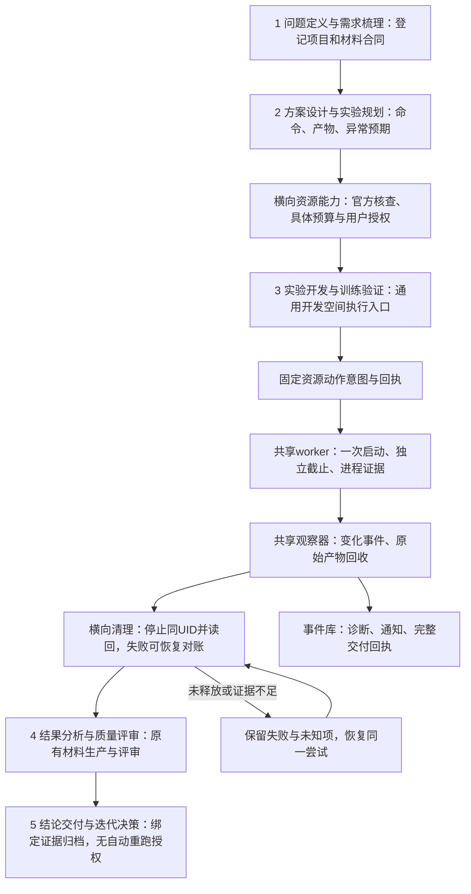

# 通用开发空间执行与清理合同

这是现有执行、资源、证据与评审能力的共享实现，不增加节点，不改变34节点的职责、依赖或策略。
入口属于已授权的开发空间短案例执行；它不替代正常训练的S12/S13、节点15放行或完整34节点验收。
项目声明工作负载与材料格式，禁止为每个案例复制提交、观察或回收控制器。

## 公开入口

新项目可在`devspace_main_workflow`中声明`initialization`、`evaluation`和`decision_criteria`，分别作为研究记录的初始化、评估范围/选择规则和判定依据。省略时保留旧RoadModel记录默认；分类、回归等新任务应声明自己的事实，不沿用权重初始化或mIoU标签。这些描述不替代实际工作负载结果及检查。

执行和watch共用同一选择规则：声明`devspace_study`时走原Study；否则声明`devspace_main_workflow`时走主流程；两者都没有才使用独立执行器。单轮主流程同样先完成准备和方案评审，不能因为没有Study而绕过。后台观察仍要求已有执行及原授权，不自动启动新任务。

已有输出若包含独立执行器的`execution.json`，但没有主图日志/准备失败记录，继续原独立恢复与收尾，不能中途补套主图。原冻结代码仍优先使用；采用修复后的新主流程需新尝试目录。新建目录不会通过这一兼容分支跳过准备。

1. 在项目JSON配置 `devspace_execution.version=1`、`owner`、绝对 `submission_registry` 和 `plan`。
2. `run_project_pipeline.py --project PROJECT --inspect-devspace-plan` 仅检查本地配置、给出摘要和预算；不查询平台，不产生执行授权。
3. 先用官方SDK/CLI核实账号资源和操作能力。保留现有调查证据，选择支持的 `official-cli` 或明确授权的 `native-ui`，记录 `route_evidence`。网关待确认不能推断飞书已送达；审批/认证错误不能自动切换路径重写。
4. 用户确认具体方案后，保存 `authorization: {confirmed: true, plan_digest: 检查结果摘要, source_ref: 原始授权引用}`。不得由程序自动填入确认。
5. `--devspace-execution --output ATTEMPT` 推进一步；真实空间还必须显式 `--allow-devspace-live`。本地CPU用 `transport=local-cpu`，真实空间用 `ssh`。
6. 可加 `--watch-devspace` 使用同一共享观察循环，遇待处理动作、故障或评审等待则返回。它不是定时唤醒AI；只有事件进入原有通知队列。部署时按原有冻结运行时方法绑定版本，不能修改运行中服务或另开重复观察器。
7. 对同一配置、同一输出再次调用即恢复，不创建新尝试。不要改变run_id/输出目录来规避未知启动结果。
8. 已授权后台运行时使用`--devspace-execution --supervise-devspace --allow-devspace-live --output ATTEMPT`。独立本地父进程监督唯一`--watch-devspace`子进程，异常退出后恢复同一配置与目录；等待原生动作、评审或明确故障时正常交接，不循环重提。启动回执须先单独绑定，不与supervisor参数混用。

`plan`字段：

|字段|合同|
|---|---|
|`run_id`, `resource`|稳定请求标识；资源精确uid、namespace、route。真实空间另含name、cluster、绝对官方cli_path。不会创建空间或组件|
|`transport`, `remote_root`|local-cpu或ssh；每个尝试独立绝对目录，禁止链接/路径穿越|
|`argv`|用户授权的工作负载参数数组；不会执行日志或诊断报告中的文本|
|`inputs`|相对name、绝对path、原始SHA256；启动前核对并上传，不导入项目模块|
|`artifacts`|必须回收的相对文件列表；有界下载，缺失保持不完整|
|`max_artifact_bytes`, `max_total_bytes`|默认分别8MiB和32MiB；完整模型checkpoint需要时，在授权计划内显式声明，分别最大1GiB。保留文件与总量双重校验，不自动放大默认值；当前回收使用有界内存编码，配置大文件时须考虑控制端内存|
|`artifact_transfer_timeout_seconds`|单次产物回收传输超时，默认45秒，可显式设为1至600秒；其他观察调用仍为45秒。这是传输故障边界，不是训练时长限制|
|`deadline`, `max_seconds`, `hourly_rate`, `budget`|UTC Unix截止、时长秒数、每小时报价、预算上限；实际截止取绝对截止和首次执行时间加时长的较早者；线性估价不等于账单|
|`limit_policy`, `limit_authorization_ref`|用户明确取消时间/预算硬上限时，设`user-authorized-unbounded`并引用真实授权；deadline/max_seconds/budget须显式null，不能用极大数字伪装无限。不设置截止不取消终态清理及异常取证|
|`ssh`|经官方资源读回核对的host/user/port及本地key路径；可显式提供`executable`为原生ssh/ssh.exe绝对路径，避免PATH命中批处理包装。固定host-key检查，不关闭SSH验证|
|`supervised_cleanup`|真实空间必须true；当前不承诺主机断电时仍能释放平台分配。值来自明确停止方案，不得自动当成有人值守|
|`adopt_existing_ready`|可选；只有明确授权接管该现有就绪空间时才设true|
|`route_evidence`|官方操作能力核查来源；本地模拟不需要|
|`expected_failure`|可选，精确exit_code、exception_type、marker、step；其他异常不得算作预期故障|
|`raw_materials`|已有sdm-material-preparation/v1合同；角色root可用`$artifacts`映射回收目录。接回已有工作区评审/决策/归档，不另写分析器|
|`health_policy`|可选的[工作负载健康合同](devspace-health.md)，进入原计划授权摘要；capsule独立判断并停止所属进程，收集健康/异常现场及比较图，资源停止仍走原清理与官方读回。不热改旧任务|

同时配置既有 `task_event_collector` 和 `task_event_service`，绑定唯一空间UID、namespace和cluster；它们在此只承载本地事件存储，不运行 `tasks get/pods` 采集器。
启用已授权通知时，配置 `task_event_wakeup.resource_kind=devspace`；本地模拟不得启用真实消息派发。

`lpai-agent`写接口的`pending_approval`只表明该网关返回待确认，不证明飞书卡片已发送或存在平台审批。核对已知能力与用户授权后，使用已授权的原生界面启动/停止并保存真实回执、官方同UID读回；不要反复要求用户处理不存在的飞书审批，也不要重发网关写入。旧尝试因该状态误入失败、且尚未启动工作负载时，可用`reconcile_devspace_native_start.py`对账真实原生启动，保留原错误、配置和请求身份；它不调用平台写接口、不授予新权限。

SSH以短bootstrap参数启动，安装版worker及请求通过标准输入传输，避免Windows完整命令行超过32767字符导致WinError206。固定host-key与输入摘要继续有效；平台日志、报告和模型建议不作为代码。控制端Python/SSH失败要保留winerror/errno等实际诊断，不能仅凭FileNotFoundError推断“文件缺失”。

共享GPU场景先用NVML元数据筛选允许且有足够显存的设备，再在导入/初始化CUDA之前按UUID收窄可见性。不要通过逐卡torch.cuda.mem_get_info探测闲卡：它可能在低剩余显存卡上创建上下文并OOM，即使另一张卡足够空闲。复用已有RoadModel的选卡方式；公开分类资产中的gpu_runtime.py提供同类隔离，须与工作负载一起作为固定摘要输入。初始化OOM、模型构建OOM与真实训练OOM分开诊断，按堆栈和阶段证据处理，不能统一归为batch过大或模型不适用。NVML快照不是独占承诺，阈值按工作负载选择。
可用`task_event_wakeup.trigger_kinds`声明哪些事件唤醒对话，例如process_terminal、collection_unavailable、cleanup_failed；其余事件仍持久留在收件箱，终态到达后一起读报告、交付和确认，不能静默确认。省略过滤时兼容原行为；禁止空列表。按当前目标选择触发条件，避免启动待办先占据唯一待交付消息而挡住终态。未知派发仍保留待对账，不绕过去重约束。
验证独立终态唤醒时，先启动并确认隐藏的共享观察进程与远端计算已运行，再结束当前对话回合；不要在前台等待并消费终态来冒充自动接续。收到事件的新回合须恢复同一输出目录，在既有用户执行/清理授权内回收产物、停止并读回、填写真实评审、归档和确认通知。消息本身不增加权限。
配置不能包含账号密钥明文；SSH配置只引用密钥路径。工作负载可依原项目方式读取其已授权环境。

## 执行与恢复

### 同一研究的多轮开发空间接续

沿用`--devspace-execution`、`--watch-devspace`和`--supervise-devspace`，在同一项目配置增加`devspace_study`；不增加节点、项目适配器或决策模型。单轮配置保持兼容。

- `version:1`、`study_id`、`objective`、`stop_criteria`、显式正整数`max_rounds`声明本次研究范围；轮数由任务确定，不是全局开发默认上限。
- `initial_parameters`、`allowed_variables`使用既有变量域合同；`parameter_flags`把各变量唯一绑定到argv中的长参数，参数值不作为shell代码执行。`result_artifact`必须已登记；`fixed_fields`声明跨轮相同的数据/源码/协议身份，`metrics`声明数值指标，`required_values`可要求checkpoint重载等报告事实。实际报告必须包含精确`parameters`；不把日志外观当作参数传递证明。
- `authorization`含真实用户授权引用、`confirmed:true`及`study_digest`。摘要为完整配置去掉`devspace_study.authorization`后的既有digest；模板本身的资源计划授权仍须有效。逐轮执行授权从该冻结范围继承，记录父决策与Study摘要，不伪造新用户确认；换资源、扩大轮数或超变量域不从评审得到授权。
- 同一输出目录保存Study配置、每轮声明配置、计划、原始产物、评审、观察与迭代决定。每轮使用既有执行器、Guard、事件库及原生启停/官方读回，不重复提交已完成轮次；不复用已经失效的运行/预检证据。首轮完成后先清理，再分析并推进下一轮。
- 当前Agent按真实原件填写已有评审response，单轮`action`仍可为`stop-analysis`；它只表示本次证据评审结束。`next_step.iteration.action`必须显式为`run-next-round`或`stop`。前者还须提供`parameters`、`changed_variable`、`hypothesis`、`expected_observations`，next_step的授权须existing且状态ready。共享入口核验恰好一个变量变化、不重复旧配置、前轮成功及清理完成后，自动生成并执行下一轮。不再要求Agent手工复制/修改第二轮项目JSON。
- 通知使用根项目与原对话，收件箱仍按既有合同交付；接续根输出目录，原生回执绑定当前轮的真实请求，不误投历史轮。等待真实Agent评审时交还回合，不用预写回复来冒充结果驱动决策。
  逐轮配置不能直接冒充根项目通过通知校验。共享执行器显式接收已验证Study通知归属，逐项核对事件库、服务与唤醒绑定相同，再以原始根配置执行严格persisted-project校验；子轮事件和诊断仍保留原绑定。启动前遇该本地通知错误且未启动计算时，保留原失败，只有原生启动真实回执绑定到原请求后才能恢复同一轮；不清空台账或另建请求。
- `PAUSE`仅在轮次间暂停，不强杀计算。最终`study-result.json`须有实际各轮结果和明确停止决定；“下一轮已建议/已准备/已提交”均不是下一轮执行完成。最后一轮仍要求评审；Study通过不等于全部34项能力实机验收。

实现：共享`devspace_study.py`仅组织既有执行与评审。此合同接通和CPU回归不代替LPAI两轮实机结果；当前Agent分析、合成测试互动、真实用户回答和可选Pro交互须分别标记，不伪造外部评审。

方案修订与失败恢复沿用同一入口和Study，不增加执行框架：

- 可选event_driven_continuation:true要求精确该轮process_terminal派发已通过--received-task-dispatch记录接收，才保存该轮评审决定并推进后继；否则awaiting-event-consumer，不启动下一轮。这是执行接续来源的证据门禁，不是新的用户授权，也不能仅凭记录声称已证明独立唤醒。真实新回合到达与提交后实际交还分别留证。
- 启动已记录后使用同一入口--background-devspace，复用既有supervisor/observer并返回yield_turn=true。每个执行绑定只建立一份后台启动claim，重复调用不再派生进程；未知启动保留待对账。原生启动待就绪可以由观察器继续同请求读回，不重发启动；没有记录真实启动动作则不允许后台交接。运行端为Windows时隐藏且分离控制台，CPU回归需证明父调用返回后继续观察。
- round-transition.json按轮保存实际参数、指标、评审依据、下一决定及next_result_pending，供用户看到结果到决定的链路；下一轮实际结果仍须单独验收。数据/参数授权和34项能力不变，原前台入口保留兼容。

- 可选`initial_plan_review_required:true`先返回`awaiting-study-plan`，此时没有资源动作或计算。当前Agent读取`study-plan-request.json`，在`study-plan-response.json`提供请求摘要、`action:accept|revise`、`parameters`和理由。accept不能改参，revise仅允许一个已授权变量变化。响应保存在不可变`study-plan-decision.json`，旧请求、不在变量域内的参数或后续改写回应在派发前拒绝。这里是方案评审回应，不是用户资源确认；改变资源/费用/变量域等范围仍需原有授权程序。
- 显式`max_attempts_per_round`扩展本次Study授权内的失败修复尝试数；省略仍为1，不启用自动重试。只有已完成诊断评审、进程明确失败、产物收齐和同UID停止已读回后，`next_step.iteration.action:retry-round`才可提出修复；还须精确`failed_attempt_binding`、单变量参数、假设和预期。未知启动、失联、缺产物或未清理不得借此重派。
- 同一失败轮的新尝试使用`round-N/attempt-M`和独立远端目录、run_id、Guard与回执。原失败的日志、退出码、评审及产物均保留；成功前轮不重跑。`attempt_history`保留所有尝试，`history`保留最终轮次结果，失败尝试存在有限指标也不能算成功质量证据。失败记录可保留未满足的required_values用于诊断，成功记录仍必须满足全部条件。
- 原生动作回执必须匹配当前轮次和当前尝试，不能投到已停止的旧尝试。达到本次尝试授权上限保持blocked；新授权、改代码或丢失证据不是静默扩大本授权的理由。`PAUSE`仍在新计算前的轮次/尝试边界生效。
- 纯CPU合同中的评审/故障夹具、Agent实际评审、真实人类修改和真实平台受控故障分别记录。本功能不保证自然故障、任意代码迁移或任意训练checkpoint恢复；逐项以实际证据验收。

断点续训按需在同一Study声明`checkpoint_resume:{artifact:"checkpoint.json",input_name:"resume-checkpoint.json",flag:"--resume-checkpoint"}`。artifact必须已登记，输入名称和命令flag不能与原输入/参数冲突。失败评审的`retry-round`可带`resume:{from_execution_binding:失败绑定,artifact_sha256:原始文件SHA256}`；只能选择已收齐且已停止尝试的该文件，不接受任意本机或远端路径。共享入口保留原文件，通过既有固定摘要输入传输，在独立新尝试中附加flag和文件名。内容改变/丢失/来源不符在资源动作之前拒绝。无修复参数变化的纯恢复允许`changed_variable:null`及原参数；有修复仍限一个授权变量。

续训结果须报告`resume:{input_sha256:实际读取摘要,restored:true,start_updates:恢复时累计更新,end_updates:结束累计更新}`；start_updates必须正整数且end_updates严格增加。不满足不得声称续训成功。该合同绑定来源与可观察进度，不自动证明训练器完整恢复了模型、优化器、调度器、随机状态、数据顺序；须由真实工作负载记录这些状态，并用不中断对照核对。故障前保存checkpoint、诊断修复、续训和最终结果均保留独立证据；主动诱发的真实异常与自然故障分别标记，不能泛化为GPU/NaN验收。

统一协调器保存授权摘要和资源动作意图；共享Guard约束同一逻辑请求只能使用原输出目录。资源写入之前保存意图，响应未知时只读对账，不重发。
远端共享 `devspace_worker.py` 使用不可覆盖的启动意图和进程claim，独立于观察器运行。主机观察器退出后可重新观察同一进程；空意图/未知启动保留待对账，不能删除claim重跑。
本地守护父进程和观察器各持有完整生命周期OS锁，防止重复部署；子进程死亡时OS释放锁。`supervisor.json`保存绑定、子PID、退出与重启次数，日志按观察器代次保留。仅结束本次观察子进程可验证自动拉起；不能结束远端计算或其他服务。
`devspace_execution.observer_recovery`可配置max_restarts/restart_delay/read_retries/retry_delay；默认3次异常重启、间隔2秒，3次短时读取重试、递增2秒退避。这是局部故障恢复策略，不是训练时间、预算或Loop轮数上限。达到局部恢复限额保留故障并发出observer_recovery_exhausted/collection_recovery_exhausted，交给Agent定位，不自动创建新任务。
只读SSH采集的连接中断/超时可重试；身份/授权/host-key/远端合同错误不当成临时网络失败。恢复后collection_recovered与原始故障均留证。任务接收变化触发范围可只选终态、恢复耗尽等事件，避免每次短时失败唤醒；收件箱仍保留全部记录供最终交付。
这不承诺守护父进程也被杀死、主机关闭或平台网络长期不可达时自动恢复；该范围另行验收。父进程不具备独立停止平台资源的能力，原生清理仍由已授权Agent接续。
工作负载按需写 `progress.json` 的整数 `optimizer_updates`；没有此字段就不宣称有效更新。受控异常另写 `failure.json`，包含异常类型、标识和步骤，且进程退出码必须与计划一致。单条NaN文本不会触发“持续发散”结论。
这些JSON是项目报告的证据；并非对优化器内部行为的独立认证。

worker实施截止与进程树结束；POSIX清理整个专用进程组。Windows使用精确子进程树终止，不能保证脱离父进程树的任意后台后代受到控制；真实SSH运行端限定为Linux。
进程结束不等于空间停止。清理先尝试回收产物，回收失败仍推进资源停止，并保留原始失败。
SSH断开时仍尝试精确空间停止；官方资源状态无法查询时，记录未知状态，不推断释放成功。

原生UI动作保存 `start-request.json`/`stop-request.json`，由当前Agent通过浏览器/Computer Use执行。
公开入口输出统一使用UTF-8。回执路径可以相对当前目录提供，入口先解析并验证绑定，再更新执行状态；无效输入不得污染资源生命周期。官方CLI路径在配置准备时解析到实际安装文件，不能把系统路径重定向误认为平台故障。
执行后提供 `--devspace-action-receipt RECEIPT`：包含 `request_digest`、`uid`、`action`、`performed=true`、Unix `at`、`source_ref`。
回执必须绑定既有请求；协调器再用官方CLI读取同UID状态。点击成功、CLI退出0、进程退出均不构成释放证明。
停止失败可重新提供新的实际动作回执并恢复同一尝试；协调器不会自动重复官方写操作。

官方GET连接拒绝、DNS/网络中断或超时属于可恢复的只读传输失败；认证/权限/证书/身份/响应合同错误不按临时网络失败重试，写操作失败仍保持原有未知副作用对账边界。有限读取次数耗尽发出既有collection_recovery_exhausted并交接，不重派计算；故障持续多久不重置预算，稍后恢复同一入口核查。

已固定并实际启动的SSH尝试在官方GET失联期间仍可通过原端点只读观察和回收原件，发现真实终态后生成已有授权范围内的停止意图，不把SDK故障改成训练失败。停止动作和回执可以先完成，但官方读回不可得时stop_verified保持false。resource-reconciliation.json记录精确UID/绑定、unknown/已观测阶段、停止意图/动作、进程/产物状态和billing_release_verified=false；不能用旧resource-observation.json或点击成功当释放证据。官方查询恢复后同UID stopped读回才闭合资源对账，保留最初故障、失败次数及持续时间并加入评审材料；这不代表实际账单对账通过。
尚未执行原生停止动作时发出`cleanup_pending`，不误报为清理失败；动作后仍未停止或发生查询错误时保留失败/未知证据。
官方启动意图尚未闭合时，即使当前显示stopped也保持待对账，避免迟到的启动请求被掩盖；通过已有外部操作对账规范取得真实关闭证据后再人工处置，禁止直接改ledger强行通过。

## 通知、评审与交付

持久事件包括空间就绪、进程开始、首次有效更新、进程终态、采集故障/恢复、产物回收、清理失败/空间停止、评审待办与归档完成。事件以请求摘要和类型去重；不按每个step唤醒，不新增五分钟AI轮询。
未生成评审请求/归档绑定的失败通知还绑定稳定的错误原因与类型：同错重入不重复通知，同一尝试的新错误原因仍可形成独立通知；不把每次失败记录的时间戳放入去重键。
观察器结束后仍有待派发事件时，公开通知确认入口在已授权devspace通知配置下接续派发下一批；它不查询平台、不启动进程、不产生训练授权。
每次先读取报告、向用户实际交付，再按收件箱 `receipt_contract` 写完整回执并确认。参见[事件采集合同](task-event-collector.md)。派发接受与用户交付是两种状态。

回收文件逐项登记SHA256，恢复评审前再核对。原有材料生产器生成绑定原件的评审请求；Agent填写现有response合同后，恢复同一入口完成决策与归档。
开发空间执行器把授权计划中的大文件上限传给材料登记的`material_discovery_limits.max_file_bytes`（默认仍256MiB，最大1GiB），登记总量仍最多1GiB；避免已通过回收的完整checkpoint在评审前被旧单文件限额再次拒绝。独立项目工作区也可显式配置该双重有界合同，默认值不变，未知字段、非整数或超过1GiB拒绝。登记与评审继续核对原文件摘要，不以checkpoint清单替代原件。
共享入口还必须自动加入`sdm_execution`证据角色（保留该名称）：绑定进程阶段、退出码、控制器判定、受控故障标记及停止读回。项目指标可能在随后失败前已经写出，指标成功不能覆盖整个进程失败。该角色来自单独的执行证据目录，不修改远端原件；评审事件按请求/结果绑定去重，升级后新请求不能沿用旧的待办引用。
新开发空间评审必须提供`next_step`（见[事件接续合同](task-event-consumer.md)）；协调器校验停止判断、下一步动作、依据、验收条件及授权/执行状态，并写入result/recommendation和归档报告。缺少方案不能只凭“stop-analysis/已归档”结束项目。该字段不创建新任务权限；已授权工作由Agent继续推进，未知提交仍须先对账。
真实空间材料进入 `retained-material` 评审，运行来源仍保留 `live-platform-observation`；CPU模拟一直标记 `cpu-simulation`。
评审结论不能授权重跑。缺少产物、退出结果或释放证据仍明确保留，不能用归档完成掩盖。

CPU回归证明本地流程与故障边界；官方响应结构、原生启停、新事件实时唤醒、网络/主机故障及实际账单仍需后续独立授权的真实小案例验收。不得拿历史案例冒充新版验收，也不得为验证此改动操作已有A800。
2026-10-20共享入口已完成真实A100 Share开发空间上的CPU回归训练、产物回收、人工Agent评审归档和官方停止读回；事件回执与重复确认通过。该结果不覆盖GPU训练、断网/断电释放、实际账单或34节点全部实机验收。本批队列接受与独立新回合到达仍分开记录。

清理前产物读取遇到OSError/TimeoutExpired时，复用observer_recovery的有限读重试与延迟，失败次数在execution.json持久化；观察器重启不得重置。身份/合同错误不重试。耗尽或到达已授权截止后继续停止同一资源，保留artifact_error和released-evidence-incomplete，不因重试延迟无限占用资源。瞬时失败与恢复分别留事件，最终失败才产生artifact_collection_failed；此路径的CPU回归与LPAI实机验收分开登记。
# Retained Study accounting

## 主流程准备失败后的资源收尾

主流程恢复时仍核对原输入和准备材料。若校验失败且当前尝试已持有资源或存在未决start，记录`main/preparation-failure.json`，仅沿原授权、原UID执行原清理器，不再推进准备、训练或后继。未取得归属时保持原校验错误，不查询或停止仅在配置中出现的资源。

清理未闭合返回`cleanup-required`，继续原生停止回执及真实读回；原生回执本身不等于释放成功。读回闭合后返回`main-workflow-failed`，保留准备失败原因。恢复输入不能重开这个已中止尝试；重复调用不重发停止。必须按原配置处理同一资源，替换计划/UID会被拒绝。原有已停止任务的历史校验错误继续按原规则报告。

## Failed Study diagnostics (CPU-verified scope)

When a Study explicitly authorizes multiple attempts, its derived child context
permits diagnostic collection for a known terminal nonzero exit only. Missing
declared result/checkpoint files stay listed in `missing_artifacts` with
`required_artifacts_complete:false`; collecting available diagnostic files does
not make them complete. Stop/readback still precedes review. The existing review
engine can use bound executor fields and the retained stdout tail when final
metrics are missing/nonfinite, rather than synthesizing a score. Such round
observations are `diagnostic_only`, with unavailable metrics/fixed fields null.
Available conflicting parameters or comparison identities still block. Success
qualification and successful-round comparisons retain their original requirements.

A grounded reviewer may request `retry-round` within the unchanged attempt scope,
one-variable rule and exact failed binding. Unknown/exit0 failures do not gain this
permission. Missing checkpoint permits no claim of resume; normal repair may run
from initialization only if authorized. This is not automatic blind retry. Local
CPU end-to-end recovery is separate from unverified native early-crash behavior.

## Streamed artifact collection for new frozen profiles

New frozen SSH profiles may explicitly select
`plan.artifact_collection_mode: scp-sha256-v1`. The original collector still
includes process/progress/failure and log files automatically; Study produces
the neighboring round project before execution. The mode obtains a bound remote
manifest, streams files with native SCP, checks local SHA256 before publication,
and persists `artifact-transfer.json` after each file. Small diagnostics precede
checkpoints, and one failed file does not skip all remaining diagnostics. The
transfer allowance applies across file attempts. Required missing artifacts
remain missing; original allocation cleanup and official readback still apply.
Manifest-stage rejection can prevent diagnostic recovery, so this is not a
universal recovery guarantee. Legacy collection remains the default and existing
frozen runs are not migrated. This option adds no user-facing lifecycle node.

## Public-data readiness

Public-data profiles should verify remotely available members before submitting
ML. A working package import/GPU probe does not prove that a download URL works.
Treat data/network failures as execution failures, preserve the recipe while
repairing data, and record any mirror plus verified upstream checksums. A cache
with verified extracted members may legitimately lack its original archive;
report that absence instead of inventing archive provenance.

## Read-only accounting

For a comparison against retained runs, each explicitly declared raw-material
role root must be registered in the review workspace, including the baseline
and generated comparison directory. Register those exact roots; never infer a
parent repository or silently omit an unregistered role. The same path,
discovery and byte budgets apply. Validate this with the actual material
preparation entry, not just the JSON configuration shape.

An A/B judgment consumes a snapshot taken before its own calls finish. Its
approval covers the judgment; the coordinator separately reconciles actual call
receipts, archive results and lifecycle readback. Do not ask a reviewer to prove
its own future completion, or rewrite its historical snapshot after completion.
A separate read-only repaired reader may complete retained-result analysis while
the original frozen Study projection remains blocked; report both states.

For a new Study using research worker v4/v5, opt into automatic proposal context
with `devspace_study.review_context = {"version":1,"path":"ABSOLUTE_SEED",
"sha256":"sha256:..."}`. The frozen `sdm-study-review-context/v1` seed contains
the normal context fields (`goal`, `constraints`, `data`, `code_revision`,
`configuration`, `history`, `unknowns`, `sources`), without a subject digest.
The Study binds each generated context to that round's exact subject and adds
the accepted prior results, decisions and durable review-consumption receipt.
Keep all seed sources fixed and within the existing source budgets. Do not
register a changing progress file or the configuration that hashes this seed.

With this producer, declare one JSON result role (`root: "$artifacts"`,
`json_globs: [result_artifact]`). The next round's result review also registers
that role for prior actual results. The coordinator consumes the previous
approved review from its persisted acceptance before generating a successor;
the new proposal still passes the original A/B gate and resource Guard.
This producer adds evidence, never an approval or a platform capability.

An existing-ready space can be in use by another chat even when a GPU has free
memory or no training process is visible at one instant. Explicit adoption
accepts allocation cleanup; it is not a borrowed-space lease. Reconcile known
parallel use before adopting or stopping it. With a conflict, finish the public
proposal-only review and preserve the other task's allocation; resume resource
actions after lifecycle ownership is established. UID readback alone does not
establish exclusive use or permission to stop another task.

If retained controls matter to the next decision, declare `retained_roles` in
that seed, using the existing raw-material JSON-role format. Each role must name
one JSON file already registered in the seed's hashed sources; its typed fields
are checked before acquisition. Proposal background alone does not place control
metrics in result review. These roles are registered for every actual round.

For retained-material analysis with a Study, top-level `action: stop-analysis`
finishes analysis of source roles; it does not stop the Study. The executable
continue/retry/stop decision lives in `next_step.iteration` and passes the Study
domain and authorization checks. Do not send source-role rows to the executable
Loop history validator or treat its resulting wire rejection as scientific
evidence of failed training. The original Loop completeness checks remain.

On Windows, use the ancillary storage layer's extended IO paths for both the
atomic rename destination and reads, not only the temporary file. Keep normal
absolute paths in persisted identities. Reconcile an interrupted supplement's
exact deterministic view without recharging unknown calls or replacing its
request. Long-path existence checks must not overwrite an immutable prior value.

Use `run_project_pipeline.py --project PROJECT --output STUDY_ROOT --study-accounting`
to inspect an existing Study without platform calls, execution, event acknowledgement
or changes to frozen evidence. The exact stored project must match. It reports
per-attempt prelaunch, process compute, postcompute-to-review-archive and material
engine timestamps, plus scoped outbox delivery and queue-to-consumer times when
their local schema exists. Prelaunch includes resource waiting and native UI;
engine timings exclude Agent reasoning. Do not add overlapping phase durations or
call this a complete task wall clock including installation or initial planning.

Missing or backwards timestamps produce null, never file-mtime estimates. Agent
operations, actual human interventions/active effort, unseen platform events,
duplicate computations and old-SDM speedup remain null without independent evidence.
Outbox zero unread means only observed events were delivered. Existing frozen live
services are not modified to add accounting; run the new read-only entry against
their retained root with the original exact project. This capability adds no node,
monitor, resource grant or experiment strategy.

For new frozen worker v5 profiles, `research_worker.live_context_required:true`
adds a pinned snapshot of the latest eight semantic conversation records to the
same raw evidence shared by A and B. Configure `research_observation`, record the
question and meaningful human changes through the public recorder before review.
The window and omissions are explicit; old snapshots and calls remain unchanged.
This repairs stale planning conditions such as a previously occupied resource
after the human has released it. Conversation records do not grant resource
authority; the original Guard and fresh platform readback still decide execution.

If an old frozen review is already consumed but its successor is blocked, use
`--project PROJECT --output STUDY --study-successor-plan` to extract a read-only,
proposal-only handoff. It validates the original commit/call receipts, consumption,
actual result, archive and proposed variable/domain/scope. Original blockers and
failed main checks are reported, never converted to passes. A linked fresh profile
may pin that JSON as `devspace_study.predecessor:{path,sha256}`; it must use the
derived stable Study ID, the proposed initial parameters, unchanged training
inputs/resource/experiment contract and no more than the remaining human scope.
It passes the original proposal A/B and execution gates again with current facts.
Do not rewrite the old decision/runtime, import its computation as a new run,
repeat training to repair a record defect, or claim one seamless old-Study run.

The workflow's typed list of alternative explanations is joined only when
projected into the existing text quality record. Keep the original list in model
evidence. A main summary marked `complete` can retain failed checks; require the
actual completed/required counts and failure list when claiming full acceptance.

The context supports 64 raw sources; a proposal supports 32 evidence references.
For a larger shared context, the model adapter references its immutable full
shared-evidence index while retaining all original source IDs, hashes and bytes
in the shared review packet. Validate adapter-owned evidence fields before a model
call. A host-generated reference overflow cannot be repaired by model reasoning.

Only a fresh linked profile that never acquired a resource may use
`--rebind-unlaunched-study NEW_PROJECT` with its original project/output. This
conditional repair checks the same pinned predecessor/logical Study ID, original
scope, absent round execution/native requests, fresh target and every known model
completion before transferring the shared submission claim. Unknown outcomes or
any execution reject it. The proof and old scope remain in the shared ledger;
old frozen outputs are untouched and their previous scope can no longer submit.
This is not recovery or migration of a running allocation.

Keep native-action/readback receipts inside their bound execution directory or
name them with both frozen profile and round. Round 01 in two versions is not the
same action; overwriting a retained readback can invalidate the next plan's
hashed sources. Mutable latest-status views are not immutable source receipts.

