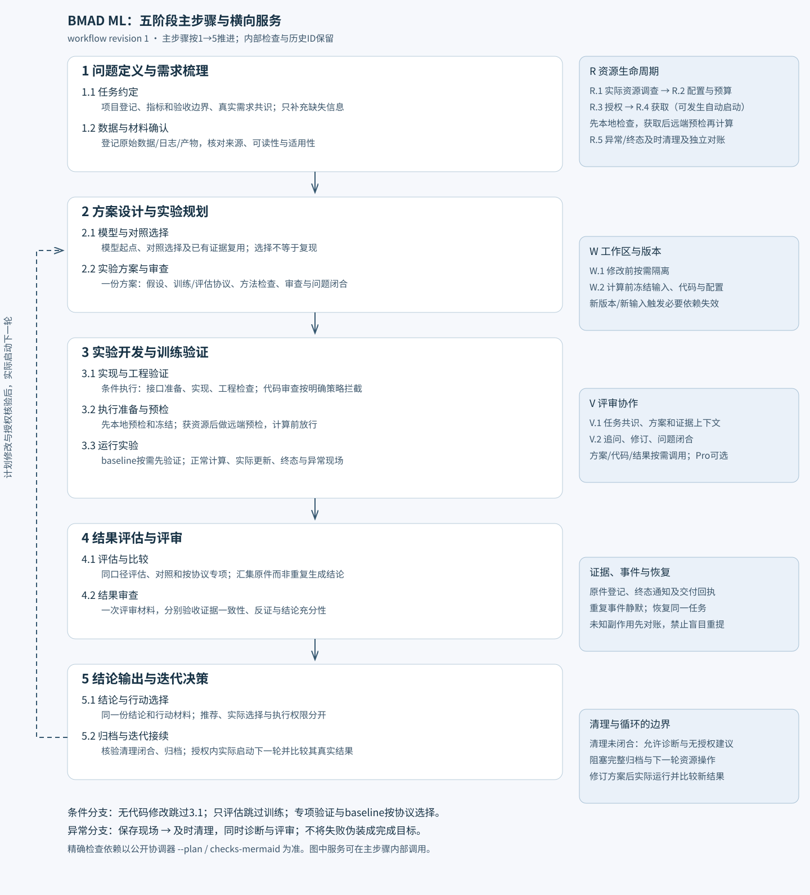
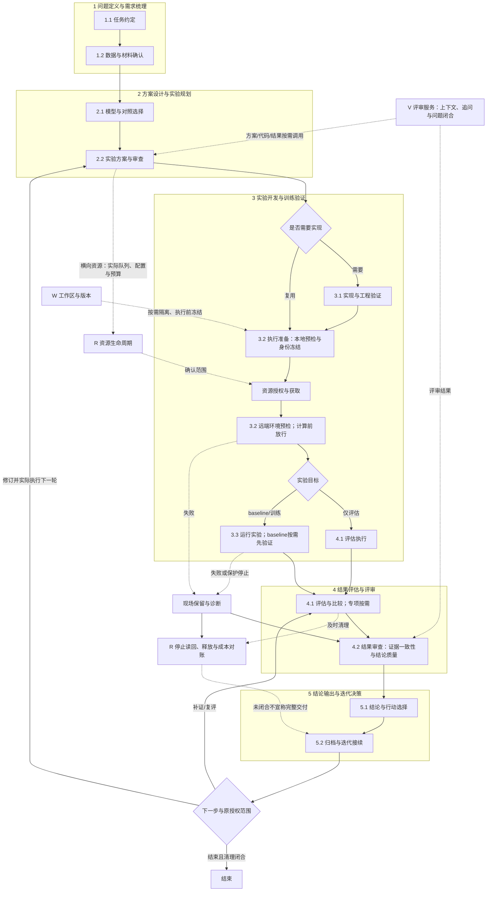

# 五阶段工作流与横向能力

RoadModel默认保留原验证路径；[探索流程](exploration-workflow.md)修订2保留原操作责任，仅合并四组纯记录检查，作为显式对照路径。下文34项是职责和驱动身份，不要求人每轮重复填写，也不预设精简数量。

当前：workflow_revision=1。五阶段11个主步骤；旧ID1—34保留为内部检查和驱动/回执身份，不再是34个同级业务步骤。
驱动wire revision3和gate contract revision2保留。职责和最终依赖分别由`work_packages.py`与`workflow_definition.py`维护。
内部检查保留是为了执行与历史兼容，不要求每轮运行全部检查或重新生成全部材料。

## 阶段职责与编号

### 问题定义与需求梳理

| 编号 | 主步骤 | 职责与触发 | 兼容检查ID |
|---|---|---|---|
| 1.1 | 任务约定 | 项目登记、指标和验收边界、真实需求共识；只补充缺失信息 | 1, 2, 22 |
| 1.2 | 数据与材料确认 | 登记原始数据/日志/产物，核对来源、可读性与适用性 | 3 |

### 方案设计与实验规划

| 编号 | 主步骤 | 职责与触发 | 兼容检查ID |
|---|---|---|---|
| 2.1 | 模型与对照选择 | 模型起点、对照选择及已有证据复用；选择不等于复现 | 4 |
| 2.2 | 实验方案与审查 | 一份方案：假设、训练/评估协议、方法检查、审查与问题闭合 | 6, 24, 25, 34 |

### 实验开发与训练验证

| 编号 | 主步骤 | 职责与触发 | 兼容检查ID |
|---|---|---|---|
| 3.1 | 实现与工程验证 | 条件执行：接口准备、实现、工程检查；代码审查按明确策略拦截 | 9, 10, 11, 12 |
| 3.2 | 执行准备与预检 | 先本地预检和冻结；获资源后做远端预检，计算前放行 | 7, 13 |
| 3.3 | 运行实验 | baseline按需先验证；正常计算、实际更新、终态与异常现场 | 5, 15 |

### 结果评估与评审

| 编号 | 主步骤 | 职责与触发 | 兼容检查ID |
|---|---|---|---|
| 4.1 | 评估与比较 | 同口径评估、对照和按协议专项；汇集原件而非重复生成结论 | 16, 17, 18 |
| 4.2 | 结果审查 | 一次评审材料，分别验收证据一致性、反证与结论充分性 | 19, 32 |

### 结论输出与迭代决策

| 编号 | 主步骤 | 职责与触发 | 兼容检查ID |
|---|---|---|---|
| 5.1 | 结论与行动选择 | 同一份结论和行动材料；推荐、实际选择与执行权限分开 | 20, 33 |
| 5.2 | 归档与迭代接续 | 核验清理闭合、归档；授权内实际启动下一轮并比较其真实结果 | 21 |

## 横向能力（独立编号，不是额外业务阶段）

| 编号 | 能力动作 | 调用时机与边界 | 兼容检查ID |
|---|---|---|
| R.1 | 资源发现与调度调查 | 规划中调查实际队列；官方SDK/CLI优先，缺能力再原生UI | 26 |
| R.2 | 资源选择与预算方案 | 列出实际配置、卡数、费用及推荐；材料不全时逐步补齐 | 27 |
| R.3 | 用户确认与授权核验 | 副作用前核对真实用户授权及当前范围；禁止自动生成确认 | 28 |
| R.4 | 平台执行请求与资源获取 | 精确绑定提交/资源身份；未知提交先对账，不重复获取 | 14 |
| R.5 | 资源停止、释放与成本核对 | 终态/异常独立清理；停止读回、释放与费用结算分别记录 | 30 |
| W.1 | 工作区隔离与归属 | 修改前按需隔离工作区；复用代码时不强建worktree | 23 |
| W.2 | 源码、配置与输入身份冻结 | 执行前固定源码、数据、配置与checkpoint身份 | 8 |
| V.1 | 评审上下文准备与对齐 | 方案/代码/结果审查按需准备上下文，不只传最终结果 | 29 |
| V.2 | 多轮评审对话与问题管理 | 复用评审对话、追问闭合；Pro可选，本地Agent可完成 | 31 |

证据生产、事件唤醒/回执、幂等与恢复随执行横向运行，不新增主步骤或独立常驻服务。
具体调用合同见[work-packages.md](work-packages.md)、[module-interfaces.md](module-interfaces.md)。

## 执行顺序与循环

图表达业务调用顺序；横向服务可在工作包内部被调用，不能按工作包开始即认为其所有检查已经通过。
只评估任务跳过训练；仅复现任务跳过正式评估，明确不适用；需要baseline时通过复现验收后才正式训练。
组件自动开训须将远端预检放在容器内实际训练命令之前，图中的资源获取不授权绕过该门。
清理失败时可继续诊断与结果审查，但5.2仍阻塞；未闭合不能宣称交付完整或自动进入新一轮。

## 精确依赖与历史兼容

- 业务目录：`python scripts/orchestration.py --catalog --format json`，包含11个工作包及内部检查。
- 主流程图：`--catalog --format mermaid`；精确内部检查图：`--catalog --format checks-mermaid`。
- 具体TASK的实际依赖：`python scripts/task_pipeline.py --task TASK --output RUN --plan`。条件分支以该图为准。
- 内部编号保留，展示使用1.1—5.2和R/W/V；历史journal、签名或已接受回执不改写。
- `work-packages.json`与公开返回值报告工作包进度，内部原始记录仍在`events.jsonl`。
- `code_review_required`、输入变更、旧目录迁移和材料合并的精确合同见[work-packages.md](work-packages.md)。

本轮CPU回归不代表所有LPAI/GPU、DDP/AMP、大checkpoint、长期故障或计费已验收。冻结任务继续使用其固定运行时，安装不启动监控。
