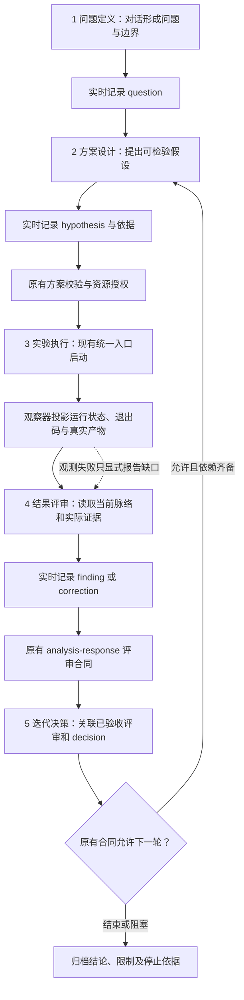

# 对话中的实验脉络

## 职责

在形成问题、提出假设、获得证据、修正判断和作出决策时记录变化，并关联实际运行。
这是现有五阶段的横向观测能力，不增加业务步骤或内部检查，不替代原评审、执行器和资源授权。
不记录每次工具调用；不根据34项检查的先后顺序推断科研因果关系。

Agent负责解释对话含义，协调器负责投影已发生的执行事实。程序不能从日志自动生成
“假设已证明”或“用户已同意”。同一结果可以有后续评审与修正；修正记录不会启动计算。

## 实际执行顺序



1. 创建新项目配置时登记下述观测绑定，在第一次运行前记录问题和假设。
   已冻结或在途项目不热改配置；特别是不能借此改变既有任务或唤醒服务。
2. 对话中改变目标、发现反证或修订方案时立即提交语义事件。引用实际消息/本地材料来源；
   Agent的假设使用actor.kind=agent，不能冒充用户决定。历史补录须在text/source_ref明确说明，
   记录时间是补录时间，不伪造原始时间。
3. 用原有执行入口运行。共享开发空间执行、Study及后台观察器自动投影执行状态；
   launch意图、进程运行、实际更新、终态、产物和停止读回分别保留，意图不是运行成功。
4. 评审返回research_context侧边快照，固定第一次准备评审时可见的脉络；同时使用
   --research-context读取最新对话变化。侧边快照不插入已冻结证据包，不改评审事实ID。
5. 根据当前结果记录发现、反证和修改，完成原analysis-response。协调器在已验收评审后
   自动关联assessment/decision，核对原response摘要，随后才按原Study合同执行下一轮。
   语义decision.next_action只是说明，不授予执行权限。
6. 下一轮必须有实际进程、实际参数和结果才算迭代完成。重入相同请求不重复记录，
   重入已完成Study不新增计算；correction保留原判断，通过revises关联。

## 配置与公开入口

在项目配置中添加，使用本项目专属绝对目录：

```json
"research_observation": {
  "version": 1,
  "project_id": "my-project",
  "question_id": "q-main",
  "store": "/absolute/project/research.sqlite3",
  "run_roots": ["/absolute/project/study"]
}
```

加入配置后，仍须在首次运行前按原方式生成精确方案/Study授权绑定；不得改已确认摘要绕过校验。
观测数据库绑定该配置，不能复用到另一个项目或任意切换默认问题。存储多个问题时事件可指定
question_id；执行投影绑定配置中的当前问题。跨项目、未知运行和跨问题关系被拒绝。

```bash
python -B scripts/run_project_pipeline.py --project PROJECT --research-event CHANGE.json
python -B scripts/run_project_pipeline.py --project PROJECT --research-context
python -B scripts/run_project_pipeline.py --project PROJECT --research-context --research-question q-main
```

CHANGE.json最小示例（先提交question，再提交hypothesis）：

```json
{
  "schema": "sdm-research-event/v1",
  "request_id": "message-17-hypothesis-1",
  "id": "h-rate",
  "kind": "hypothesis",
  "question_id": "q-main",
  "text": "在相同数据和更新次数下，提高学习率可能改善当前收敛速度。",
  "actor": {"kind": "agent", "source_ref": "实际对话回合或本地记录的引用"},
  "relations": [{"relation": "related_to", "target": "q-main", "basis": "hypothesis"}]
}
```

| 对象/字段 | 合同 |
|---|---|
| question | id与question_id相同，明确目标和边界 |
| hypothesis | 待检验判断，不能标记成已发生事实 |
| finding | 带证据、已登记run_ids或明确关系的发现；限制写入text |
| correction | 必须revises已存在记录，不能覆盖原判断 |
| decision | 必须有依据和next_action；执行仍由原合同决定 |
| run_ids | 只能引用协调器已登记的同问题运行ID |
| evidence | 绝对path及可选sha256；读取原字节核对摘要，不复制大checkpoint |
| relations | supports/contradicts/revises/motivates/related_to；basis须明确observed/hypothesis/unknown |
| expected_revision | 可选并发检查，过期先重读；相同request_id及意图重试优先去重 |

身份和请求不可覆盖；同request_id改变内容报冲突。协调器专属projection标记不能由公开事件伪造。
语义记录、执行事实、已验收Agent评审保留不同来源。SQLite事务保留变更顺序；运行快照可更新，
里程碑不可变。默认上下文只读取最近100个语义记录、30次运行和100个变化；has_more表示窗口截断，
完整历史仍在本地数据库，不宣称当前窗口包含全部证据。问题过滤同时作用于节点、运行和时间线。

## 失败与验收边界

观测存储失效、配置错误或证据变化返回unavailable/queued=false，不能冒称已排队补传；
不因此重提、停止或阻塞已授权计算和清理。语义事件明确失败时，Agent保留待补记录并修复，
不能静默声称已记录。恢复后补录须保留真实记录时间与来源，不伪造实时性。

本次验证是本地CPU实际子进程计算，平台控制标记cpu-simulation。已覆盖实时对话→运行→
结果分析→修正→原评审决定→下一轮实际计算及完成态幂等。通用组件任务的自动投影、
真实跨进程Codex事件唤醒与本观测能力联合验收、陌生项目接入尚未由本次证明。
独立Web页面的后续验收见下节；不部署第二个训练观察器，不改原A800任务或冻结运行时。

## 独立的实时Web页面

```bash
python -B scripts/run_project_pipeline.py --project PROJECT --research-web --web-port 8917 --web-ready WEB_READY.json
```

打开stdout或WEB_READY.json中的URL。端口0自动选择空闲端口；8917只是可修改的示例。
Windows后台使用pythonw及既有无窗口启动选项，将stdout/stderr落盘，保存本次服务PID；
前台用Ctrl+C结束，后台只结束核对过启动信息的本次Web服务，不触碰训练和其他工具进程。
更新前须读回原PID和监听端口已释放再启动；不能在停止失败后继续创建实例。服务使用独占端口，
Windows设置SO_EXCLUSIVEADDRUSE，拒绝第二个实例复用同一端口。启动回执的PID必须匹配新进程，
并用其URL读取实际项目快照后，才能报告就绪；已有READY文件不能单独证明本次启动成功。
Skill安装本身不启动Web服务或监控。

页面功能：

- 实验关系图：问题、假设、运行、发现、修正和决策可点击查看详情与来源。
  问题归属不是科研因果；下一轮连线须由round-plan.parent_decision_digest与已验收
  next_step.iteration精确匹配，不能凭参数相似或时间先后推断决策已执行。
- 时间线：保留修正前的判断，按真实revision展示对话和运行变化，分页读取更早历史。
  新增对话语义仍由Agent使用--research-event记录；页面不自动抓取完整Codex聊天或猜测其含义。
- 轮次对比：显示实际参数、前后变化、结果、实际更新、退出码及停止读回；原始轨迹支持loss图。
  cpu-simulation标签明确区分本地实际CPU计算与平台验收。
- 原始证据：只按已登记证据ID打开，重新核对SHA-256；文本最多预览256 KiB，二进制显示大小和摘要。
  文件改变、缺失或超出注册运行根目录时明确拒绝，不能把当前文件冒充原证据。大型文件流式核对，
  不复制checkpoint，不执行HTML/日志/脚本内容。

数据链路是“原Agent/协调器写库 → 本地Web服务读取revision → SSE推送变化 → 页面读取新快照”。
数据库检查间隔1秒，未变化不重绘；不是定时唤醒Codex，不查询LPAI。断线自动重连后读取当前
快照与持久时间线，服务重启后用新URL令牌连接原项目。Web服务不承担研究记录补传职责。

服务仅监听127.0.0.1，API有每次启动的随机令牌、Host/Origin检查，所有HTTP写入被拒绝；
SQLite使用mode=ro/query_only，不建库、不迁移、不启动观察器、不修改授权或执行训练。
不提供公网部署或团队账号权限。当前图显示最近200个语义节点和100次运行；总数与截断提示保留，
时间线可继续翻页，不能声称大项目全图已一次展示。服务只绑定一个明确项目，可用问题选择器过滤。
