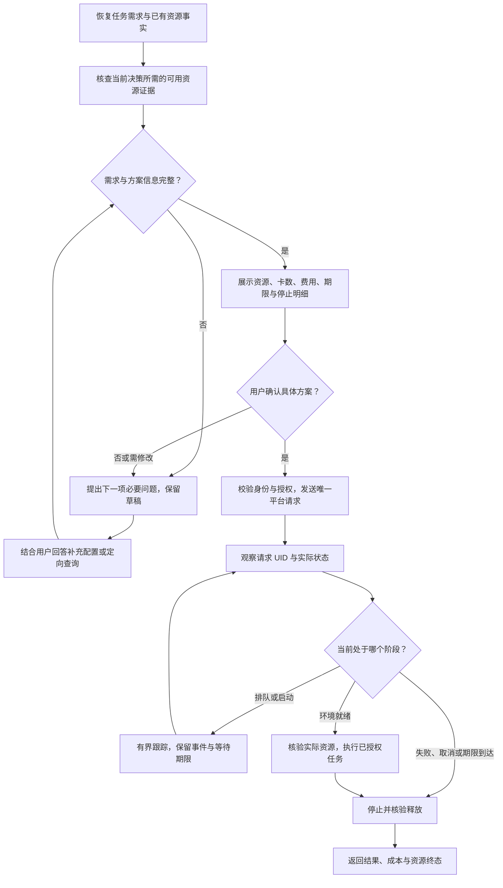

# 资源与预算：多轮规划、确认、开启与状态跟踪

## 职责与交互

R 能力围绕用户这次任务形成可执行资源方案，而非一次性遍历所有 GPU。允许多轮对话：先复用已知任务需求和资源事实，每轮补齐当前最重要的缺口，逐步确定入口、队列、实例和卡数、费用与时间。信息完整后展示明细，取得用户对该具体方案的确认，再通过已配置平台适配器开启资源。

| 步骤 | 主要工作 | 信息不足或状态未完成时 |
|---|---|---|
| R.1 资源发现与调度调查 | 依据账号实际目录、配额、占用及调度证据判断候选 | 保留已知项，区分未知与不可用；引导下一问题或必要查询 |
| R.2 资源选择与预算方案 | 确定入口、队列、各角色实例及卡数，核算完整请求、价格、总费用/时间、停止方式 | 保持 draft，多轮修改；不得编造默认卡数或未知价格 |
| R.3 用户确认与授权核验 | 展示定稿方案并保存真实用户确认及范围/期限 | 等待确认；讨论和模型建议均不产生资源使用权限 |
| R.4 执行请求与资源获取 | 用已确认配置开启资源，保存请求及资源 UID，观察排队、启动、环境就绪 | 排队不算运行；有请求但结果不明先核对，不重复提交；达到等待上限即停止处理 |
| R.5 停止、释放与费用核对 | 结束、异常或达到期限后停止，同 UID 读回并记录实际/未知费用 | 释放未核验保持 cleanup-required，不换资源或启动后继 |

`resource_planning.py` 为 draft 提供已知字段、缺失问题和下一交互入口；协调器对 `planning_status: draft/collecting` 的 inventory/proposal 返回 `awaiting-user-input`，不接受该记录为完成，更不会开始计算。正式记录仍通过原有严格校验。调用 `resource_totals` 汇总所有角色的实例数和设备数量；共享设备上限与实际分配分别表示，不能将 `unlimited/-1` 计成独占卡或零卡。

## 状态语义

目录提供该资源、账号可申请、当前可调度、已经分配和模型实际运行是不同事实。队列显示零卡时不能声称能立即运行；是否允许限时排队属于方案选择。环境 running/ready 只有设备与进程就绪含义，须有实际更新证据才能报告训练已推进。平台 failed 本身不证明资源释放。

每轮通常保持约一分钟或少量相关查询，随后返回发现与下一问题；这只是单轮响应建议，不是整个调查的硬上限，也不要求一次完成。用户回答或新的相关证据可触发后续轮次。不重复打开相同目录，不以提交任务探测资源，不扩展到无关队列。

## 实现边界

现有 `bmad-resource-investigation` 仍只负责只读调查；预算与用户确认由生命周期校验，真实 start/stop 和状态由项目平台适配器负责。独立资源开启无需伪造训练目的或模型评审，但必须遵循同一方案、确认、请求身份和释放合同。当前模块不自带通用跨平台启动器；缺少适配器时明确报告缺失，不能调用假想 Skill。

草稿可在尚未接受时修改；已接受记录与资源方案的实质变更须保留版本和适用的新确认，不重写历史。用户确认在当前对话完成，不要求或代发飞书申请。详见 [调查合同](resource-investigation.md) 和 [训练与资源确认](training-operations.md)。

## 资源采集的实际路由

R.1 必须先读取已安装 LPAI Skill、可用 SDK 文档及实际 CLI 帮助，记录
`capability_check.source / observed_at / missing_fields`。支持的字段先通过
SDK/CLI 查询；缺失接口的字段才交给浏览器，浏览器控制无法操作时使用
Computer Use。不得用历史配置或已停止开发空间推断当前容量，不得要求用户
代查平台可查询的资源事实；权限不足应明确报告，不绕过访问控制。

协调器的资源草稿通过 `resource_planning.discovery_route` 选择采集路径；未有
能力检查时返回 SDK/CLI 能力核查，已明确接口缺失时返回浏览器补齐字段。
平台事实和配置草稿不足返回 `needs-resource-investigation`，交由 Agent 继续
只读采集并准备方案，不再一律要求用户输入。只有账号范围或任务目的无法从
上下文恢复时才提问。此状态不完成节点、不生成授权，也不启动资源。

R.2 按实际候选自动形成推荐配置：入口、集群/队列/套餐、每角色实例数和卡数、
共享或独占语义、CPU/内存、报价来源、估算费用与未知计费项、预算和时间上限、
排队等待上限与停止方式。向用户展示候选和推荐理由后，由 R.3 接受该具体方案的
真实确认，R.4 才可启动并跟踪同一 UID 的排队、启动和实际设备状态。

## 新建与复用的选择边界

资源方案必须比较适配成本，不以复用既有开发空间或组件为硬约束。现有入口的
挂载、镜像、权限或运行协议不匹配时，应评估新建任务专用开发空间或组件；
按当前容量、套餐粒度、准备开销及总费用选择，而非仅按历史成功记录或小时单价。
新建所需配置应先准备完整；若页面将创建/保存与启动合并，整个提交动作都在
具体资源方案确认之后。涉及新增远程访问须明确说明所用现有凭据与作用范围。
更换空间/镜像/挂载后必须生成绑定新 UID 的运行预检和准备证据，历史运行准备
仅作计划参考，不作为新环境已就绪的证明。

安装后的 Skill 树受摘要保护。对正式安装副本做 Python 验证须设置
`PYTHONDONTWRITEBYTECODE=1` 并关闭 pytest 缓存，或在临时副本验证；不得让
测试缓存改变安装摘要。若发现仅由本次验证产生的缓存漂移，先按明确文件清单
核验并清除这些生成物，再运行正常 validate/update；不修改摘要字段绕过校验。

新建入口的准入检查必须区分 GPU 容量与对象数量限额；已停止开发空间也可能
占用账号/集群创建名额。R.1 先用受支持 CLI 在已知账号与集群范围统计对象，
再核查实际数量限制与镜像可选性。保存环境镜像不自动等于新建页面可选资产；
在提交方案前检查精确镜像与挂载配置能否通过该入口表达。未知准入项明确保留，
不能把“可用一台”解释为“允许再新建一台”。创建被拒后保存真实原因并用名称
核对结果，不重复提交、不自动删除旧对象；切换复用对象需绑定新方案与适用确认。
