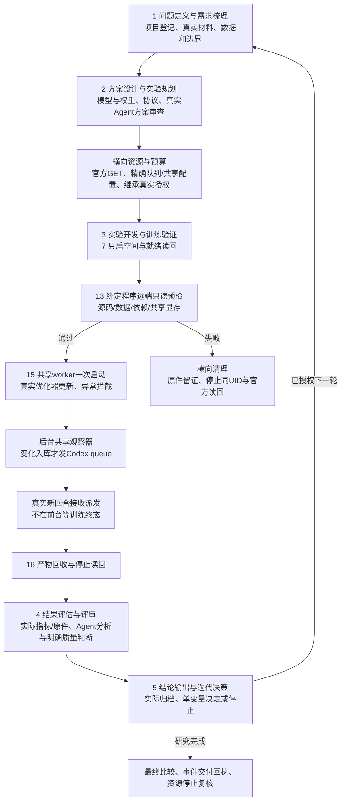

# RoadModel开发空间接入与通用项目依赖图

适用于已验证RoadModel接口、原A100 Share开发空间和明确授权的小规模真实GPU研究。此profile不替代组件库正常训练驱动，不代表任意项目、AMP/DDP或全量效果验收；不增加节点、调度器或训练框架。

## 默认接入

使用公开入口`--prepare-roadmodel-devspace --project PROFILE --output NEW_PROJECT`。准备只读本地已登记材料，不访问平台或启动资源。PROFILE的`roadmodel_devspace`包含：version=1、run_id、owner、source_root/commit/source_url、官方开发空间GET的固定摘要引用resource_observation、已授权SSH端点/密钥路径、已有项目材料evidence_paths、submission_registry、wakeup、真实用户authorization。默认32训练/8验证帧、batch1、20epoch、FP32、seed42；`epochs`可显式配置，研究通常10—30轮，1轮只用于明确的快速检查。此建议不是全局硬上限。完成门核对每个epoch的记录、epochs×train_samples次真实更新及目标epoch checkpoint，不能把第1轮checkpoint当20轮完成。当前仍是单进程共享A100小样本profile，卡数不设项目上限不代表该路径支持多卡；多卡使用对应组件配置，实际DDP仍须验收。资源与完整配置由已登记官方响应读取。

authorization须confirmed=true、真实source_ref、time_limit=null、budget_limit=null；当前profile只实现明确不限时/预算这一授权形式，不把模板或Agent建议当人类确认。官方GET须15分钟内、精确UID和原空间stopped；该事实不等于GPU空闲，实际共享卡显存资格在主图13及训练前重查。报价仅能保留其历史/当前属性，不能当账单。官方CLI能力已知返回未闭合待确认时保留原证据，不重复请求、不编造飞书卡片；原生启停按已授权的同UID动作和官方读回执行。

资产位于`assets/roadmodel/`：真实训练工作负载、优化器pre/post遥测、固定配置准备器与只读预检。项目目录只生成规格JSON和绑定配置，不再复制/维护案例专用训练、提交或结果收集脚本。旧平台伴随Skill的minimal准备器保留供历史调用；本profile独立带有同一已验证配置逻辑，后续修改须同步兼容回归，不能热改历史冻结程序。

## 主流程是真实依赖门

每轮`devspace_study`在声明`devspace_main_workflow.version=1`时，调用`devspace_main_workflow`→既有`task_pipeline.coordinate`和`workflow_definition`。旧Study未声明时保持旧路径，不自动迁移。

- 1.1/1.2、2.1/2.2读取真实用户约定、固定项目材料与数据/模型声明；这是材料/协议检查，不冒充远端GPU或完整数据审计。
- 34方案审查会生成main/plan-request.json并等待同目录plan-response.json；Agent提供请求摘要、reviewer、reason、alternatives、limitations。它是实际Agent审查，不是新的人类资源授权。
- 7通过共享执行器只启空间/核对就绪，不派发工作负载；13执行绑定源码的真实远端只读probe，核对源码、挂载、依赖和共享GPU显存；15才允许共享worker一次启动真实训练。预检程序在计划inputs内固定摘要，禁止执行日志中的程序。
- 16沿共享执行器回收真实结果并停止同UID、官方读回；18登记原件与请求，29/31/19/32走现有上下文、事实一致性和结论质量门；20/33/21归档并把真实决定交回Study。已有材料和一次Agent回应可以支撑不同语义门，不生成额外审查意见。
- 同一份结果analysis-response须增加`workflow_assessment`：evidence_consistent、conclusion_supported布尔值；非空supporting_evidence引用该回应facts；counterevidence与limitations字符串列表（limitations非空）；alternatives说明。程序只投影Agent实际判断，不自动把结构校验或退出0转成质量通过。
- 现有代码复用时3.1不适用；baseline/robustness等可选检查未运行就保持未测量，不能把34项都标为已真实执行。

## 后台接续

同一公开入口绑定原生start回执，确认实际开始后调用`--background-devspace`；验证observer_started_verified后立即交还回合。冻结运行时、配置、assets和references一并保留，不热改运行中服务。

唤醒先记录`--received-task-dispatch`并查本地收件箱。终态可能先于大checkpoint下载完成：若本项目observer仍持有执行锁，不并发接管、不创建第二观察器。可先交付已知终态/更新、说明原件回收中并确认已处理事件；cleanup_pending/review_ready后再次接续同输出。没有新事件时不安排五分钟AI检查。

接续原生停止和官方读回→Agent分析→同一analysis-response中的workflow_assessment/next_step.iteration→协调器实际生成下一轮。次轮会有自己的主图方案审查请求，Agent用已接受的结果与授权域填写，不再询问重复人类确认。该轮真正运行并获得结果才算迭代；建议/排队/准备均不算完成。

本地CPU回归、真实平台主图、真实GPU、独立新回合唤醒、计费对账分别记录。保留原始失败和未验证边界，不把发布安装成功当实机通过。
