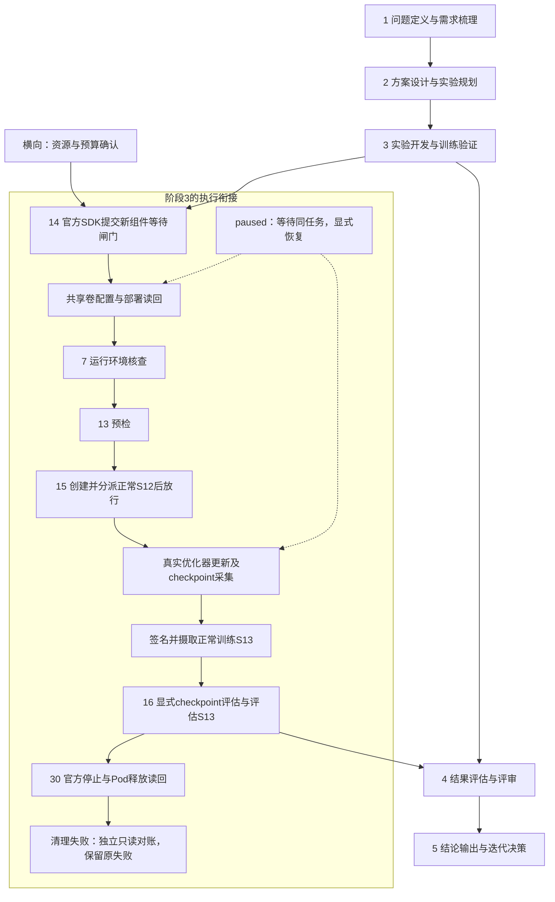

# RoadModel正常训练执行合同（normal-v2）

该入口复用通用项目交付工作包与横向能力，保留驱动wire revision3和旧检查ID；最终DAG以workflow_definition为准，不改写旧诊断驱动、旧工作区或在途任务。留存材料仍走默认project-workspace链路；此处是通用RoadModel训练执行器，不为每个材料项目编写脚本。

## 入口与顺序

```text
run_project_pipeline.py --project EXPORT_INPUT --output EXPORT_DIR --export-roadmodel-config
run_project_pipeline.py --project PROJECT_INPUT --output PREPARED_DIR --prepare-roadmodel-native
run_project_pipeline.py --project AUTH_BINDING --output ACTIVE_DIR --bind-roadmodel-native
run_project_pipeline.py --project ACTIVE_DIR/project.json --output RUN_DIR
```

前三项是配置导出、原生payload准备和授权绑定，不访问平台，不启动资源。已有明确用户确认可以同时作为资源与正常训练授权来源，不重复索要确认；缺少确认时只交付可评审方案。授权绑定读取固定摘要的prepared_project和resource_authorization，校验最终组件配置摘要，不能通过手改normal_native_preparation_only放行。

最后一项才按原资源确认门禁执行。排队或训练未结束时返回paused；再次执行同一入口时仅续接同一任务。此组件入口自身没有后台监控或自动下一轮；独立采集、唤醒和通用Loop已有能力，但当前组件normal-v2整体事件接续尚未真实验收，不能仅凭这些模块存在宣称闭环完成。单次协调调用预算不替代排队/训练时限；training_wall_seconds、queue_wall_seconds、total_budget明确为null时不引入1800秒、3轮等应用上限。

RoadModel用户最新约定：新研究任务卡数不设项目上限，依据方案、队列和实际资源选择；epoch建议10—30，默认建议20。normal-v2读取显式固定的训练协议和解析配置，两处epoch必须一致，不偷偷重写历史300轮配置或warmup。代码中fixture_inputs的300为CPU合同夹具，不是实际提交默认；新方案使用审议通过的短程配置。



图中分支细化原依赖，不新增节点，不提升科学结论或推进原编号资格游标。

## 输入合同与真实配置

provider=roadmodel-normal-v2，normal_source_root是本地已登记仓库；normal_protocol与normal_resolved_config使用{path,digest}。协议为roadmodel-normal-protocol/v2，明确study/trial/attempt、源码commit、source_files、全量数据摘要、运行时源码/配置/输出位置、训练参数、分布式参数和初始化方式。原train.py、misc/dist_utils.py、misc/ckpt_load_utils.py接口固定；原生正常链路还固定eval.py。完整源码冻结仍归原W.2，数据科学资格仍归原阶段门禁。

--export-roadmodel-config执行固定摘要、已审阅的独立Python配置，在隔离子进程中只注入明确实验环境。仅支持os/decimal导入，保留单下划线合法配置项，过滤双下划线、函数与模块。它不是不可信代码沙箱；继承_base_或非JSON兼容配置应通过明确的合并导出，不得删除未知值伪装兼容。既有JSON快照将tuple归一为list，模型消费端语义仍需真实验证。导出不导入模型、torch、MMEngine或SDK。AMP由明确CLI协议补入。

| 参数 | 实际消费者 |
|---|---|
| epochs | max_epochs |
| batch_per_gpu / workers_per_gpu | train_loader.batch_size / num_workers |
| learning_rate | optimizer.optimizer.lr |
| amp / seed / gradient_accumulation | 显式训练CLI参数 |
| nodes / gpus_per_node / node_rank / master地址端口 | torchrun |
| training_wall_seconds | 组件进程超时；null为不限时 |
| runtime_output_root | 独立attempt输出，执行前必须为空 |

参数与快照不一致则拒绝。effective-config.py只含Python字面量，不自动覆盖参数。已实现、冻结代码的execute-and-learn属于本入口；代码修改、专用baseline复现及robustness继续使用原对应工作流，不隐式承诺支持。

## 原生绑定与共享卷

normal_native包含固定摘要的component_template、adapter（namespace/owner/cluster/component_uid/task_info/共享submission_registry）、sdk_python、request_key、资源authorization_ref、training_authorization、runtime_control_root和runtime_assets。data-index与initial-checkpoint的路径/摘要必须匹配计划。

execution配置包含：

- workspace：已认证的S12/S13工作区；缺失时可由固定摘要workspace_payload在准备阶段按标准create_workspace登记，使用本版assets。旧工作区不静默迁移。
- signer：固定entry摘要、python、lifecycle_root、trust_root、private_root、principal；复用正式sign_personal_result.py，不生成或泄露密钥。principal必须属于工作区信任快照的platform-producer。
- local_control_root、local_output_root、shared_volumes：每项明确name、runtime_root、local_root，并必须匹配原生模板input_data_volume中的name/env_value。控制与输出路径按明确前缀映射，配置亦处于声明共享卷中，禁止猜测路径。
- evaluation_metrics：有界正则与捕获组，来自实际完整评估日志；无指标不宣称成功。evaluation_wall_seconds可显式配置。

组件配置通过官方SDK更新及读回；仅允许未运行的新组件，核对主命令、全部角色、镜像、源码与挂载。任务提交继续复用共享去重、写前意图和不确定副作用对账。若SDK在Windows而协调器在WSL，adapter.runtime_path_map显式映射脚本/配置路径，native_configuration_ref用于SDK主机；official_cli可固定官方CLI绝对路径。无映射不自动猜测，错误在调用/预检中明确暴露。真实跨主机互操作仍需平台验收。

组件启动的是闸门。配置字节及gate/observer/bundle由已授权payload固定部署；ready回传bundle摘要、随机session_nonce、运行路径、源码/数据/配置摘要及可见卡数。协调器验证SDK任务身份和共享读回一致才接受7/13。过期预检通过共享卷请求重新采集。控制卷必须限制为可信协调器/组件可写；这些文件不是通用不可信消息通道。

## 正常S12、节点15与S13

ml.normal-execution与ml.diagnostic-execution使用独立操作合同。旧branch-diagnostic及60–1800秒范围原样保留。正常S12绑定计划、attempt、源码、数据、配置、组件UID、任务UID、bundle、授权摘要、目标epoch、world size、执行种类、证据类别和明确训练时限；由原handoffs创建、mark-dispatched、摄取，不建立第二套签名或状态机。

training_authorization为sdm-normal-training-authorization/v1，必须有direct_user_confirmation、source_ref、scope=normal-training、计划及attempt、component_uid/namespace/owner、evidence_kind、training_wall_seconds、queue_wall_seconds、total_budget，以及allow_evaluation/allow_cleanup。有限总预算需要绑定组件的预算quote；组件按总预算除小时报价生成运行时间包络，从组件启动起覆盖预检、等待放行、训练和评估，计时到期会终止本组件子进程。排队时间不计入这份运行时间包络。它不是实际账单或平台计费硬上限；镜像拉取、平台计费粒度及实际价格仍需验收。null保持不限额。准备结束后，资源授权还需匹配最终组件configuration_digest，模型effective_config_digest是另一个字段。

15在原门禁之后创建/分派正常S12，将请求与放行凭据通过受限共享卷交付；凭据固定S12文件摘要及13接受的预检摘要。组件再次校验S12作用域和实际环境，再以独占started标记执行一次。恢复只核查同一任务；丢失回执、不确定提交不自动重派。

运行包装器不改模型源码或参数：通过优化器post-step hook统计实际更新，AMP跳过不会计为更新；在原torch.save完成后记录完整checkpoint的epoch/global_iter和组件元数据，不反序列化pickle。结束后要求所有rank完成且有更新、达到目标epoch且对应checkpoint真实存在并核对字节摘要。进程退出0不等于完成300epoch。原始日志保留，非有限警告与真实OOM栈分开记录。

正常S13复用原producer签名和handoffs.ingest。签名验收同时校验actual_report摘要、S12作用域、任务/attempt/数据/配置、目标进度与评估checkpoint，保持cpu-simulation类别不可提升。失败也可形成经认证的failed S13；它不产生有效模型或科学结论。

## checkpoint、评估与恢复

roadmodel-checkpoint-index/v1明确id/relative_path/digest/origin/epoch/complete/components及可选metrics。通用选择器支持exact、唯一latest-complete、明确metric和min/max的best；不选数组首项或mtime。原生生产器保留本次目标epoch完整checkpoint，默认评估选择latest-complete；需要best时必须存在真实逐候选指标，缺失则拒绝，不伪造历史指标。

评估在16读取已接受训练S13的索引，重验文件字节并显式传--resume-from文件；不默认首项、不切换数据子集。现有eval.py使用单进程完整评估，回执明确evaluation_world_size=1，不冒充8卡评估。评估完成和有限数值指标均需成立。

weights至少声明model；resume来源须同study/trial不同历史attempt，部分恢复需声明model/optimizer/scheduler/epoch/global_iter并明确resume_kind=optimizer-schedule。现有源码未证明AMP scaler/RNG完整恢复，因此full resume持续拒绝；不宣称抢占恢复已保障。空输出预检阻止源码自动发现旧latest.pth。

## 清理、失败与对账

cleanup使用14已接受任务UID、正常授权中的allow_cleanup及官方SDK/CLI同身份读回。停止前固化意图；后续只读核查，不重发stop。任务终态且Pod全部终态/明确空列表才证明释放。模型文件、初始化权重、签名器或评审工作区损坏不应阻断已授权同任务的独立释放。

清理尚未确认时保存原cleanup失败。使用公开入口：

```text
run_project_pipeline.py --project RUN_DIR/attempt-01/project.json --reconcile-roadmodel-cleanup
```

它复用原cleanup_reconciliation，只发起新的只读任务/Pod读回，绑定原cleanup摘要及14所有权，不重跑训练、不重发停止、不改写原失败。恢复原运行入口亦可先做同类只读对账。未知提交身份仍走既有reconcile-submission入口，禁止猜UID清理。

## 验证边界

代码接通、合同握手、CPU模型/平台夹具及真实Ed25519签名测试不替代实际SDK调度、共享卷部署、CUDA/DDP、正常训练效果、真实checkpoint恢复与账单验收。缺少合法配置或用户资源确认时继续在提交前阻断。保留旧34能力、原策略与旧任务；不自动增加监控或下一轮实验。


SDK登记信息的五项元数据必须在任何组件更新之前完整校验。expected_duration仅为平台预计时长登记值，不转换成排队、训练或预算上限。声明卡数必须与正常计划一致；正常源码须由匹配commit的代码资产或明确共享卷提供。共享卷的控制器根必须已存在且可访问，并支持本协议使用的POSIX独占发布/硬链接语义。缺少运行时目录、SDK解释器或签名器路径在资源提交前拒绝，而不把配置缺失留到训练后。

## 2026-10-19 持续非有限拦截与恢复修正

正常组件内置本地进程保护，不依赖Codex定时监控。旧日志的grad_norm在梯度累积期间可能是上一次更新边界的值，不能把5条抽样日志等同于连续5次更新失败。新版observer在真实clip边界及GradScaler.update后输出NORMAL_UPDATE_HEALTH，绑定rank、epoch、微步/global_iter、更新尝试序号、有限性、scale前后值、实际optimizer post-hook计数和停止理由，并逐rank持久保存最新记录。gate收到该结构化证据后不再用抽样grad_norm决定停止；未配置新版observer的历史入口保留旧保护，不因升级擅自弱化。

启动期仅当梯度非有限、实际更新为0、scale严格下降、loss有限且更新状态未损坏时记为amp_scale_backoff，不能称为已恢复。保留原20次真实更新边界无成功更新的保护上限，触发时记amp_calibration_exhausted（失败待诊断，不冒充已证明模型发散）。一旦成功更新，有限更新会重置坏边界计数；此后连续5次真实坏更新边界触发persistent_update_failure。坏梯度却执行更新、有限梯度没有更新、scale未回退或无效、loss非有限立即失败。非AMP坏梯度直接退出；优化器更新前后检查参数和优化器状态，非有限裁剪范数同样失败。控制逻辑不得修改学习率、初始scale、反向传播或scheduler来掩盖异常。

结构化记录可验证AMP恢复：必须看到有限梯度、真实optimizer更新递增及后续持续有限的实际记录；loss有限或平台Running均不够。旧任务缺这些记录时结论为证据不足，仅可将已授权重试用于带保护的实际观测，不回填虚构更新次数。torchrun负责单rank异常后的其他rank收束；CPU夹具不替代真实DDP和持续健康更新验收。第一轮A10已验证进程组终止，不代表所有异常分支均已实测。

warmup_epochs若在协议声明，必须与解析配置一致且无冲突warmup_iters；无声明的旧500步默认显式固化到effective-config.py。不得只写环境变量而不核对实际调度日志。微步与优化器更新不是同一口径，梯度累积配置必须留档。

正常启动脚本生成有效配置时，解析模式必须与冻结源码的训练入口一致。当前fca04db7版train.py明确使用Config.fromfile(..., lazy_import=False)；省略此参数会使含os/decimal导入的配置进入MMEngine懒加载，在os.environ调用处失败。生成和读回均须显式使用该模式，读回warmup实际值；配置检查应先于CUDA扩展编译。语法编译或runpy独立配置执行不等于MMEngine dump/reload验证，缺依赖时必须单独标记该未验证项，不因更换GPU重复同一个解析错误。

包装器检查checkpoint中的模型、优化器、scheduler、AMP scaler及进度字段有限性，添加AMP scaler状态，使用同目录临时文件+原子替换保存，不以损坏训练状态覆盖最后健康文件。normal_health明确finite_state_scope，评审元数据另记metadata_finite；RoadModel best_traj的未评测Inf哨兵不得单独当作模型发散，亦不得把该元数据宣称为有效评测。真实resume准备要求健康/有限性证据；AMP需scaler组件，运行加载再次检查二进制并恢复scaler。完整RNG/采样器续训尚未证明，full resume仍拒绝。不得从最大epoch或best文件名推断健康。

历史A800使用提交时冻结的旧驱动，不会因安装新版Skill自动升级；不得热改活动组件以追赶新规则。新任务必须冻结修正后的observer与本地保护模块摘要。已知持续失败应按已授权停止边界立即处理，保存日志和卷，核对任务及Pod终态；取消定时监控不等于禁用任务内故障保护。

## 发散处置的完整验收合同（2026-10-19 补充）

用户要求的闭环是持续观测、异常自停、发散前后checkpoint留存、可视化分析及同次实验归档。上节的NaN拦截和健康文件保护仅覆盖其中一部分，不得以其CPU通过宣称完整闭环已接通。此要求归现有运行观测、证据、评审与归档职责，不增加节点。

1. **观测与判定**：任务内周期检查实际训练进度及日志，每次完整评估后检查已配置的关键指标。计划中记录检查频率、指标名、优劣方向、近零阈值、相对跌幅、有效样本数和可比评估协议。训练loss非有限、参数非有限、确认的持续梯度非有限或合格评估指标突然崩塌，应触发故障停止。偶发AMP梯度溢出沿用已有恢复判定；不能把正常趋零的loss、无有效样本、单类本来为零或缺失值等同于整体评测崩塌。不同指标不得共用未经声明的近零阈值。
2. **停止优先**：触发后禁止继续优化器更新和自动重跑；停止训练进程组并核查平台任务及Pod终态。停止意图、原因、触发记录与完成回执均绑定同一task/attempt。保存现场、绘图或分析失败不得延迟停止或被转化成训练继续的理由。任务内保护与外部周期平台核查是不同能力；用户此前取消的Codex自动化不得因本合同而自动恢复。
3. **发散前后证据**：保留最后可验证健康checkpoint及最早可取得的异常现场快照，记录实际epoch/step/rank、源码/数据/配置摘要、路径和文件摘要、健康检查结果、保存结果。异常快照放入独立诊断目录，标记diagnostic-only并排除正常checkpoint索引及恢复选择；不能覆盖健康版本。有限张量不等于评测健康，两种资格分别记录。无法取得发散后快照、保存超时或存储失败必须明确记missing/failed及原因，不能延长训练来制造“发散后”结果。
4. **开发空间与持久存储**：产物保存在已授权持久卷的该次实验目录，登记开发空间访问路径并核对挂载映射；没有可用开发空间时记录未完成的访问/归档步骤，不擅自新建或启动计费空间，不把组件临时目录当已持久保存。
5. **可视化与原因分析**：首先生成真实日志的loss/梯度/学习率/AMP scale及关键评测指标时间线，标注触发点和前后checkpoint。对前后checkpoint在同一批固定样本上生成预测、GT和差异图；缺模型输出或计算资源时明确待生成，不用曲线代替预测对比。区分已证实原因、候选原因、证据缺口和验证方案，不凭NaN或近零标签确定具体算子根因。
6. **实验归档与验收**：异常事件、停止/释放凭据、前后checkpoint清单、图表、分析和下一步建议写入原实验的attempt记录，保留原失败状态。通过注入NaN、合格指标骤降、AMP瞬时恢复、缺失指标、零有效样本、保存失败与重复调用的CPU回归后，仍需真实GPU/DDP停止和持久卷文件读回验收。未产生的产物逐项标缺，不将部分实现勾选为闭环完成。

当前未接通：评测崩塌运行时判定、异常现场checkpoint隔离保存、前后预测可视化及自动实验归档。既有健康checkpoint保护不等于上述异常现场留存能力。下一次任务提交前必须在交付中显式披露这些缺项；不得仅凭文档更新或正式安装将其描述为已实现。
# 固定规模多节点与不可变材料路径（2026-10-19）

部署时还必须计算原生配置中的全部命令副本（全局 cmd 和各 role cmd）。
`validate_native_payload` 当前采用60000字节的保守本地上限：超过即在提交前阻断，
改用保持源码语义与摘要验证的压缩载荷或可追溯运行时资产。这个值是本地工程
约束，不是已核实的平台官方限制。只计算单份 shell 命令长度不能代替此检查。
pipeline-init 失败且未生成 Pod 时，不归因为 NaN/OOM 或多卡通信；保留原始
任务与空事件证据，平台没有给出具体栈时应明确根因尚未确认。

全量实验按用户授权选择 A800，卡数上限与实际分配分开登记；本次授权
32 卡（4×8），每卡 batch3、累积1，全局 batch96，LR2e-5、显式 warmup3epochs。
小规模流程测试才在两个指定同事组件均无非终态任务且实际有空闲卡时优先 A10。
没有待执行且已授权的流程测试时，资源空闲不产生新训练；L20X 在性能问题验收前不作为自动回退。

`scripts/roadmodel_launch_support.py` 是固定运行时辅助代码，不新增能力节点。
提交端核验 master1+worker(N-1) 和每节点规格，启动端校验 NODE_NUM、GPU_NUM、
节点 RANK、MASTER_ADDR/PORT，禁止把节点 rank 当全局进程 rank或使用多节点回环地址。
torchrun 使用每节点8进程、固定 nnodes、零自动重启，现有训练入口负责 env:// 全局 rank。

每次提交采用唯一实验身份；各节点独立源码工作副本和构建目录、节点日志目录，
共享实验根、训练产物和按全局 rank 区分的 observer 文件。所有节点必须在同一
共享控制目录读回完整预检合同才开始模型训练。45分钟只限制初始化协调，
不限制排队和正常训练时间。错误节点写入 abort，其他节点的运行时 watchdog
终止自己的子进程组；节点失联及整个共享卷失效仍依赖 DDP 超时与平台收束，
不能宣称 CPU 回归已经验收跨机 NCCL、网络故障和真实资源释放。

固定数据版本和已核验索引可显式启用有界正结果路径缓存。首次解析沿用原函数，
保留根目录和候选优先级；缓存键包含资产身份、file_ref、primary_root、fallback_subdir
和有序 search_roots。缺失结果不缓存，以保留延迟挂载语义。缓存仅在本次进程内，
每 worker 最多32768项；不适用于会新增同名高优先级文件或变更映射的可变资产。
固定资产被移除后读取应失败，不静默改读其他候选。不得以 CPU 缓存命中测试
宣称实际 GPU 吞吐提高，首次读取仍有元数据开销。
