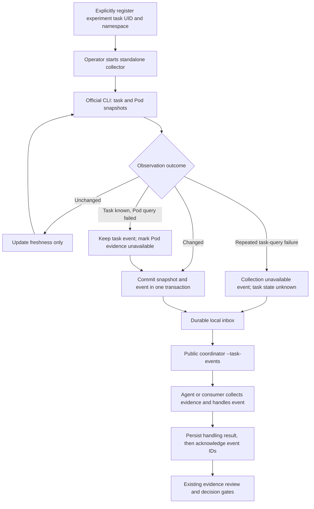
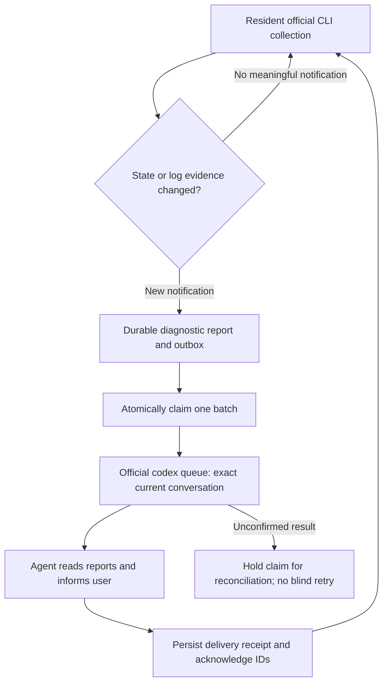

# Independent task event collection

## Responsibility and qualification

The collector is an implementation of execution observation within the existing
34-capability lifecycle, not a new node, training driver or messaging platform.
It uses official `lpai-agent tasks get/pods` commands only. Authentication remains
in the official CLI configuration. It never submits, stops, restarts or edits a
platform task, sends Feishu messages, imports a model, or calls an AI service.

Polling observes snapshots: short transitions between polls can be missed. This
is not an authoritative platform event stream or a log-based divergence detector.
Runtime numerical guards remain responsible for prompt training interruption.
The collector records platform status, not successful optimizer updates. Existing
S13 evidence, review, decision and resource-release gates remain mandatory.

## Execution chain



The public inbox returns suggested next actions; it does **not** execute them or
advance lifecycle nodes. `ai_wakeup_connected: false` is explicit. Reading a file
or inserting a SQLite event cannot spontaneously wake a closed/idle Codex chat.
A separately authorized resident service can use the event wake-up transport below.
The collector inbox alone still does not dispatch an agent.

## Configuration

Place this block in the project JSON (absolute paths appropriate to the host):

```json
{
  "task_event_collector": {
    "version": 1,
    "store": "D:/project/experiment/events.sqlite3",
    "cli_path": "C:/Users/USER/AppData/Local/bin/lpai-agent.exe",
    "interval_seconds": 60,
    "query_timeout_seconds": 30,
    "error_threshold": 3,
    "tasks": []
  }
}
```

Register only authorized experiment tasks using
`{"uid":"canonical-task-uuid","namespace":"confirmed-namespace"}`. Do not
discover other people's tasks or restore A10 idle-capacity checks. An empty task
list prevents live collection. The database belongs to one experiment workspace;
use its authoritative submission receipt when registering a task. The collector
does not turn a configuration entry into training authorization.

Keep SQLite/WAL on a local filesystem, not a shared training volume or a database
file accessed simultaneously through Windows and WSL. The CLI must be an absolute
path to the official executable. SDK response wrapping and unsupported status or
Pod shapes must be adapted and tested explicitly; unknowns are not terminal states.
No arbitrary command template or shell expansion is accepted.

## Commands

Run under the same authenticated OS user as the CLI. The following are explicit
operator actions, not post-install hooks (replace `PROJECT` with an absolute JSON
path and run from the lifecycle `scripts` directory):

```text
python task_event_collector.py --project PROJECT --once --allow-live-read
python task_event_collector.py --project PROJECT --run --allow-live-read
python run_project_pipeline.py --project PROJECT --task-events --event-consumer coordinator
python run_project_pipeline.py --project PROJECT --task-events --event-consumer coordinator --ack-task-events ACK_JSON
```

`ACK_JSON` is a JSON list of processed event IDs. Persist diagnostic/handling
receipts keyed by event ID before acknowledging them. Reads never acknowledge.
If the consumer crashes before acknowledgement it receives the same event again;
handling must therefore be idempotent. Acknowledgements are independent per
consumer; unknown IDs roll back the entire acknowledgement batch. Pages contain
at most 500 events and indicate `has_more`. Events retain their IDs across restarts.

Stop the foreground process with Ctrl+C, or create an empty file named
`events.sqlite3.stop` beside the configured database. Stop takes effect between
bounded queries (at most two query timeouts per current task), without changing
GPU tasks. Remove the stop marker only when deliberately starting collection again.
An OS file lock prevents two collector processes from using the same store and
releases on process death. SQLite commits observation changes and corresponding
events atomically; consumer reads can proceed concurrently. No scheduled service
or auto-start is installed by these commands. A long-running host/process supervisor
is needed for unattended operation and remains a separate deployment action.

## Event semantics

| Kind | Meaning | Consumer action |
|---|---|---|
| `task_state_observed` | First observed state or task/Pod change | Inspect progress; require actual iteration evidence before saying training started |
| `task_terminal_observed` | Platform terminal state or changed terminal Pod evidence | Collect logs/artifacts, verify epoch/metrics/checkpoint and release separately |
| `collection_unavailable` | Consecutive task-query failures reached threshold | Repair collection; retain last successful snapshot as historical, not current |
| `collection_recovered` | Successful query after an alert | Reconcile current state and any unseen terminal outcome |

A failed Pod query does not suppress an observed task failure. Its snapshot carries
`pod_collection: unavailable`, so no release inference is allowed. Empty Pod lists
also provide no release proof. Deleted compute Pods are a narrow observation;
`billing_release_verified` and `experiment_success_verified` remain false. The
inbox exposes freshness and staleness even after the collector process has exited;
without a running consumer there is no active stale-process notification.

Only allowlisted state fields are persisted; full task commands, environment,
credentials, raw CLI stdout/stderr and full training logs are not stored here.
The existing diagnostic/evidence collectors obtain logs separately when handling
an event. Database events currently require explicit archive/retention management;
there is no automatic pruning that could erase unconsumed evidence.

## CPU acceptance and remaining work

## Authorized resident service and diagnostic consumer

`task_event_service.py --project PROJECT --run --allow-live-read` combines the
standalone collector with a diagnostic consumer. It requires a separate
`task_event_service` block: `version: 1`, `read_only: true`, an absolute local
`evidence_root`, and `bindings` with each registered task's `uid`, `namespace` and
verified `cluster`. The task set is explicit; it never discovers colleague jobs.
The host may supervise this process with a limited-user task; enabling it is a
deployment action and never an installation side effect. A `.stop` marker beside
the database stops only collection, not the platform task. The caller must not
invoke training stop/retry commands even if logs contain a serious error.

The consumer uses fixed official `logs pod` and `tasks summary-events` queries.
It saves bounded, redacted log excerpts and a preliminary diagnostic report; root
cause is unconfirmed until a reviewer establishes it. Coordination/helper Pods
do not count as GPU training roles. Platform/container running and actual
epoch/iteration or optimizer updates generate distinct notifications. A single
non-finite token is not a failure classification or stop instruction. State-stable
running roles are probed periodically so the first model iteration is not missed.

Diagnostic receipt, notification outbox insertion and source-event acknowledgement
commit together. Notification IDs deduplicate each task/milestone or collection
failure episode. Delivery is separate: use the public coordinator
`--task-notifications` and, only after communicating the notification, pass
`--ack-task-notifications FILE`, where FILE contains `ids` and `delivery_receipt`.
Do not acknowledge just because the outbox was read. Missing diagnostics or logs
remain visible. Terminal status does not certify the target epoch, model quality,
complete checkpoint or billing release.

An approved Codex heartbeat can consume only this local outbox and provide the
user-facing notification and contextual analysis. Collection/diagnostics continue
independently of that heartbeat. This is scheduled delivery, not a native push
callback: the host and Codex must be available for notification delivery. Configure
quiet behavior when there are no meaningful changes, an explicit current task UID,
and no stop/retry/new-training authority. Never reactivate cancelled A10 capacity
checks or old A800/L20X monitoring instructions. The notifier should report stale
service health and retain unacknowledged notifications across consumer failures.

### Qualification

`--replay RECORDS_JSON` accepts synthetic observation records without network calls.
Replay stores carry `cpu-simulation`; they cannot be reused by the live collector,
and this label propagates through the public inbox. Test transports are CPU mocks,
not evidence of live platform acceptance. Do not supply synthetic errors to a live
store. Source tests cover duplicate observations, ordering, restart, atomicity,
explicit acknowledgement, fault/recovery, partial queries, identity mismatches,
locking, bounded pages, freshness and public entry isolation.

Live CLI shape/authentication, host service deployment, actual task transitions,
long-duration operation and notification delivery require deployment-specific verification.
GPU training is unnecessary for most of these transport tests; an authorized short
real experiment is required to close the actual execution evidence loop.

When the user requests a real development-space case, local synthetic replay is
preparation only. Register the exact space, execute the bounded workload there,
collect its actual process/log/exit/artifact evidence, dispatch its notification,
and verify the authorized resource stop. Distinguish startup rejection, workload
failure and observation/cleanup failure; a controller exit is not workload completion.
The task collector's `tasks get/pods` queries do not inspect processes inside a
development space. Use the approved process observer and the same durable outbox;
do not start a second collector for unrelated training. Set wakeup `resource_kind`
to `devspace` for that outbox; the default `training-task` remains unchanged.
Record remote execution, queue acceptance and user delivery separately. If native
UI owns cleanup, the active caller must finish stop/readback; a process timeout or
CPU job exit does not release the development-space allocation.

## Event-triggered Codex notification delivery

### Delivery receipt integrity

The public inbox returns `receipt_contract`. After actually notifying the user,
write an absolute, unlinked JSON file containing that contract's `schema`,
`project_binding`, `store`, `evidence_kind`, plus the exact ordered `ids`,
UTC ISO-8601 `utc_time`, nonempty sent `text`, and `delivered: true`.
Acknowledgement checks the file, project/store/batch binding, evidence kind,
time after notification creation, and immutable receipt bytes for repeat calls.
Unknown IDs roll back the whole acknowledgement. A path string alone is not a
receipt. This contract records delivery claims; it cannot prove human readership.
Existing archived deliveries are not rewritten. Frozen active monitors retain
their original contract until an explicitly authorized migration.

For shared devspace execution only, a successful ack may advance the already
authorized queue to the next waiting batch after the observer has exited. This
does not collect platform data or grant execution authority. Use the same
`--task-notifications --ack-task-notifications` entry; no case-specific notifier.

With explicit authorization and a successful independent-process probe of the exact
conversation, configure `task_event_wakeup` with `version: 1`, `enabled: true`,
`thread_id`, the verified absolute `codex_home` directory, and absolute existing
`cli_path`, `project_path`, `coordinator_path`. Pin the home explicitly so a host
service does not depend on the invoking shell environment.
The CLI must be official Codex, and the coordinator is `run_project_pipeline.py`.
The persisted project must equal the running configuration. Freeze these bindings
with the service deployment manifest; installation alone does not enable delivery.

The existing resident service calls the transport after diagnostics. No outbox
change means no Codex call. Up to 100 notifications are combined into one queue
message. `BEGIN IMMEDIATE` claims the batch before invoking `codex queue`; durable
membership prevents duplicate dispatch after restart or concurrent calls. At most
one unresolved batch is queued at a time; later events wait for delivery. The public
`--task-notifications` result includes transport status. Notification data/raw logs
never become the queue prompt; only validated identities and configured paths do.

`queued` means the official CLI returned an exact thread-bound message receipt;
it is not a user-delivery receipt. The agent reads reports, notifies the user, then
acknowledges through the same public coordinator. `unknown` or a crash-retained
`dispatching` claim requires read-only message-ID/thread-history reconciliation;
never blindly resend or equate an ambiguous result with failure. A delivery receipt
can close such a claim on the next service cycle. An accepted but unconsumed message
also remains pending. There is no timed model retry or fallback to another thread.



The host still polls LPAI snapshots/logs because this transport is not a platform
webhook. Only meaningful events wake the AI. A host supervisor may restart the
local process without waking the AI. Codex must be available to consume its queue;
closing the app or losing the transport can delay notifications. Do not remove a
working bridge until its replacement has independent wake-up proof, CPU regression,
and a verified live service binding. Do not inject test events into a live store.


### Windows headless execution

Starting the parent with pythonw or PowerShell WindowStyle Hidden does not suppress
consoles created by its CLI children. Every resident collector, diagnostic and
Codex queue subprocess must pass CREATE_NO_WINDOW on Windows (zero on other
hosts), while retaining captured output and timeout handling. Do not create
visible command windows for unattended monitoring. The host task's Hidden flag
alone is not a child-process window policy.

### Queue timing and consumer entry

Queue acceptance does not interrupt an active Codex response. Preserve queue_started_at/queue_accepted_at independently of dispatch updated_at, which changes on delivery. The public --task-notifications --received-task-dispatch ID records the first consumer entry idempotently without ack, send or platform access. Outbox status exposes transport time and queue wait; unknown legacy timestamps stay null. The consumer handles known local terminal events before unrelated long batches and ends an idle waiting turn rather than monopolizing the response. Accepted or ambiguous dispatches are never resent to chase latency. This is not an immediate safety-stop channel.
